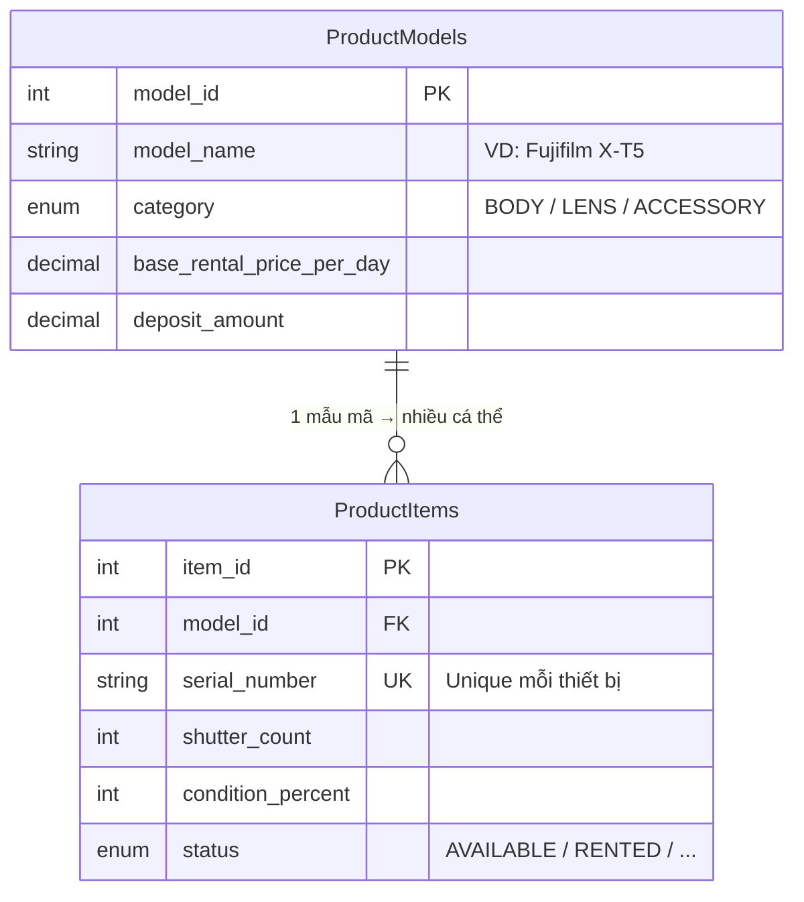
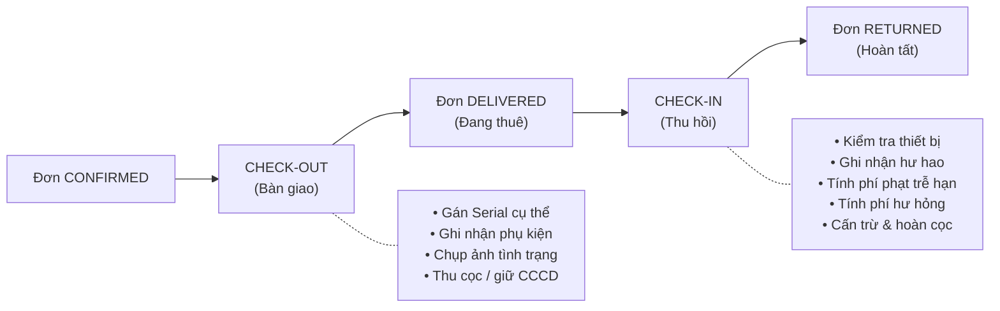
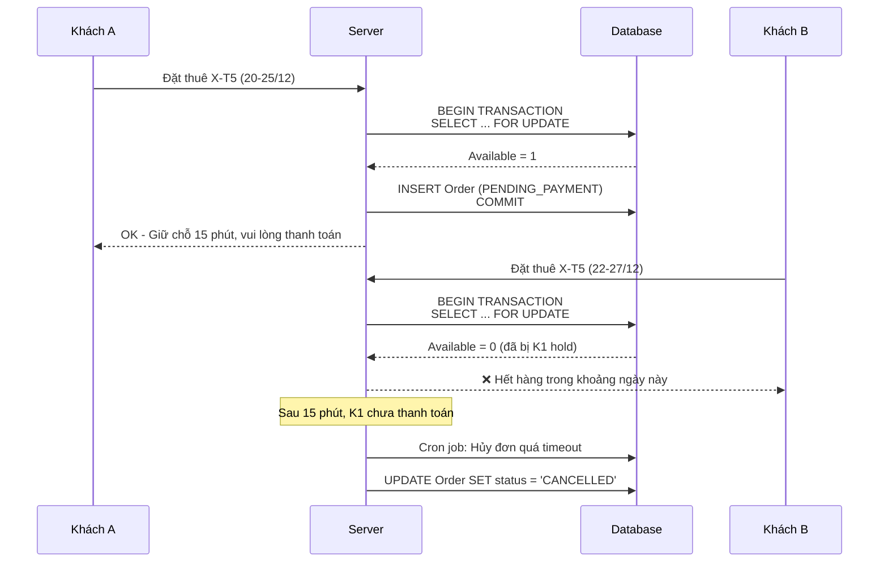
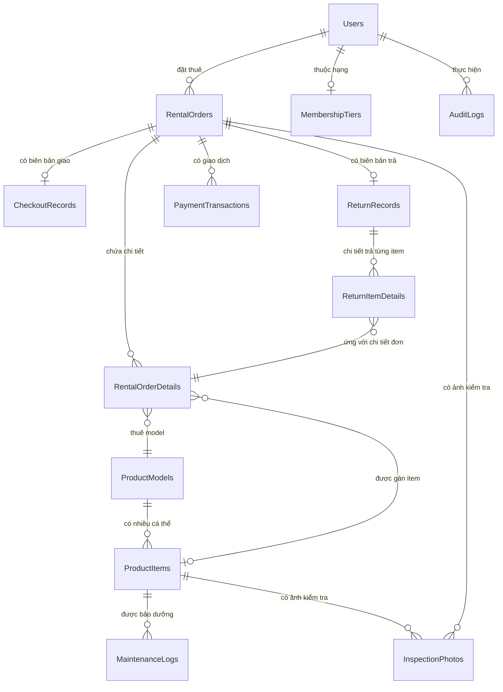
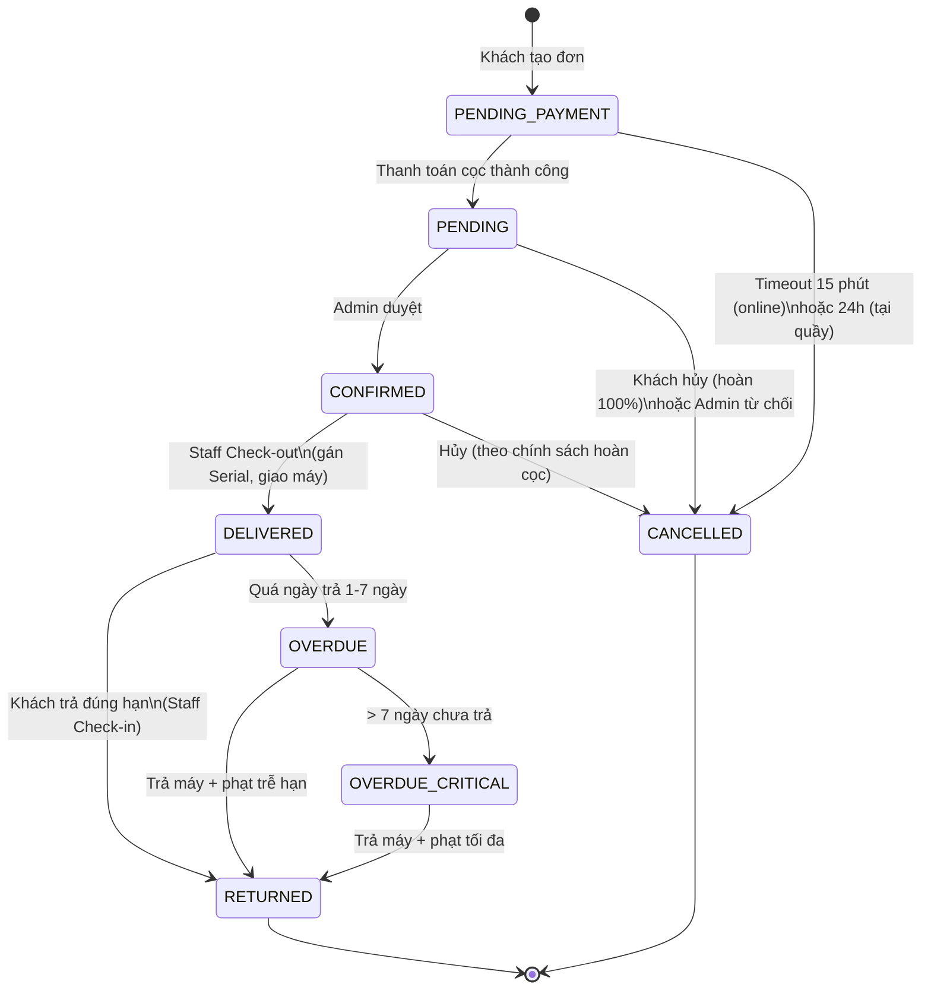
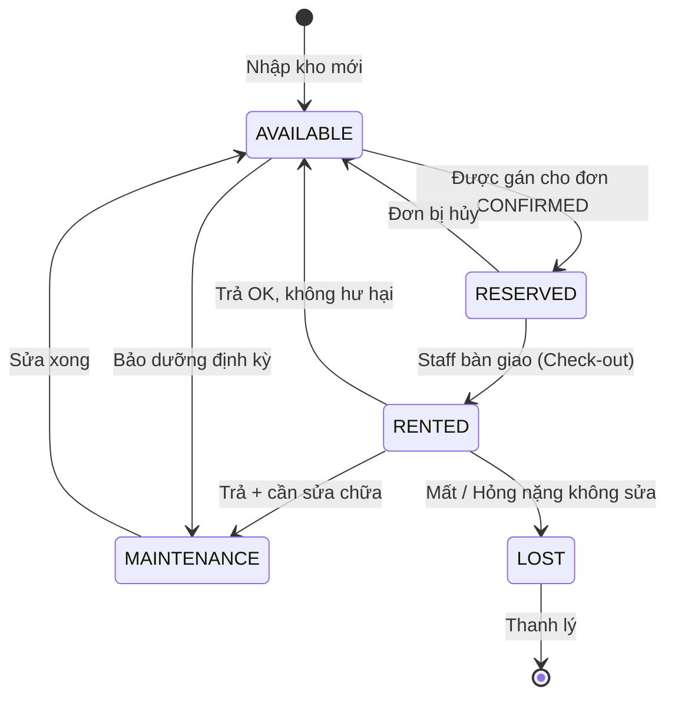
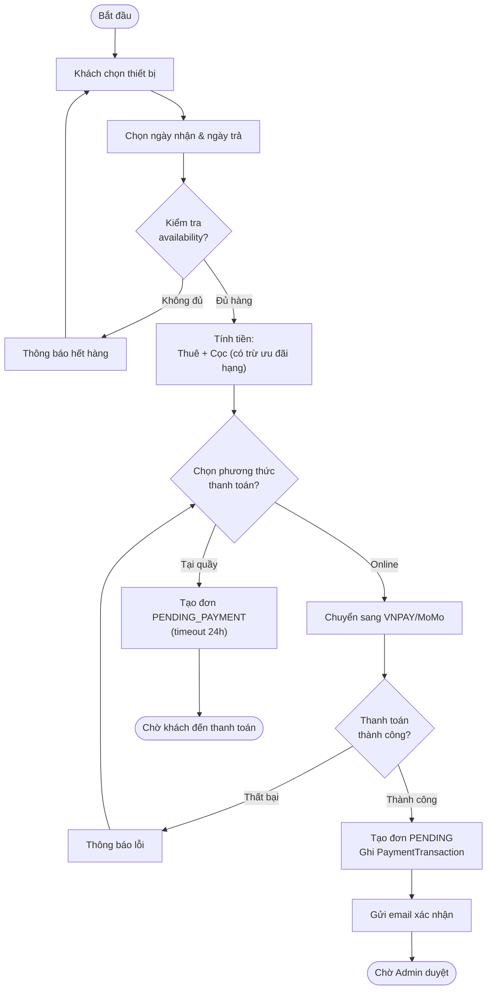
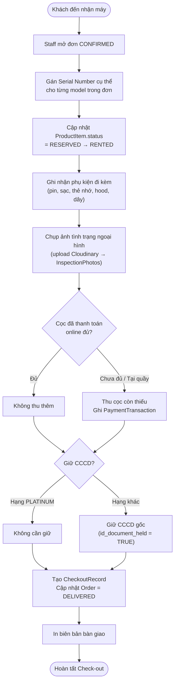
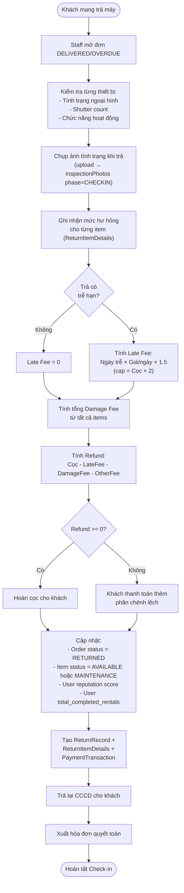

# REFUJI — HỆ THỐNG QUẢN LÝ & CHO THUÊ MÁY ẢNH FUJIFILM
## BẢN ĐẶC TẢ CHÍNH THỨC — PHIÊN BẢN 1.0

> [!NOTE]
> Đây là bản đặc tả gốc chính thức của dự án **ReFuji**. Mọi phiên bản sau sẽ được đánh số từ v1.1, v1.2,... trở đi.
> Ngày tạo: 21/08/2026 · Chủ dự án: **Tran Txi** — Đại học Công nghệ Sài Gòn (STU), Khoa CNTT

---

## MỤC LỤC

1. [Tổng quan dự án](#1-tổng-quan-dự-án)
2. [Kiến trúc nghiệp vụ đặc thù](#2-kiến-trúc-nghiệp-vụ-đặc-thù)
3. [Phân hệ và tính năng chi tiết](#3-phân-hệ-và-tính-năng-chi-tiết)
4. [Quy tắc nghiệp vụ (Business Rules)](#4-quy-tắc-nghiệp-vụ--business-rules-)
5. [Thiết kế CSDL hoàn chỉnh (12 bảng)](#5-thiết-kế-csdl-hoàn-chỉnh--12-bảng-)
6. [Data Dictionary](#6-data-dictionary)
7. [Biểu đồ UML](#7-biểu-đồ-uml)
8. [API Endpoints Blueprint](#8-api-endpoints-blueprint)
9. [Ma trận yêu cầu 3 học phần](#9-ma-trận-yêu-cầu-3-học-phần)
10. [Công nghệ đề xuất](#10-công-nghệ-đề-xuất)
11. [Security Checklist](#11-security-checklist)

---

## 1. TỔNG QUAN DỰ ÁN

**Tên hệ thống:** ReFuji — Hệ thống quản lý & cho thuê máy ảnh Fujifilm

**Bối cảnh học thuật:**

| Thông tin | Chi tiết |
|---|---|
| **Trường** | Đại học Công nghệ Sài Gòn (STU) — Khoa Công nghệ Thông tin |
| **Số học phần áp dụng** | 3 học phần xuyên suốt |
| **HP 1** | Phân tích & Thiết kế HTTT — Báo cáo đặc tả, UML, lược đồ CSDL |
| **HP 2** | Thực hành Lập trình Web — Ứng dụng web CRUD + Auth |
| **HP 3** | Đồ án Chuyên ngành — Production-ready, nghiệp vụ sâu, kiểm thử |

**Mô tả tóm tắt:** Hệ thống cho phép khách hàng tra cứu, đặt lịch thuê thiết bị nhiếp ảnh Fujifilm (body, lens, phụ kiện) theo khoảng thời gian, thanh toán cọc online, và theo dõi trạng thái đơn. Phía quản trị viên/nhân viên quản lý danh mục thiết bị theo Serial Number, xử lý quy trình bàn giao – thu hồi 2 chiều, tính phí phạt tự động, và xem báo cáo thống kê.

---

## 2. KIẾN TRÚC NGHIỆP VỤ ĐẶC THÙ

> [!IMPORTANT]
> Hệ thống này **KHÔNG PHẢI** website bán hàng thông thường. Dưới đây là các điểm khác biệt cốt lõi cần nắm vững.

### 2.1. Tách biệt Mẫu mã (Model) và Cá thể thiết bị (Item/Asset)



* **Product Model (Danh mục):** Fujifilm X-T4, Fujifilm X100VI, Lens XF 35mm f/1.4... Chứa thông số kỹ thuật, giá thuê/ngày, tiền cọc cơ bản.
* **Product Item (Cá thể kho):** Mỗi thiết bị vật lý cụ thể gắn **Serial Number**, số lần chụp (Shutter Count), độ mới (%), lịch sử bảo dưỡng, tình trạng trầy xước.

### 2.2. Lịch thuê & Kiểm tra tính khả dụng (Time-slot Inventory)

Khách hàng chọn khoảng thời gian $[T_{start}, T_{end}]$. Hệ thống kiểm tra:

$$\text{Available}(model, T_s, T_e) = \text{TotalItems}(model) - \text{BookedItems}(model, T_s, T_e)$$

Trong đó, một đơn được coi là **chiếm chỗ** (overlap) khi:

$$T_s^{order} < T_e \;\land\; T_e^{order} > T_s$$

Chỉ đếm các đơn có `order_status NOT IN ('RETURNED', 'CANCELLED')`.

> [!WARNING]
> 🆕 **Race Condition:** Khi 2 khách đặt cùng lúc cho cùng mẫu máy, cần áp dụng cơ chế kiểm soát tương tranh. Xem chi tiết tại [Mục 4.4](#44--race-condition--reservation-timeout).

### 2.3. Quy trình Giao – Nhận 2 chiều (Check-out & Check-in)



---

## 3. PHÂN HỆ VÀ TÍNH NĂNG CHI TIẾT

### A. Phân hệ Khách hàng (Client Portal)

| Mã | Tính năng | Mô tả chi tiết |
|---|---|---|
| **C01** | Đăng ký / Đăng nhập | Email + Mật khẩu (hash bcrypt). 🆕 Hỗ trợ Forgot Password qua email |
| **C02** | Quản lý hồ sơ | Cập nhật họ tên, SĐT, CCCD, ảnh đại diện. Xem hạng thành viên |
| **C03** | Tra cứu thiết bị | Tìm kiếm theo tên. Lọc theo: category (Body/Lens/Accessory), ngàm (X-mount/G-mount), cảm biến, tiêu cự, khẩu độ |
| **C04** | Kiểm tra availability | Chọn khoảng ngày $[T_s, T_e]$ → Hệ thống hiển thị số lượng còn trống theo từng model |
| **C05** | Tạo đơn đặt thuê | Chọn model + số lượng + ngày nhận/trả → Hệ thống tính: $\text{Tổng} = (\text{Giá/ngày} \times \text{Số ngày}) + \text{Cọc}$ |
| **C06** | Thanh toán cọc online | Chuyển sang cổng thanh toán (VietQR / VNPAY / MoMo Sandbox) hoặc chọn trả tại quầy |
| **C07** | Theo dõi đơn | Xem trạng thái: `PENDING → CONFIRMED → DELIVERED → RETURNED` |
| **C08** | Hủy đơn | 🆕 Khách có thể hủy đơn theo chính sách hủy (xem Business Rules) |
| **C09** | Xem lịch sử thuê | Danh sách đơn đã hoàn tất, chi phí phát sinh, thiết bị đã thuê |
| **C10** | 🆕 Nhận thông báo | Email nhắc trước ngày trả 1 ngày, thông báo duyệt đơn, cảnh báo quá hạn |

### B. Phân hệ Quản trị & Nhân viên (Admin & Staff Portal)

| Mã | Tính năng | Mô tả chi tiết |
|---|---|---|
| **S01** | Quản lý Danh mục (CRUD) | CRUD dòng máy: Fujifilm Series X-T, X-Pro, X-E, X100, GFX |
| **S02** | Quản lý Thiết bị (CRUD) | CRUD theo Serial Number. Cập nhật Shutter Count, condition, trạng thái |
| **S03** | Duyệt đơn đặt thuê | Xem đơn `PENDING` → Duyệt thành `CONFIRMED` hoặc Từ chối |
| **S04** | Bàn giao thiết bị (Check-out) | Gán Serial cụ thể → Ghi nhận phụ kiện → Chụp ảnh → Thu cọc → In biên bản |
| **S05** | Thu hồi thiết bị (Check-in) | Kiểm tra tình trạng → Ghi hư hao → Tính phí phạt → Xuất hóa đơn → Hoàn cọc |
| **S06** | 🆕 Quản lý bảo dưỡng | Tạo log bảo dưỡng, đặt lịch bảo dưỡng tiếp theo, xem thiết bị đến hạn |
| **S07** | Quản lý Khách hàng | Xem thông tin CCCD, lịch sử uy tín, hạng thành viên |
| **S08** | 🆕 Quản lý thanh toán | Xem lịch sử giao dịch, xác nhận thanh toán thủ công (trả tại quầy), xử lý hoàn tiền |
| **S09** | Báo cáo thống kê | Doanh thu theo thời gian, tần suất sử dụng Serial, thiết bị đến hạn bảo dưỡng |
| **S10** | 🆕 Nhật ký hệ thống | Audit log: ai thực hiện thao tác gì, lúc nào, trên đối tượng nào |

---

## 4. QUY TẮC NGHIỆP VỤ (BUSINESS RULES) 🆕

> [!IMPORTANT]
> Toàn bộ mục này là nội dung **mới bổ sung**, giải quyết các lỗ hổng nghiệp vụ chưa được định nghĩa trong bản gốc.

### 4.1. Công thức tính tiền thuê

$$\text{Tổng tiền thuê} = \sum_{i=1}^{n} \left( \text{GiaThuê}_i \times \text{SốNgày} \right)$$

$$\text{Tổng thanh toán khi đặt} = \text{Tổng tiền thuê} + \text{Tổng tiền cọc}$$

Trong đó:
- **Số ngày** tính theo công thức: $\text{SốNgày} = T_{end} - T_{start}$ (tính chẵn ngày, tối thiểu 1 ngày)
- **Tiền cọc** = `deposit_amount` của từng model × số lượng thuê
- 🆕 Hạng thành viên được giảm cọc (xem [Mục 4.6](#46--hệ-thống-hạng-thành-viên))

### 4.2. Công thức tính phí trễ hạn (Late Fee)

$$\text{LateFee} = \text{SốNgàyTrễ} \times \text{GiaThuê/ngày} \times K_{penalty}$$

| Tham số | Giá trị | Giải thích |
|---|---|---|
| $K_{penalty}$ | **1.5** | Hệ số phạt (150% giá thuê/ngày) |
| Grace period | **2 giờ** | Trả muộn ≤ 2 giờ so với giờ đóng cửa → không phạt |
| Đơn vị tính | **Ngày** | Trễ > 2 giờ → tính tròn 1 ngày. Mỗi ngày tiếp theo cộng thêm |
| Mức phạt tối đa (Cap) | **Tiền cọc × 2** | Phạt trễ không vượt quá 200% tiền cọc |
| Ngưỡng cảnh báo mất | **> 7 ngày trễ** | Tự động chuyển trạng thái đơn sang `OVERDUE_CRITICAL`, gửi email cảnh báo pháp lý |

**Ví dụ minh họa:**
- Thuê X-T5, giá 500.000₫/ngày, cọc 5.000.000₫
- Trả trễ 3 ngày → Phạt = $3 \times 500.000 \times 1.5 = 2.250.000₫$
- Trả trễ 10 ngày → Phạt lý thuyết = $10 \times 500.000 \times 1.5 = 7.500.000₫$, nhưng cap = $5.000.000 \times 2 = 10.000.000₫$ → Phạt thực = **7.500.000₫**

### 4.3. Chính sách hủy đơn (Cancellation Policy)

| Thời điểm hủy | Hoàn cọc | Ghi chú |
|---|---|---|
| Trước ngày nhận **≥ 3 ngày** | **100%** | Hoàn toàn bộ cọc |
| Trước ngày nhận **1–2 ngày** | **70%** | Giữ 30% phí xử lý |
| **Trong ngày nhận** (trước giờ nhận) | **50%** | Giữ 50% |
| **Sau giờ nhận** hoặc đã Check-out | **Không hoàn** | Đơn đã bàn giao không được hủy |
| Admin hủy đơn (lý do hệ thống) | **100%** | Hoàn toàn bộ, ghi lý do vào audit log |

**Quy tắc bổ sung:**
- Chỉ đơn ở trạng thái `PENDING` hoặc `CONFIRMED` mới được hủy
- Đơn `DELIVERED` (đã bàn giao) không thể hủy — chỉ có thể trả sớm
- Trả sớm: không phạt, nhưng **không hoàn tiền thuê** cho các ngày chưa sử dụng

### 4.4. 🆕 Race Condition & Reservation Timeout

**Vấn đề:** Hai khách cùng đặt mẫu máy giống nhau, cùng khoảng thời gian, khi chỉ còn 1 thiết bị available.

**Giải pháp — Cơ chế Reservation Hold:**



**Quy tắc:**
- Khi tạo đơn thành công → trạng thái = `PENDING_PAYMENT`
- **Timeout = 15 phút** để thanh toán cọc (online) hoặc **24 giờ** (thanh toán tại quầy)
- Hết timeout → Hệ thống tự hủy đơn, giải phóng availability
- Dùng `SELECT ... FOR UPDATE` (pessimistic locking) khi kiểm tra & tạo đơn

### 4.5. 🆕 Quy tắc tính phí hư hỏng (Damage Fee)

| Mức hư hỏng | Mô tả | Phí tính |
|---|---|---|
| **Không hư hại** | Trả nguyên trạng | 0₫ |
| **Trầy xước nhẹ** | Xước nhẹ bề mặt, không ảnh hưởng chức năng | 5% giá trị cọc |
| **Hư hỏng nhẹ** | Mòn cao su grip, bong tróc nhỏ | 10–20% giá trị cọc |
| **Hư hỏng trung bình** | Vỡ kính filter, hỏng hot shoe, lỗi nút bấm | 30–50% giá trị cọc |
| **Hư hỏng nặng** | Hỏng sensor, vỡ mount, ngập nước | 70–100% giá trị cọc |
| **Mất thiết bị** | Không trả lại | 100% giá trị cọc + bồi thường theo giá thị trường |

**Quy trình:**
1. Staff kiểm tra và chọn mức hư hỏng
2. Có thể nhập số tiền phí tùy chỉnh kèm lý do
3. Chụp ảnh làm bằng chứng (lưu vào `InspectionPhotos`)
4. Phí hư hỏng được cấn trừ vào tiền cọc

### 4.6. 🆕 Hệ thống hạng thành viên (Membership Tier)

| Hạng | Điều kiện | Ưu đãi |
|---|---|---|
| **BRONZE** | Mặc định khi đăng ký | Không ưu đãi |
| **SILVER** | ≥ 5 đơn hoàn tất, reputation ≥ 80 | Giảm 5% cọc |
| **GOLD** | ≥ 15 đơn hoàn tất, reputation ≥ 90 | Giảm 10% cọc, ưu tiên duyệt đơn |
| **PLATINUM** | ≥ 30 đơn hoàn tất, reputation ≥ 95 | Giảm 15% cọc, không cần giữ CCCD |

**Điểm uy tín (Reputation Score):**
- Khởi tạo: 100 điểm
- Trả đúng hạn: +2 điểm (tối đa 100)
- Trả trễ 1–3 ngày: −5 điểm
- Trả trễ > 3 ngày: −15 điểm
- Hư hỏng thiết bị: −10 điểm
- Mất thiết bị: −50 điểm (khóa tài khoản nếu reputation < 20)

### 4.7. 🆕 Quy tắc hoàn cọc (Refund Calculation)

$$\text{Refund} = \text{Cọc đã thu} - \text{LateFee} - \text{DamageFee} - \text{PhíPhátSinhKhác}$$

- Nếu Refund > 0 → Hoàn tiền cho khách
- Nếu Refund < 0 → Khách phải thanh toán thêm phần chênh lệch
- Hoàn tiền qua **cùng kênh thanh toán ban đầu** (nếu online) hoặc tiền mặt (nếu tại quầy)

---

## 5. THIẾT KẾ CSDL HOÀN CHỈNH (12 BẢNG)

> [!NOTE]
> Schema dưới đây bao gồm **6 bảng gốc** (đã sửa lỗi) + **6 bảng mới bổ sung**. Tất cả bảng mới được đánh dấu 🆕.

### Sơ đồ quan hệ tổng thể



### 5.1. Bảng `Users` — Người dùng & Phân quyền 🔧

```sql
CREATE TABLE Users (
    user_id       INT PRIMARY KEY AUTO_INCREMENT,
    full_name     VARCHAR(100) NOT NULL,
    email         VARCHAR(100) UNIQUE NOT NULL,
    password_hash VARCHAR(255) NOT NULL,
    phone         VARCHAR(20) NOT NULL,
    id_card_number VARCHAR(20),                            -- CCCD
    avatar_url    VARCHAR(500),                             -- 🆕 Ảnh đại diện
    role          ENUM('ADMIN', 'STAFF', 'CUSTOMER') DEFAULT 'CUSTOMER',
    -- 🆕 Membership & Reputation
    membership_tier ENUM('BRONZE', 'SILVER', 'GOLD', 'PLATINUM') DEFAULT 'BRONZE',
    total_completed_rentals INT DEFAULT 0,
    reputation_score INT DEFAULT 100,                       -- 0-100
    -- 🆕 Account security
    is_active     BOOLEAN DEFAULT TRUE,                     -- Khóa tài khoản nếu reputation quá thấp
    password_reset_token VARCHAR(255),
    password_reset_expires DATETIME,
    -- Timestamps
    created_at    TIMESTAMP DEFAULT CURRENT_TIMESTAMP,
    updated_at    TIMESTAMP DEFAULT CURRENT_TIMESTAMP ON UPDATE CURRENT_TIMESTAMP,

    INDEX idx_email (email),
    INDEX idx_role (role),
    INDEX idx_membership (membership_tier)
);
```

**Thay đổi so với bản gốc:**
- 🆕 Thêm `avatar_url` — hỗ trợ UI profile
- 🆕 Thêm `membership_tier`, `total_completed_rentals`, `reputation_score` — hệ thống hạng thành viên
- 🆕 Thêm `is_active` — khóa tài khoản
- 🆕 Thêm `password_reset_token`, `password_reset_expires` — quên mật khẩu
- 🆕 Thêm `updated_at` — tracking thay đổi
- 🆕 Thêm indexes

---

### 5.2. Bảng `ProductModels` — Danh mục Mẫu mã 🔧

```sql
CREATE TABLE ProductModels (
    model_id                INT PRIMARY KEY AUTO_INCREMENT,
    model_name              VARCHAR(150) NOT NULL,
    category                ENUM('BODY', 'LENS', 'ACCESSORY') NOT NULL,
    mount_type              VARCHAR(50),                    -- X-mount, G-mount, N/A
    base_rental_price_per_day DECIMAL(12, 2) NOT NULL,
    deposit_amount          DECIMAL(12, 2) NOT NULL,
    -- 🆕 Bổ sung thông tin
    brand                   VARCHAR(50) DEFAULT 'Fujifilm',
    is_active               BOOLEAN DEFAULT TRUE,           -- 🆕 Ẩn/hiện sản phẩm trên catalog
    description             TEXT,
    specs_json              JSON,                            -- {"iso_range": "160-12800", "megapixels": 40.2, ...}
    image_url               VARCHAR(500),
    -- Timestamps
    created_at              TIMESTAMP DEFAULT CURRENT_TIMESTAMP,
    updated_at              TIMESTAMP DEFAULT CURRENT_TIMESTAMP ON UPDATE CURRENT_TIMESTAMP,

    INDEX idx_category (category),
    INDEX idx_mount (mount_type),
    INDEX idx_active (is_active),
    FULLTEXT idx_search (model_name, description)           -- 🆕 Full-text search
);
```

**Thay đổi so với bản gốc:**
- 🆕 Thêm `brand` — mở rộng cho tương lai (không chỉ Fujifilm)
- 🆕 Thêm `is_active` — soft-delete / ẩn sản phẩm
- 🆕 Thêm full-text index cho tìm kiếm
- 🔧 Mở rộng `image_url` thành `VARCHAR(500)`

---

### 5.3. Bảng `ProductItems` — Cá thể thiết bị theo Serial 🔧

```sql
CREATE TABLE ProductItems (
    item_id           INT PRIMARY KEY AUTO_INCREMENT,
    model_id          INT NOT NULL,
    serial_number     VARCHAR(100) UNIQUE NOT NULL,
    shutter_count     INT DEFAULT 0,
    condition_percent INT DEFAULT 100,                      -- 0-100%
    -- 🔧 Thêm 'LOST' vào ENUM (spec yêu cầu nhưng bản gốc thiếu)
    status            ENUM('AVAILABLE', 'RENTED', 'MAINTENANCE', 'RESERVED', 'LOST') DEFAULT 'AVAILABLE',
    -- 🆕 Bổ sung thông tin
    purchase_date     DATE,                                 -- 🆕 Ngày mua / nhập kho
    purchase_price    DECIMAL(12, 2),                       -- 🆕 Giá mua (để tính khấu hao)
    total_rental_count INT DEFAULT 0,                       -- 🆕 Tổng số lần được thuê
    last_maintenance_date DATE,                             -- 🆕 Lần bảo dưỡng gần nhất
    next_maintenance_date DATE,                             -- 🆕 Lần bảo dưỡng tiếp theo
    note              TEXT,
    -- Timestamps
    created_at        TIMESTAMP DEFAULT CURRENT_TIMESTAMP,
    updated_at        TIMESTAMP DEFAULT CURRENT_TIMESTAMP ON UPDATE CURRENT_TIMESTAMP,

    FOREIGN KEY (model_id) REFERENCES ProductModels(model_id) ON DELETE RESTRICT,
    INDEX idx_model (model_id),
    INDEX idx_status (status),
    INDEX idx_serial (serial_number),
    INDEX idx_next_maintenance (next_maintenance_date)       -- 🆕 Query thiết bị đến hạn bảo dưỡng
);
```

**Thay đổi so với bản gốc:**
- 🔧 **Thêm `LOST` vào status ENUM** — spec mô tả nhưng schema gốc thiếu
- 🆕 Thêm `purchase_date`, `purchase_price` — quản lý tài sản
- 🆕 Thêm `total_rental_count` — thống kê tần suất
- 🆕 Thêm `last_maintenance_date`, `next_maintenance_date` — quản lý bảo dưỡng
- 🆕 Thêm `ON DELETE RESTRICT` — không cho xóa Model nếu còn Item
- 🆕 Thêm indexes tối ưu

---

### 5.4. Bảng `RentalOrders` — Đơn thuê 🔧

```sql
CREATE TABLE RentalOrders (
    order_id             INT PRIMARY KEY AUTO_INCREMENT,
    -- 🆕 Mã đơn thuê dễ đọc (hiển thị cho khách)
    order_code           VARCHAR(20) UNIQUE NOT NULL,       -- VD: "FR-20261225-001"
    user_id              INT NOT NULL,
    start_date           DATE NOT NULL,
    expected_return_date DATE NOT NULL,
    -- Tài chính
    total_rental_fee     DECIMAL(12, 2) NOT NULL,
    total_deposit        DECIMAL(12, 2) NOT NULL,
    -- 🆕 Bổ sung trạng thái thanh toán & đơn
    payment_status       ENUM('UNPAID', 'DEPOSITED', 'PAID_FULL', 'REFUNDED', 'PARTIALLY_REFUNDED') DEFAULT 'UNPAID',
    order_status         ENUM('PENDING_PAYMENT', 'PENDING', 'CONFIRMED', 'DELIVERED', 'RETURNED',
                               'OVERDUE', 'OVERDUE_CRITICAL', 'CANCELLED') DEFAULT 'PENDING_PAYMENT',
    -- 🆕 Chính sách hủy & timeout
    payment_deadline     DATETIME,                           -- 🆕 Thời hạn thanh toán (timeout reservation)
    cancellation_reason  TEXT,                                -- 🆕 Lý do hủy (nếu có)
    cancelled_by         INT,                                -- 🆕 User/Staff nào hủy
    -- Timestamps
    created_at           TIMESTAMP DEFAULT CURRENT_TIMESTAMP,
    updated_at           TIMESTAMP DEFAULT CURRENT_TIMESTAMP ON UPDATE CURRENT_TIMESTAMP,

    FOREIGN KEY (user_id) REFERENCES Users(user_id) ON DELETE RESTRICT,
    FOREIGN KEY (cancelled_by) REFERENCES Users(user_id),
    INDEX idx_user (user_id),
    INDEX idx_status (order_status),
    INDEX idx_dates (start_date, expected_return_date),      -- 🆕 Tối ưu query availability
    INDEX idx_payment_deadline (payment_deadline),           -- 🆕 Cron job timeout
    INDEX idx_order_code (order_code)
);
```

**Thay đổi so với bản gốc:**
- 🆕 Thêm `order_code` — mã đơn dễ đọc cho khách
- 🆕 Thêm `PENDING_PAYMENT` — trạng thái chờ thanh toán (reservation hold)
- 🆕 Thêm `OVERDUE_CRITICAL` — quá hạn nghiêm trọng (> 7 ngày)
- 🆕 Thêm `PARTIALLY_REFUNDED` — hoàn một phần cọc
- 🆕 Thêm `payment_deadline` — hỗ trợ reservation timeout
- 🆕 Thêm `cancellation_reason`, `cancelled_by` — audit trail khi hủy
- 🆕 Thêm composite index cho availability query

---

### 5.5. Bảng `RentalOrderDetails` — Chi tiết Đơn thuê (gốc, giữ nguyên cấu trúc)

```sql
CREATE TABLE RentalOrderDetails (
    detail_id            INT PRIMARY KEY AUTO_INCREMENT,
    order_id             INT NOT NULL,
    model_id             INT NOT NULL,
    assigned_item_id     INT NULL,                           -- NULL lúc đặt, gán Serial khi Check-out
    rental_price_per_day DECIMAL(12, 2) NOT NULL,            -- Snapshot giá tại thời điểm đặt
    -- 🆕 Bổ sung
    quantity             INT DEFAULT 1,                      -- 🆕 Số lượng thuê cùng model
    deposit_per_unit     DECIMAL(12, 2) NOT NULL,            -- 🆕 Snapshot cọc tại thời điểm đặt

    FOREIGN KEY (order_id) REFERENCES RentalOrders(order_id) ON DELETE CASCADE,
    FOREIGN KEY (model_id) REFERENCES ProductModels(model_id) ON DELETE RESTRICT,
    FOREIGN KEY (assigned_item_id) REFERENCES ProductItems(item_id) ON DELETE SET NULL,
    INDEX idx_order (order_id),
    INDEX idx_model (model_id),
    INDEX idx_assigned (assigned_item_id)
);
```

**Thay đổi so với bản gốc:**
- 🆕 Thêm `quantity` — hỗ trợ thuê nhiều thiết bị cùng model
- 🆕 Thêm `deposit_per_unit` — snapshot giá cọc tại thời điểm đặt (tránh bị ảnh hưởng nếu admin đổi giá sau)
- 🆕 Thêm `ON DELETE CASCADE` / `RESTRICT` / `SET NULL` phù hợp

---

### 5.6. Bảng `ReturnRecords` — Biên bản Thu hồi 🔧

```sql
CREATE TABLE ReturnRecords (
    record_id              INT PRIMARY KEY AUTO_INCREMENT,
    order_id               INT NOT NULL UNIQUE,              -- 🔧 Thêm UNIQUE (1 đơn chỉ 1 biên bản trả)
    -- 🆕 Bổ sung thông tin Staff
    staff_id               INT NOT NULL,                     -- 🆕 Nhân viên thực hiện thu hồi
    actual_return_date     DATETIME NOT NULL,                -- 🔧 Đổi sang DATETIME (cần tính grace period theo giờ)
    -- Phí phát sinh tổng
    total_late_fee         DECIMAL(12, 2) DEFAULT 0,
    total_damage_fee       DECIMAL(12, 2) DEFAULT 0,
    other_fee              DECIMAL(12, 2) DEFAULT 0,         -- 🆕 Phí phát sinh khác
    other_fee_description  TEXT,                              -- 🆕 Mô tả phí khác
    -- Hoàn cọc
    refund_amount          DECIMAL(12, 2) NOT NULL,
    -- Ghi chú
    staff_inspection_notes TEXT,
    -- Timestamps
    created_at             TIMESTAMP DEFAULT CURRENT_TIMESTAMP,

    FOREIGN KEY (order_id) REFERENCES RentalOrders(order_id) ON DELETE RESTRICT,
    FOREIGN KEY (staff_id) REFERENCES Users(user_id),
    INDEX idx_order (order_id),
    INDEX idx_return_date (actual_return_date)
);
```

**Thay đổi so với bản gốc:**
- 🔧 Thêm `UNIQUE` cho `order_id` — mỗi đơn chỉ có 1 biên bản trả
- 🆕 Thêm `staff_id` — truy vết nhân viên thu hồi
- 🔧 Đổi `actual_return_date` từ `DATE` sang `DATETIME` — cần tính grace period theo giờ
- 🆕 Thêm `other_fee`, `other_fee_description` — phí phát sinh linh hoạt

---

### 5.7. 🆕 Bảng `CheckoutRecords` — Biên bản Bàn giao

```sql
CREATE TABLE CheckoutRecords (
    checkout_id          INT PRIMARY KEY AUTO_INCREMENT,
    order_id             INT NOT NULL UNIQUE,                -- 1 đơn chỉ 1 biên bản giao
    staff_id             INT NOT NULL,                       -- Nhân viên thực hiện bàn giao
    checkout_date        DATETIME NOT NULL,
    -- Thông tin cọc & giấy tờ
    deposit_method       ENUM('CASH', 'ONLINE', 'BANK_TRANSFER') NOT NULL,
    deposit_collected    DECIMAL(12, 2) NOT NULL,            -- Số tiền cọc thực thu
    id_document_held     BOOLEAN DEFAULT FALSE,              -- Có giữ CCCD gốc không
    -- Phụ kiện đi kèm
    accessories_json     JSON,                               -- {"battery": 2, "charger": 1, "memory_card": "128GB", "lens_hood": 1, "strap": 1, "cable": 1}
    -- Ghi chú
    condition_notes      TEXT,                               -- Tình trạng tổng quan khi giao
    -- Timestamps
    created_at           TIMESTAMP DEFAULT CURRENT_TIMESTAMP,

    FOREIGN KEY (order_id) REFERENCES RentalOrders(order_id) ON DELETE RESTRICT,
    FOREIGN KEY (staff_id) REFERENCES Users(user_id),
    INDEX idx_order (order_id),
    INDEX idx_checkout_date (checkout_date)
);
```

---

### 5.8. 🆕 Bảng `ReturnItemDetails` — Chi tiết trả từng thiết bị

```sql
CREATE TABLE ReturnItemDetails (
    return_detail_id     INT PRIMARY KEY AUTO_INCREMENT,
    record_id            INT NOT NULL,                       -- FK → ReturnRecords
    detail_id            INT NOT NULL,                       -- FK → RentalOrderDetails (để biết trả item nào)
    -- Tình trạng sau trả
    condition_after      INT,                                -- % tình trạng sau khi trả
    shutter_count_after  INT,                                -- Shutter count khi nhận lại
    -- Hư hỏng
    damage_level         ENUM('NONE', 'LIGHT_SCRATCH', 'MINOR', 'MODERATE', 'SEVERE', 'LOST') DEFAULT 'NONE',
    damage_description   TEXT,
    damage_fee           DECIMAL(12, 2) DEFAULT 0,
    -- Phụ kiện trả
    accessories_returned_json JSON,                          -- So sánh với accessories_json lúc giao
    missing_accessories_fee   DECIMAL(12, 2) DEFAULT 0,      -- Phí mất phụ kiện
    -- Timestamps
    created_at           TIMESTAMP DEFAULT CURRENT_TIMESTAMP,

    FOREIGN KEY (record_id) REFERENCES ReturnRecords(record_id) ON DELETE CASCADE,
    FOREIGN KEY (detail_id) REFERENCES RentalOrderDetails(detail_id) ON DELETE RESTRICT,
    INDEX idx_record (record_id),
    INDEX idx_detail (detail_id)
);
```

---

### 5.9. 🆕 Bảng `PaymentTransactions` — Giao dịch thanh toán

```sql
CREATE TABLE PaymentTransactions (
    transaction_id       INT PRIMARY KEY AUTO_INCREMENT,
    order_id             INT NOT NULL,
    -- Chi tiết giao dịch
    amount               DECIMAL(12, 2) NOT NULL,
    payment_method       ENUM('CASH', 'VIETQR', 'VNPAY', 'MOMO', 'BANK_TRANSFER') NOT NULL,
    transaction_type     ENUM('DEPOSIT', 'RENTAL_FEE', 'LATE_FEE', 'DAMAGE_FEE', 'OTHER_FEE', 'REFUND') NOT NULL,
    -- Thông tin cổng thanh toán
    gateway_transaction_id VARCHAR(100),                     -- Mã giao dịch từ VNPAY/MoMo
    gateway_response_code  VARCHAR(20),                      -- Mã phản hồi từ gateway
    -- Trạng thái
    status               ENUM('PENDING', 'SUCCESS', 'FAILED', 'REFUNDED') DEFAULT 'PENDING',
    -- Ghi chú
    note                 TEXT,
    processed_by         INT,                                -- Staff xác nhận (nếu thủ công)
    -- Timestamps
    created_at           TIMESTAMP DEFAULT CURRENT_TIMESTAMP,
    updated_at           TIMESTAMP DEFAULT CURRENT_TIMESTAMP ON UPDATE CURRENT_TIMESTAMP,

    FOREIGN KEY (order_id) REFERENCES RentalOrders(order_id) ON DELETE RESTRICT,
    FOREIGN KEY (processed_by) REFERENCES Users(user_id),
    INDEX idx_order (order_id),
    INDEX idx_status (status),
    INDEX idx_method (payment_method),
    INDEX idx_gateway (gateway_transaction_id),
    INDEX idx_type (transaction_type)
);
```

---

### 5.10. 🆕 Bảng `InspectionPhotos` — Ảnh kiểm tra tình trạng

```sql
CREATE TABLE InspectionPhotos (
    photo_id        INT PRIMARY KEY AUTO_INCREMENT,
    order_id        INT NOT NULL,
    item_id         INT NOT NULL,
    -- Phân loại
    phase           ENUM('CHECKOUT', 'CHECKIN') NOT NULL,    -- Ảnh lúc giao hay lúc trả
    -- Thông tin ảnh
    photo_url       VARCHAR(500) NOT NULL,                   -- URL trên Cloudinary
    caption         VARCHAR(255),                            -- Mô tả ngắn: "Mặt trước", "Góc trên phải"
    -- Timestamps
    uploaded_at     TIMESTAMP DEFAULT CURRENT_TIMESTAMP,
    uploaded_by     INT NOT NULL,                            -- Staff upload

    FOREIGN KEY (order_id) REFERENCES RentalOrders(order_id) ON DELETE CASCADE,
    FOREIGN KEY (item_id) REFERENCES ProductItems(item_id) ON DELETE RESTRICT,
    FOREIGN KEY (uploaded_by) REFERENCES Users(user_id),
    INDEX idx_order_phase (order_id, phase),
    INDEX idx_item (item_id)
);
```

---

### 5.11. 🆕 Bảng `MaintenanceLogs` — Lịch sử bảo dưỡng

```sql
CREATE TABLE MaintenanceLogs (
    log_id               INT PRIMARY KEY AUTO_INCREMENT,
    item_id              INT NOT NULL,
    -- Chi tiết bảo dưỡng
    maintenance_type     ENUM('CLEANING', 'REPAIR', 'CALIBRATION', 'SENSOR_CLEANING',
                              'FIRMWARE_UPDATE', 'GENERAL_INSPECTION') NOT NULL,
    description          TEXT NOT NULL,
    cost                 DECIMAL(12, 2) DEFAULT 0,
    -- Nhân sự
    performed_by         INT,                                -- Staff thực hiện
    external_vendor      VARCHAR(150),                       -- Đơn vị sửa bên ngoài (nếu có)
    -- Thời gian
    started_at           DATE NOT NULL,
    completed_at         DATE,                               -- NULL nếu đang bảo dưỡng
    next_maintenance_date DATE,                              -- Đề xuất lần bảo dưỡng tiếp
    -- Timestamps
    created_at           TIMESTAMP DEFAULT CURRENT_TIMESTAMP,

    FOREIGN KEY (item_id) REFERENCES ProductItems(item_id) ON DELETE RESTRICT,
    FOREIGN KEY (performed_by) REFERENCES Users(user_id),
    INDEX idx_item (item_id),
    INDEX idx_type (maintenance_type),
    INDEX idx_completed (completed_at)
);
```

---

### 5.12. 🆕 Bảng `AuditLogs` — Nhật ký hệ thống

```sql
CREATE TABLE AuditLogs (
    log_id          BIGINT PRIMARY KEY AUTO_INCREMENT,
    -- Ai làm gì
    user_id         INT NOT NULL,                            -- Người thực hiện
    action          VARCHAR(100) NOT NULL,                   -- VD: 'ORDER_CREATED', 'ITEM_STATUS_CHANGED', 'PAYMENT_RECEIVED'
    -- Đối tượng bị tác động
    entity_type     VARCHAR(50) NOT NULL,                    -- VD: 'RentalOrder', 'ProductItem', 'User'
    entity_id       INT NOT NULL,                            -- ID của đối tượng
    -- Chi tiết thay đổi
    old_value       JSON,                                    -- Giá trị cũ (nếu là update)
    new_value       JSON,                                    -- Giá trị mới
    description     TEXT,                                    -- Mô tả hành động bằng text
    -- Context
    ip_address      VARCHAR(45),                             -- IPv4/IPv6
    user_agent      VARCHAR(500),
    -- Timestamps
    created_at      TIMESTAMP DEFAULT CURRENT_TIMESTAMP,

    FOREIGN KEY (user_id) REFERENCES Users(user_id),
    INDEX idx_user (user_id),
    INDEX idx_entity (entity_type, entity_id),
    INDEX idx_action (action),
    INDEX idx_created (created_at)
);
```

---

### 5.13. 🆕 Bảng `MembershipTiers` — Cấu hình hạng thành viên

```sql
CREATE TABLE MembershipTiers (
    tier_id                    INT PRIMARY KEY AUTO_INCREMENT,
    tier_name                  ENUM('BRONZE', 'SILVER', 'GOLD', 'PLATINUM') UNIQUE NOT NULL,
    min_completed_rentals      INT NOT NULL DEFAULT 0,
    min_reputation_score       INT NOT NULL DEFAULT 0,
    deposit_discount_percent   DECIMAL(5, 2) DEFAULT 0,      -- % giảm cọc
    priority_approval          BOOLEAN DEFAULT FALSE,         -- Ưu tiên duyệt đơn
    skip_id_document_hold      BOOLEAN DEFAULT FALSE,         -- Không cần giữ CCCD
    description                TEXT,

    INDEX idx_tier_name (tier_name)
);

-- Dữ liệu seed
INSERT INTO MembershipTiers (tier_name, min_completed_rentals, min_reputation_score, deposit_discount_percent, priority_approval, skip_id_document_hold, description) VALUES
('BRONZE',   0,  0,  0.00, FALSE, FALSE, 'Hạng mặc định khi đăng ký'),
('SILVER',   5,  80, 5.00, FALSE, FALSE, 'Giảm 5% cọc'),
('GOLD',     15, 90, 10.00, TRUE,  FALSE, 'Giảm 10% cọc, ưu tiên duyệt'),
('PLATINUM', 30, 95, 15.00, TRUE,  TRUE,  'Giảm 15% cọc, không cần giữ CCCD');
```

---

## 6. DATA DICTIONARY 🆕

> [!NOTE]
> Bảng từ điển dữ liệu mô tả ý nghĩa các ENUM và giá trị đặc biệt được sử dụng xuyên suốt hệ thống.

### 6.1. ENUM Reference

#### `Users.role`
| Giá trị | Ý nghĩa | Quyền hạn chính |
|---|---|---|
| `ADMIN` | Quản trị viên | Toàn quyền hệ thống |
| `STAFF` | Nhân viên cửa hàng | CRUD thiết bị, xử lý đơn, check-in/out |
| `CUSTOMER` | Khách hàng | Đặt thuê, thanh toán, xem đơn |

#### `ProductItems.status`
| Giá trị | Ý nghĩa | Chuyển trạng thái từ |
|---|---|---|
| `AVAILABLE` | Sẵn sàng cho thuê | `MAINTENANCE`, `RESERVED` (khi đơn hủy), `RENTED` (khi trả OK) |
| `RESERVED` | Đã được gán cho đơn (chờ check-out) | `AVAILABLE` |
| `RENTED` | Đang cho khách thuê | `RESERVED` (sau check-out) |
| `MAINTENANCE` | Đang bảo dưỡng / sửa chữa | `RENTED` (trả + cần sửa), `AVAILABLE` |
| `LOST` | Mất / Hỏng không sửa được | `RENTED` |

#### `RentalOrders.order_status`
| Giá trị | Ý nghĩa | Trigger |
|---|---|---|
| `PENDING_PAYMENT` | 🆕 Chờ thanh toán cọc (reservation hold) | Khách tạo đơn |
| `PENDING` | Đã cọc, chờ Admin duyệt | Thanh toán cọc thành công |
| `CONFIRMED` | Admin đã duyệt | Admin approve |
| `DELIVERED` | Đã bàn giao thiết bị cho khách | Staff check-out |
| `RETURNED` | Khách đã trả, hoàn tất | Staff check-in |
| `OVERDUE` | Quá hạn trả (1–7 ngày) | Cron job kiểm tra hàng ngày |
| `OVERDUE_CRITICAL` | 🆕 Quá hạn nghiêm trọng (> 7 ngày) | Cron job |
| `CANCELLED` | Đơn đã hủy | Khách/Admin hủy, hoặc timeout |

#### `PaymentTransactions.transaction_type`
| Giá trị | Ý nghĩa | Hướng tiền |
|---|---|---|
| `DEPOSIT` | Thanh toán tiền cọc | Khách → Cửa hàng |
| `RENTAL_FEE` | Thanh toán tiền thuê (phần còn lại) | Khách → Cửa hàng |
| `LATE_FEE` | Phí phạt trễ hạn | Khách → Cửa hàng |
| `DAMAGE_FEE` | Phí hư hỏng thiết bị | Khách → Cửa hàng |
| `OTHER_FEE` | Phí khác (mất phụ kiện, v.v.) | Khách → Cửa hàng |
| `REFUND` | Hoàn cọc / hoàn tiền | Cửa hàng → Khách |

---

## 7. BIỂU ĐỒ UML

### 7.1. State Diagram — Vòng đời đơn thuê (ĐÃ CẬP NHẬT)



### 7.2. State Diagram — Vòng đời thiết bị (ĐÃ CẬP NHẬT)



### 7.3. Activity Diagram — Quy trình đặt thuê hoàn chỉnh



### 7.4. 🆕 Activity Diagram — Quy trình Check-out (Bàn giao)



### 7.5. 🆕 Activity Diagram — Quy trình Check-in (Thu hồi & Tính phí)



### 7.6. Danh sách UML cần vẽ cho môn PTTKHTTT

| Loại | Số lượng | Chi tiết |
|---|---|---|
| **Use Case Diagram** | 2 | (1) Tổng quan hệ thống — 3 actors, (2) Chi tiết phân hệ Booking |
| **Activity Diagram** | 3 | (1) Đặt thuê (7.3), (2) Check-out (7.4), (3) Check-in (7.5) |
| **Sequence Diagram** | 3 | (1) Đặt lịch & kiểm tra availability, (2) Thanh toán cọc online, (3) Trả máy & hoàn cọc |
| **Class Diagram** | 1 | Domain model 13 class (12 bảng + 1 MembershipTier config) |
| **ER Diagram** | 1 | Lược đồ CSDL chuẩn 3NF — 12 bảng |
| **State Diagram** | 2 | (1) Vòng đời đơn thuê (7.1), (2) Vòng đời thiết bị (7.2) |

---

## 8. API ENDPOINTS BLUEPRINT 🆕

### 8.1. Authentication & User

| Method | Endpoint | Mô tả | Auth |
|---|---|---|---|
| `POST` | `/api/auth/register` | Đăng ký tài khoản | Public |
| `POST` | `/api/auth/login` | Đăng nhập → JWT token | Public |
| `POST` | `/api/auth/forgot-password` | Gửi email reset password | Public |
| `POST` | `/api/auth/reset-password` | Đặt lại mật khẩu | Public (token) |
| `GET` | `/api/users/me` | Xem profile cá nhân | Customer |
| `PUT` | `/api/users/me` | Cập nhật profile | Customer |
| `GET` | `/api/users/me/rentals` | Lịch sử thuê | Customer |

### 8.2. Product Catalog

| Method | Endpoint | Mô tả | Auth |
|---|---|---|---|
| `GET` | `/api/models` | Danh sách mẫu mã (có filter, search, paginate) | Public |
| `GET` | `/api/models/:id` | Chi tiết mẫu mã + số lượng available | Public |
| `GET` | `/api/models/:id/availability?start=&end=` | Kiểm tra availability theo ngày | Public |
| `POST` | `/api/admin/models` | Tạo mẫu mã mới | Admin |
| `PUT` | `/api/admin/models/:id` | Sửa mẫu mã | Admin |
| `DELETE` | `/api/admin/models/:id` | Xóa mẫu mã (soft-delete) | Admin |

### 8.3. Inventory (Items)

| Method | Endpoint | Mô tả | Auth |
|---|---|---|---|
| `GET` | `/api/admin/items` | Danh sách thiết bị (filter status, model) | Staff/Admin |
| `GET` | `/api/admin/items/:id` | Chi tiết thiết bị + lịch sử thuê | Staff/Admin |
| `POST` | `/api/admin/items` | Thêm thiết bị mới (Serial) | Admin |
| `PUT` | `/api/admin/items/:id` | Cập nhật thông tin thiết bị | Staff/Admin |
| `GET` | `/api/admin/items/maintenance-due` | DS thiết bị đến hạn bảo dưỡng | Staff/Admin |

### 8.4. Rental Orders

| Method | Endpoint | Mô tả | Auth |
|---|---|---|---|
| `POST` | `/api/orders` | Tạo đơn đặt thuê | Customer |
| `GET` | `/api/orders/:id` | Xem chi tiết đơn | Customer (own) / Staff |
| `POST` | `/api/orders/:id/cancel` | Hủy đơn (theo cancellation policy) | Customer (own) / Admin |
| `POST` | `/api/admin/orders/:id/approve` | Duyệt đơn | Admin/Staff |
| `POST` | `/api/admin/orders/:id/reject` | Từ chối đơn | Admin/Staff |
| `POST` | `/api/admin/orders/:id/checkout` | Bàn giao (Check-out) | Staff |
| `POST` | `/api/admin/orders/:id/checkin` | Thu hồi (Check-in) | Staff |
| `GET` | `/api/admin/orders` | Danh sách đơn (filter, paginate) | Staff/Admin |
| `GET` | `/api/admin/orders/overdue` | DS đơn quá hạn | Staff/Admin |

### 8.5. Payments

| Method | Endpoint | Mô tả | Auth |
|---|---|---|---|
| `POST` | `/api/payments/create` | Tạo giao dịch thanh toán → URL gateway | Customer |
| `GET` | `/api/payments/vnpay/callback` | Callback từ VNPAY (IPN) | Public (verify signature) |
| `POST` | `/api/payments/momo/callback` | Callback từ MoMo | Public (verify signature) |
| `GET` | `/api/orders/:id/transactions` | Lịch sử giao dịch của đơn | Customer (own) / Staff |
| `POST` | `/api/admin/payments/:id/confirm` | Xác nhận thanh toán thủ công | Staff |
| `POST` | `/api/admin/payments/refund` | Xử lý hoàn tiền | Staff/Admin |

### 8.6. Reports & Statistics

| Method | Endpoint | Mô tả | Auth |
|---|---|---|---|
| `GET` | `/api/admin/reports/revenue?from=&to=` | Doanh thu theo khoảng thời gian | Admin |
| `GET` | `/api/admin/reports/item-usage` | Tần suất thuê theo Serial | Admin |
| `GET` | `/api/admin/reports/customer-ranking` | Xếp hạng khách hàng | Admin |
| `GET` | `/api/admin/reports/dashboard` | Tổng hợp dashboard (tổng đơn, doanh thu tháng, thiết bị rảnh, ...) | Admin |

---

## 9. MA TRẬN YÊU CẦU 3 HỌC PHẦN (CẬP NHẬT)

| Hạng mục | Môn PTTKHTTT | Môn Thực hành Web | ĐACN |
|---|---|---|---|
| **Trọng tâm** | Tài liệu phân tích, UML, CSDL chuẩn hóa | Code web, UI/UX, CRUD Back-end | Production-ready, nghiệp vụ sâu, kiểm thử |
| **Sản phẩm** | Báo cáo Word/PDF | Source code + Demo | Báo cáo + Mã nguồn + Demo bảo vệ |
| **Số bảng CSDL** | 13 bảng (thiết kế giấy) | 5–6 bảng core | 13 bảng đầy đủ |
| **Bảng sử dụng** | Toàn bộ (thiết kế) | Users, ProductModels, ProductItems, RentalOrders, RentalOrderDetails | Toàn bộ 12 bảng + MembershipTiers |
| **Chức năng** | Toàn bộ Use Case | Auth, CRUD sản phẩm, Booking cơ bản, Admin CRUD | Serial management, Check-in/out, Payment gateway, Late fee, Dashboard |
| **Mã nguồn** | Không bắt buộc (Mockup) | Bắt buộc | Bắt buộc, Clean Architecture/MVC |
| **Bảo mật** | Không yêu cầu | Cơ bản (hash password, auth middleware) | 🆕 Đầy đủ (xem Security Checklist) |

### Phân bổ bảng CSDL theo giai đoạn

````carousel
**Giai đoạn 1 — PTTKHTTT (Thiết kế)**
```
✅ Users                    (thiết kế)
✅ ProductModels             (thiết kế)
✅ ProductItems              (thiết kế)
✅ RentalOrders              (thiết kế)
✅ RentalOrderDetails        (thiết kế)
✅ ReturnRecords             (thiết kế)
✅ CheckoutRecords           (thiết kế)
✅ ReturnItemDetails         (thiết kế)
✅ PaymentTransactions       (thiết kế)
✅ InspectionPhotos          (thiết kế)
✅ MaintenanceLogs           (thiết kế)
✅ AuditLogs                 (thiết kế)
✅ MembershipTiers           (thiết kế)
→ Tất cả 13 bảng trên giấy
```
<!-- slide -->
**Giai đoạn 2 — Thực hành Web (Code cơ bản)**
```
✅ Users                    (code CRUD + Auth)
✅ ProductModels             (code CRUD + Search)
✅ ProductItems              (code CRUD cơ bản)
✅ RentalOrders              (code Booking flow)
✅ RentalOrderDetails        (code Booking flow)
⬜ ReturnRecords             (chưa cần)
⬜ CheckoutRecords           (chưa cần)
⬜ ReturnItemDetails         (chưa cần)
⬜ PaymentTransactions       (chưa cần)
⬜ InspectionPhotos          (chưa cần)
⬜ MaintenanceLogs           (chưa cần)
⬜ AuditLogs                 (chưa cần)
⬜ MembershipTiers           (chưa cần)
→ 5 bảng thực tế
```
<!-- slide -->
**Giai đoạn 3 — ĐACN (Code hoàn chỉnh)**
```
✅ Users                    (+ membership, reputation)
✅ ProductModels             (+ full-text search)
✅ ProductItems              (+ maintenance tracking)
✅ RentalOrders              (+ timeout, cancellation)
✅ RentalOrderDetails        (+ quantity, snapshot price)
✅ ReturnRecords             (+ staff, datetime)
✅ CheckoutRecords           (+ accessories, photos)
✅ ReturnItemDetails         (+ damage level per item)
✅ PaymentTransactions       (+ gateway integration)
✅ InspectionPhotos          (+ Cloudinary)
✅ MaintenanceLogs           (+ scheduling)
✅ AuditLogs                 (+ full tracking)
✅ MembershipTiers           (+ auto-upgrade)
→ Tất cả 13 bảng production-ready
```
````

---

## 10. CÔNG NGHỆ ĐỀ XUẤT (TECH STACK)

### Khuyến nghị chính thức (cho bối cảnh STU)

| Layer | Công nghệ | Lý do |
|---|---|---|
| **Front-end** | React.js (Vite) + TailwindCSS | Phổ biến nhất, nhiều tài liệu, dễ tuyển thêm thành viên |
| **Back-end** | Node.js + Express.js + TypeScript | Cùng ngôn ngữ JS, giảm context switching |
| **Database** | MySQL 8.0 | STU thường dạy MySQL, giám khảo quen thuộc |
| **ORM** | Prisma | Type-safe, migration tốt, schema-first |
| **Auth** | JWT (Access + Refresh Token) | Stateless, dễ triển khai |
| **Payment** | VNPAY Sandbox | Tài liệu tiếng Việt đầy đủ, sandbox miễn phí |
| **Image Upload** | Cloudinary (free tier 25GB) | SDK tốt, transform ảnh tự động |
| **Email** | Nodemailer + Gmail SMTP (dev) | Đơn giản cho môi trường dev |
| **Testing** | Jest + Supertest (API), Postman | Đủ yêu cầu ĐACN |
| **Deployment** | Docker Compose (dev) | Dễ chạy demo trước hội đồng |

### Stack thay thế

| Nếu quen... | Dùng... | Trade-off |
|---|---|---|
| PHP | Laravel + Blade + MySQL | Monolith, FE kém linh hoạt, nhưng phát triển nhanh |
| Java | Spring Boot + Thymeleaf + PostgreSQL | Enterprise-grade, boilerplate nhiều |
| C# | .NET Core + Razor Pages + SQL Server | Tốt nếu có kinh nghiệm .NET |
| Vue.js | Vue 3 + Vite + TailwindCSS | Thay thế React, dễ học hơn |

---

## 11. SECURITY CHECKLIST 🆕

> [!CAUTION]
> Checklist này **bắt buộc hoàn thành** cho ĐACN. Đây là tiêu chí đánh giá quan trọng khi bảo vệ trước hội đồng.

| # | Hạng mục | Chi tiết | Giai đoạn |
|---|---|---|---|
| 1 | **Password Hashing** | bcrypt với salt rounds ≥ 10 | Web Practice |
| 2 | **JWT Authentication** | Access Token (15 phút) + Refresh Token (7 ngày) | Web Practice |
| 3 | **Authorization Middleware** | Kiểm tra role (ADMIN/STAFF/CUSTOMER) trên mọi route | Web Practice |
| 4 | **Input Validation** | Validate tất cả input phía server (express-validator / Joi / Zod) | Web Practice |
| 5 | **SQL Injection Prevention** | Dùng ORM / Prepared Statements, **KHÔNG** nối string SQL | Web Practice |
| 6 | **XSS Prevention** | Escape output, dùng Content-Security-Policy header | ĐACN |
| 7 | **CORS Configuration** | Whitelist domain cụ thể, không dùng `*` trên production | ĐACN |
| 8 | **Rate Limiting** | Giới hạn request/phút trên các endpoint nhạy cảm (login, register, payment) | ĐACN |
| 9 | **VNPAY Signature Verification** | Verify checksum trên mọi callback từ cổng thanh toán | ĐACN |
| 10 | **File Upload Validation** | Chỉ cho phép image (jpg/png/webp), giới hạn kích thước ≤ 5MB | ĐACN |
| 11 | **Sensitive Data Protection** | Không trả `password_hash` trong bất kỳ API response nào | Web Practice |
| 12 | **Audit Logging** | Ghi log mọi thao tác quan trọng (tạo/sửa/xóa đơn, thiết bị) | ĐACN |
| 13 | **HTTPS** | Bắt buộc HTTPS trên production (dùng Let's Encrypt) | ĐACN |
| 14 | **Environment Variables** | Không hardcode secrets, dùng `.env` + `.env.example` | Web Practice |

---

## 12. 🆕 SCHEDULED JOBS (CRON TASKS)

| Job | Tần suất | Mô tả |
|---|---|---|
| **Cancel Expired Reservations** | Mỗi 5 phút | Hủy đơn `PENDING_PAYMENT` quá `payment_deadline` |
| **Check Overdue Orders** | Mỗi ngày 8:00 AM | Chuyển đơn `DELIVERED` quá `expected_return_date` → `OVERDUE` |
| **Check Critical Overdue** | Mỗi ngày 8:00 AM | Chuyển `OVERDUE` > 7 ngày → `OVERDUE_CRITICAL`, gửi email cảnh báo |
| **Send Return Reminder** | Mỗi ngày 9:00 AM | Gửi email nhắc khách trả máy trong vòng 24h |
| **Maintenance Reminder** | Mỗi tuần (Thứ 2) | DS thiết bị đến hạn bảo dưỡng trong 7 ngày tới |
| **Auto-upgrade Membership** | Mỗi ngày 0:00 AM | Kiểm tra và tự động nâng hạng thành viên đủ điều kiện |

---

## TÓM TẮT THAY ĐỔI SO VỚI BẢN GỐC v1.0

| # | Vấn đề | Cách khắc phục |
|---|---|---|
| 1 | Thiếu bảng `CheckoutRecords` | 🆕 Thêm bảng 5.7 — Biên bản bàn giao |
| 2 | Thiếu bảng `InspectionPhotos` | 🆕 Thêm bảng 5.10 — Ảnh kiểm tra tình trạng |
| 3 | Thiếu bảng `MaintenanceLogs` | 🆕 Thêm bảng 5.11 — Lịch sử bảo dưỡng |
| 4 | Thiếu bảng `ReturnItemDetails` | 🆕 Thêm bảng 5.8 — Chi tiết trả từng thiết bị |
| 5 | Thiếu bảng `PaymentTransactions` | 🆕 Thêm bảng 5.9 — Giao dịch thanh toán |
| 6 | Thiếu bảng `MembershipTiers` | 🆕 Thêm bảng 5.13 — Cấu hình hạng thành viên |
| 7 | Thiếu bảng `AuditLogs` | 🆕 Thêm bảng 5.12 — Nhật ký hệ thống |
| 8 | `ProductItems.status` thiếu `LOST` | 🔧 Thêm `LOST` vào ENUM |
| 9 | Không có business rules cho Late Fee | 🆕 Định nghĩa công thức + bảng tham số (Mục 4.2) |
| 10 | Không có Cancellation Policy | 🆕 Bảng chính sách hủy + quy tắc hoàn cọc (Mục 4.3) |
| 11 | Không xử lý Race Condition | 🆕 Cơ chế Reservation Hold + Timeout (Mục 4.4) |
| 12 | Không có quy tắc Damage Fee | 🆕 Bảng mức hư hỏng + phí tương ứng (Mục 4.5) |
| 13 | Thiếu hệ thống hạng thành viên | 🆕 Membership Tier + Reputation Score (Mục 4.6) |
| 14 | Thiếu Notification System | 🆕 Scheduled Jobs / Cron Tasks (Mục 12) |
| 15 | Thiếu API Endpoints | 🆕 Blueprint đầy đủ 30+ endpoints (Mục 8) |
| 16 | Thiếu Security Checklist | 🆕 14 hạng mục bảo mật (Mục 11) |
| 17 | Thiếu Data Dictionary | 🆕 ENUM Reference đầy đủ (Mục 6) |
| 18 | `ReturnRecords` thiếu `staff_id` | 🔧 Thêm FK staff thực hiện thu hồi |
| 19 | `ReturnRecords.actual_return_date` là DATE | 🔧 Đổi sang DATETIME (cần tính grace period theo giờ) |
| 20 | Không có `order_code` dễ đọc | 🆕 Thêm mã đơn human-readable |
| 21 | Thiếu trạng thái `PENDING_PAYMENT` | 🆕 Thêm vào `order_status` ENUM |
| 22 | Không snapshot giá lúc đặt | 🆕 Thêm `deposit_per_unit` vào OrderDetails |
| 23 | Thiếu indexes tối ưu query | 🆕 Thêm 20+ indexes cho availability check, search, reporting |
| 24 | Thiếu Activity Diagrams Check-in/out | 🆕 Vẽ 2 Activity Diagrams chi tiết (Mục 7.4, 7.5) |
