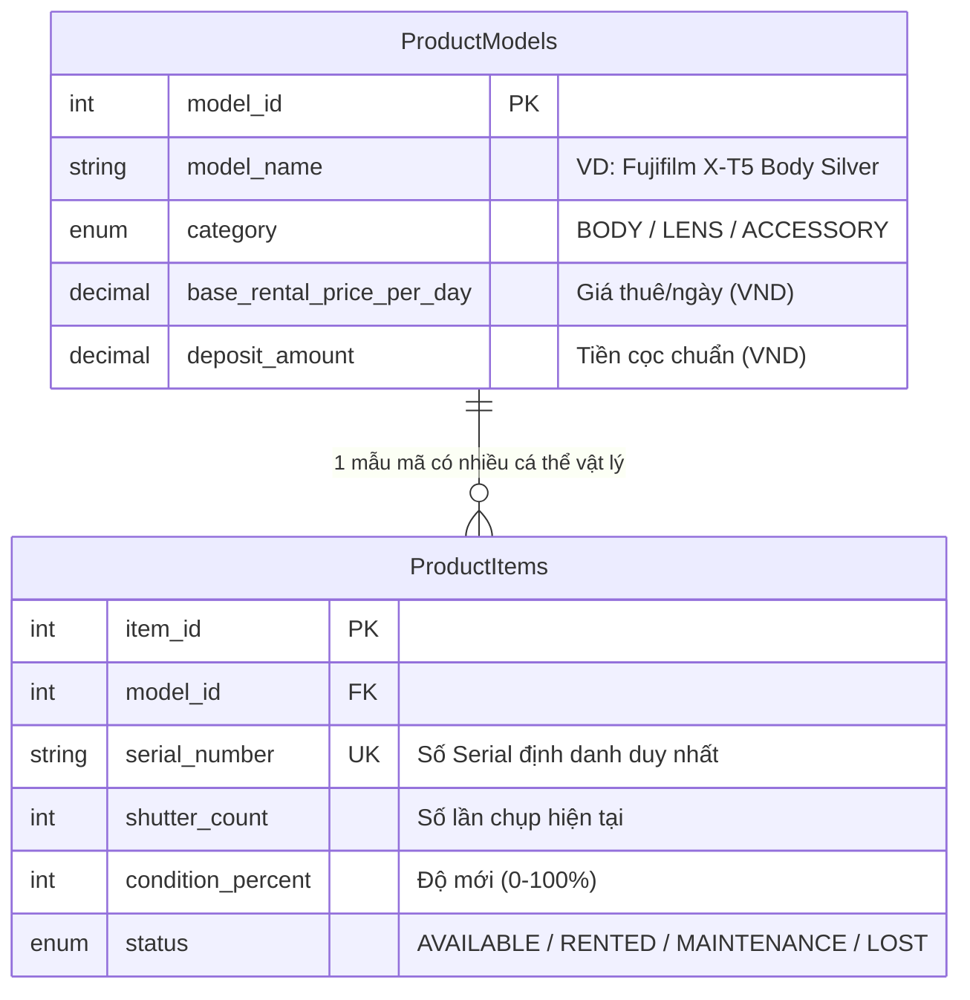
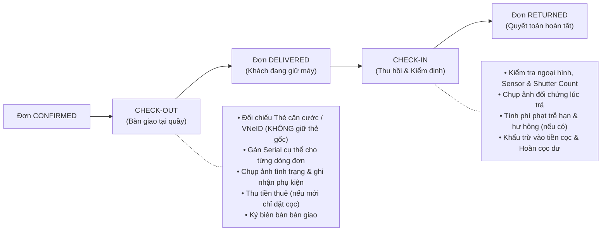
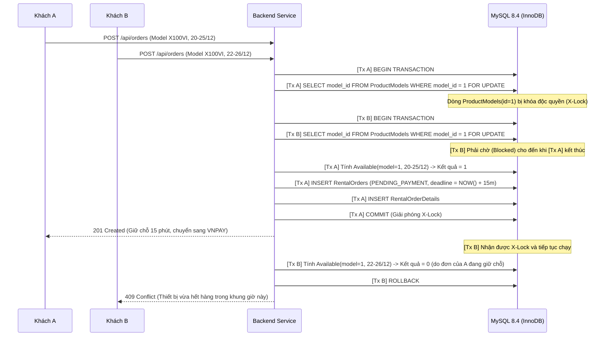
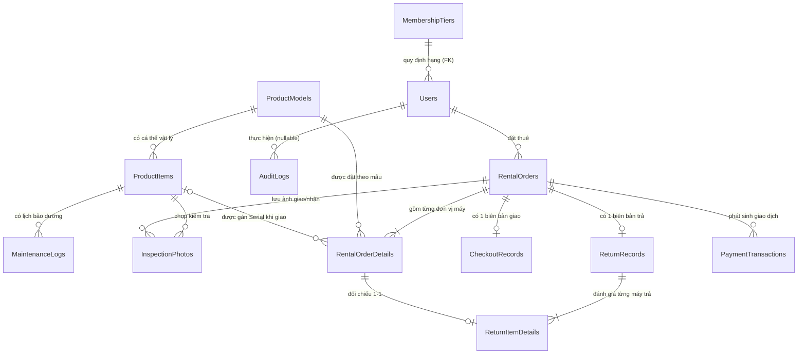
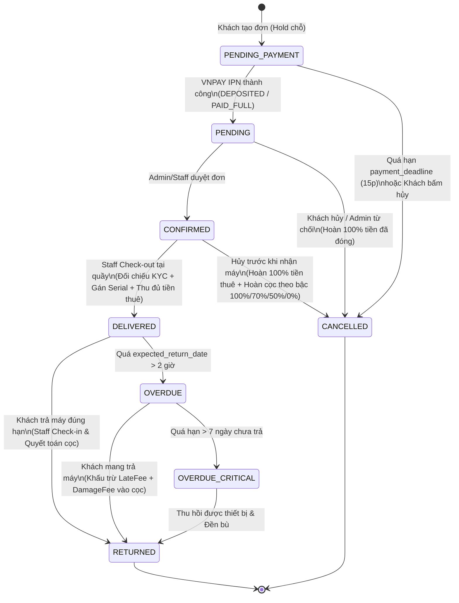
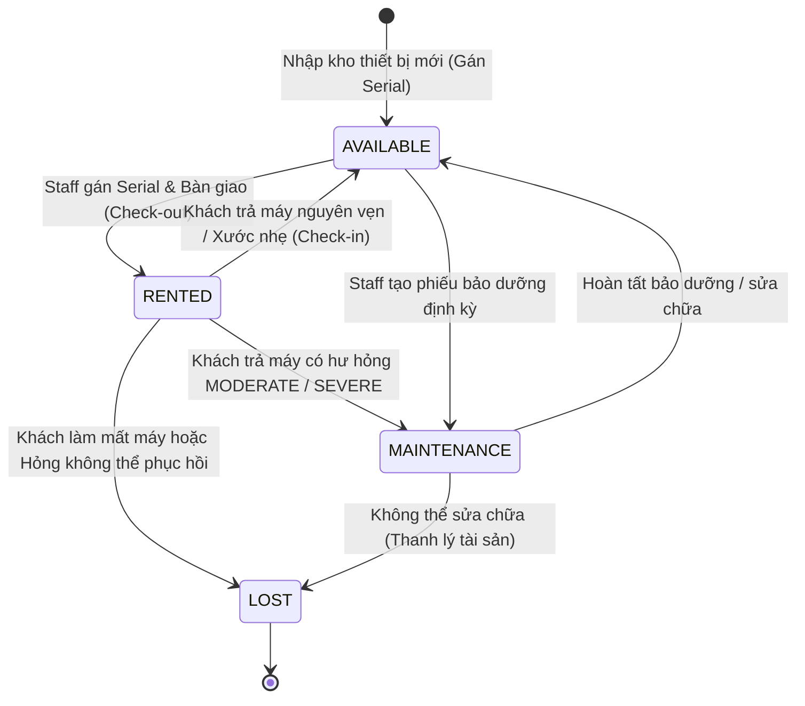
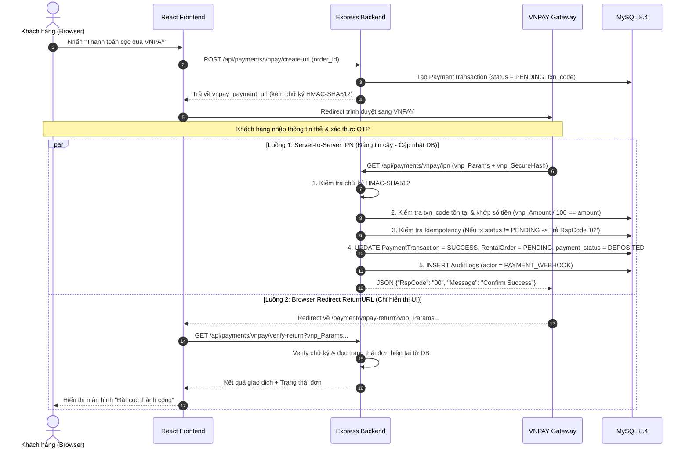

# REFUJI — HỆ THỐNG QUẢN LÝ & CHO THUÊ MÁY ẢNH FUJIFILM
## BẢN ĐẶC TẢ KỸ THUẬT & NGHIỆP VỤ — PHIÊN BẢN 1.1

> [!NOTE]
> **Lịch sử phiên bản:**
> - **v1.0 (21/08/2026):** Bản khởi tạo mở rộng từ 6 bảng gốc lên 13 bảng.
> - **v1.1 (29/10/2026):** Bản chuẩn hóa toàn diện — Khắc phục lỗi thiết kế `quantity`/`assigned_item_id`, vá lỗ hổng công thức Availability & Race Condition, chuẩn hóa pháp lý theo Luật Căn cước 2023 & Luật Bảo vệ Dữ liệu Cá nhân 2025, nâng cấp MySQL 8.4 LTS, tách luồng VNPAY Return/IPN và bổ sung đặc tả kiểm thử cho 3 học phần.
> 
> **Chủ dự án:** Tran Txi — Đại học Công nghệ Sài Gòn (STU), Khoa Công nghệ Thông tin

---

## MỤC LỤC

1. [Tổng quan dự án & Phân bổ MoSCoW](#1-tổng-quan-dự-án--phân-bổ-moscow)
2. [Kiến trúc nghiệp vụ đặc thù](#2-kiến-trúc-nghiệp-vụ-đặc-thù)
3. [Phân hệ và tính năng chi tiết](#3-phân-hệ-và-tính-năng-chi-tiết)
4. [Quy tắc nghiệp vụ (Business Rules)](#4-quy-tắc-nghiệp-vụ-business-rules)
5. [Thiết kế CSDL hoàn chỉnh (13 bảng)](#5-thiết-kế-csdl-hoàn-chỉnh-13-bảng)
6. [Data Dictionary (Từ điển dữ liệu)](#6-data-dictionary-từ-điển-dữ-liệu)
7. [Biểu đồ UML & Đặc tả Use Case trọng tâm](#7-biểu-đồ-uml--đặc-tả-use-case-trọng-tâm)
8. [API Endpoints Blueprint](#8-api-endpoints-blueprint)
9. [Ma trận yêu cầu 3 học phần & Yêu cầu phi chức năng](#9-ma-trận-yêu-cầu-3-học-phần--yêu-cầu-phi-chức-năng)
10. [Công nghệ đề xuất (Tech Stack)](#10-công-nghệ-đề-xuất-tech-stack)
11. [Bảo mật, Pháp lý & Bảo vệ dữ liệu cá nhân](#11-bảo-mật-pháp-lý--bảo-vệ-dữ-liệu-cá-nhân)
12. [Scheduled Jobs (Cron Tasks)](#12-scheduled-jobs-cron-tasks)
13. [Kế hoạch Kiểm thử (Test Plan & Concurrency Test)](#13-kế-hoạch-kiểm-thử-test-plan--concurrency-test)
14. [Tóm tắt nhật ký chỉnh sửa (Changelog v1.0 → v1.1)](#14-tóm-tắt-nhật-ký-chỉnh-sửa-changelog-v10--v11)

---

## 1. TỔNG QUAN DỰ ÁN & PHÂN BỔ MOSCOW

**Tên hệ thống:** ReFuji — Hệ thống quản lý & cho thuê máy ảnh, ống kính và phụ kiện Fujifilm

### 1.1. Bối cảnh học thuật

| Thông tin | Chi tiết |
|---|---|
| **Trường** | Đại học Công nghệ Sài Gòn (STU) — Khoa Công nghệ Thông tin |
| **Số học phần áp dụng** | 3 học phần xuyên suốt |
| **HP 1: Phân tích & Thiết kế HTTT** | Báo cáo đặc tả yêu cầu (SRS), Use Case Specification, UML, Thiết kế CSDL mức logic & vật lý (13 bảng chuẩn 3NF), Wireframe |
| **HP 2: Thực hành Lập trình Web** | Ứng dụng Web hoàn chỉnh luồng cốt lõi (Auth, Catalog, Availability Check, Đặt lịch cơ bản, Quản trị CRUD với 6 bảng core) |
| **HP 3: Đồ án Chuyên ngành (ĐACN)** | Hệ thống Production-ready đầy đủ 13 bảng: Quản lý kho theo Serial, Check-out/Check-in 2 chiều, VNPAY IPN/Return, Tính phí phạt/hư hỏng tự động, Bảo vệ dữ liệu cá nhân, Kiểm thử tự động & chống Race Condition |

### 1.2. Mô tả tóm tắt
Hệ thống cho phép khách hàng tra cứu danh mục thiết bị nhiếp ảnh Fujifilm (Body, Lens, Phụ kiện), kiểm tra số lượng khả dụng theo khung thời gian thực tế, đặt lịch thuê trực tuyến, thanh toán tiền cọc qua cổng thanh toán điện tử và theo dõi vòng đời đơn thuê. Phía cửa hàng (Admin/Staff) quản lý từng cá thể thiết bị vật lý theo **Serial Number**, thực hiện quy trình bàn giao (Check-out) – thu hồi (Check-in) có đối chiếu hình ảnh và biên bản, tự động tính toán phí trễ hạn/phí hư hỏng, quyết toán tiền cọc và theo dõi lịch bảo dưỡng định kỳ.

### 1.3. Phân bổ độ ưu tiên tính năng theo MoSCoW

Để đảm bảo tính khả thi qua 3 học phần, phạm vi dự án được chia theo ma trận **MoSCoW**:

| Phân loại | Hạng mục tính năng | Học phần mục tiêu |
|---|---|---|
| **Must have** *(Bắt buộc)* | • Phân tách `ProductModels` (Mẫu mã) và `ProductItems` (Serial Number)<br/>• Thuật toán kiểm tra Availability theo khung thời gian & chống Race Condition<br/>• Đặt đơn thuê với cơ chế giữ chỗ tạm thời (Reservation Hold 15 phút)<br/>• Quy trình Check-out (gán Serial, chụp ảnh, thu tiền thuê) & Check-in (kiểm tra, tính phí trễ hạn/hư hỏng, hoàn cọc)<br/>• Tích hợp thanh toán VNPAY Sandbox (tách biệt ReturnURL và IPN Webhook)<br/>• Bảo mật JWT (HttpOnly Cookie + Refresh Token) & Mã hóa dữ liệu căn cước | HP 2 (Core) & HP 3 (Full) |
| **Should have** *(Nên có)* | • Hệ thống hạng thành viên (`MembershipTiers`) & Điểm uy tín (`Reputation Score`)<br/>• Quản lý lịch sử bảo dưỡng thiết bị (`MaintenanceLogs`)<br/>• Cron jobs tự động giải phóng đơn quá hạn thanh toán và cảnh báo đơn trễ hạn<br/>• Báo cáo thống kê doanh thu và tần suất khai thác thiết bị | HP 3 |
| **Could have** *(Có thể làm thêm)* | • Thông báo Email tự động (nhắc lịch trả máy, xác nhận đơn)<br/>• Giao diện tra cứu nhật ký hệ thống (`AuditLogs`) trực quan cho Admin<br/>• Xuất biên bản bàn giao / quyết toán ra file PDF in ấn tại quầy | HP 3 (Điểm cộng) |
| **Won't have (v1.1)** *(Ngoài phạm vi)* | • Tích hợp cổng MoMo & SePay/payOS thực tế (chỉ thiết kế sẵn cấu trúc DB mở rộng)<br/>• Giao hàng tận nơi qua bên thứ 3 (do đặc thù thiết bị máy ảnh giá trị cao, khách bắt buộc nhận/trả và kiểm tra máy trực tiếp tại cửa hàng) | N/A |

---

## 2. KIẾN TRÚC NGHIỆP VỤ ĐẶC THÙ

> [!IMPORTANT]
> Hệ thống cho thuê thiết bị nhiếp ảnh **KHÔNG PHẢI** là hệ thống thương mại điện tử bán đứt (E-commerce). Ba trụ cột kiến trúc dưới đây quyết định toàn bộ thiết kế CSDL và luồng xử lý.

### 2.1. Tách biệt Mẫu mã (Product Model) và Cá thể vật lý (Product Item)



* **Product Model (Danh mục thương mại):** Đại diện cho dòng sản phẩm hiển thị trên website (VD: *Fujifilm X-T5*, *Fujifilm X100VI*, *Lens XF 35mm f/1.4 R*). Khách hàng đặt thuê là đặt trên **Model**, chưa gắn cứng vào một chiếc máy vật lý cụ thể tại thời điểm đặt lịch từ xa.
* **Product Item (Tài sản kho theo Serial):** Mỗi chiếc máy ảnh/ống kính cụ thể trong tủ chống ẩm của cửa hàng có một mã **Serial Number** duy nhất, số lần màn trập (`shutter_count`), ngoại hình (`condition_percent`), và lịch sử bảo dưỡng riêng. Nhân viên chỉ gán `item_id` cụ thể cho đơn hàng khi thực hiện bàn giao (**Check-out**).
* **Quy tắc tách dòng chi tiết đơn (`1 Row = 1 Unit`):** Trong bảng `RentalOrderDetails`, nếu khách hàng muốn thuê $k$ thiết bị cùng một `model_id` (ví dụ thuê 2 máy X-T5), hệ thống sẽ lưu thành **$k$ dòng bản ghi độc lập**. Thiết kế này đảm bảo mỗi dòng chi tiết đơn ánh xạ 1–1 với đúng 1 `assigned_item_id` khi Check-out và 1 `ReturnItemDetails` khi Check-in.

### 2.2. Thuật toán Kiểm tra tính khả dụng (Time-slot Inventory Availability)

Khách hàng chọn khoảng thời gian thuê dự kiến $[T_s, T_e]$ (với $T_s$ là thời điểm nhận máy `start_date` và $T_e$ là thời điểm trả máy dự kiến `expected_return_date`).

Số lượng thiết bị khả dụng của mẫu mã $M$ trong khoảng $[T_s, T_e]$ được định nghĩa chính xác bởi công thức:

$$\text{Available}(M, T_s, T_e) = \text{ActivePool}(M) - \text{BookedUnits}(M, T_s, T_e)$$

Trong đó:

1. **Tổng nguồn cung khả thác ($\text{ActivePool}$):** Là tổng số cá thể vật lý của mẫu $M$ không bị hỏng hoặc mất:
   $$\text{ActivePool}(M) = \text{COUNT}\big(\text{ProductItems WHERE } model\_id = M \land status \in \{\text{'AVAILABLE'}, \text{'RENTED'}\}\big)$$
   *(Lưu ý: Các máy đang ở trạng thái `'MAINTENANCE'` hoặc `'LOST'` bị loại khỏi nguồn cung ngay lập tức).*

2. **Số lượng đơn vị đang bị chiếm chỗ ($\text{BookedUnits}$):** Là tổng số dòng trong `RentalOrderDetails` của mẫu $M$ thuộc các đơn hàng thỏa mãn đồng thời **cả 3 điều kiện**:
   * **Điều kiện trạng thái đơn có hiệu lực:**
     $$\text{order\_status} \in \{\text{'PENDING'}, \text{'CONFIRMED'}, \text{'DELIVERED'}, \text{'OVERDUE'}, \text{'OVERDUE\_CRITICAL'}\}$$
     **HOẶC** đơn đang chờ thanh toán nhưng **chưa hết hạn giữ chỗ**:
     $$\big(\text{order\_status} = \text{'PENDING\_PAYMENT'} \land \text{payment\_deadline} > \text{NOW()}\big)$$
   * **Điều kiện giao thoa thời gian (Time Overlap) hoặc Quá hạn giữ máy:**
     Một đơn hàng chiếm chỗ trong khoảng $[T_s, T_e]$ nếu khoảng thời gian của đơn giao thoa với $[T_s, T_e]$, **HOẶC** đơn đó đang ở trạng thái quá hạn chưa trả máy (`OVERDUE` / `OVERDUE_CRITICAL`) và ngày bắt đầu thuê của khách mới nằm sau ngày bắt đầu của đơn quá hạn:
     $$\Big(T_s^{order} < T_e \;\land\; T_e^{order} > T_s\Big) \;\lor\; \Big(\text{order\_status} \in \{\text{'OVERDUE'}, \text{'OVERDUE\_CRITICAL'}\} \;\land\; T_s^{order} < T_e\Big)$$

> [!TIP]
> **Tại sao công thức này khắc phục hoàn toàn lỗi của bản v1.0?**
> - Không cần chờ Cron Job (5 phút/lần) chạy mới giải phóng đơn `PENDING_PAYMENT` hết hạn nhờ điều kiện `payment_deadline > NOW()` ngay trong câu truy vấn `SELECT`.
> - Xử lý được trường hợp khách cũ giữ máy quá hạn (`OVERDUE` qua khỏi ngày `expected_return_date`), ngăn chặn việc khách mới đặt trùng vào chiếc máy chưa được trả về kho.
> - Đếm số dòng chi tiết đơn (mỗi dòng = 1 máy) thay vì đếm số lượng đơn hàng.

### 2.3. Quy trình Giao – Nhận 2 chiều (Check-out & Check-in) tuân thủ pháp lý



---

## 3. PHÂN HỆ VÀ TÍNH NĂNG CHI TIẾT

### A. Phân hệ Khách hàng (Client Portal)

| Mã | Tính năng | Mô tả chi tiết |
|---|---|---|
| **C01** | Đăng ký / Đăng nhập / Bảo mật | Đăng ký (có tick đồng ý Chính sách bảo vệ DLCN), Đăng nhập nhận JWT (Access Token + HttpOnly Refresh Token), Đăng xuất, Quên mật khẩu qua Email |
| **C02** | Quản lý hồ sơ & KYC | Cập nhật họ tên, SĐT, thông tin Thẻ căn cước (được mã hóa AES-256 trên server, chỉ hiển thị số cuối). Xem hạng thành viên và điểm uy tín |
| **C03** | Tra cứu danh mục thiết bị | Tìm kiếm Full-text theo tên dòng máy. Lọc theo: Category (`BODY`/`LENS`/`ACCESSORY`), Ngàm (`X-mount`/`G-mount`), khoảng giá thuê |
| **C04** | Kiểm tra Availability | Chọn thời gian nhận $T_s$ và trả $T_e$ → Hệ thống trả về số lượng máy còn trống chính xác theo từng Model |
| **C05** | Tạo đơn đặt thuê | Chọn một hoặc nhiều thiết bị → Hệ thống tách từng đơn vị thiết bị thành dòng chi tiết, tính tiền thuê + tiền cọc (sau khi trừ ưu đãi hạng thành viên) và giữ chỗ 15 phút |
| **C06** | Thanh toán trực tuyến | Thanh toán **Tiền cọc** (hoặc **Trọn gói Cọc + Tiền thuê**) qua VNPAY Sandbox, hoặc chọn giữ đơn thanh toán tại quầy |
| **C07** | Theo dõi đơn thuê | Xem tiến trình đơn hàng theo thời gian thực, xem biên bản bàn giao, danh sách Serial thiết bị đang giữ và ảnh chụp kiểm tra (qua Signed URL) |
| **C08** | Hủy đơn đặt thuê | Hủy đơn trực tuyến khi đơn ở trạng thái `PENDING_PAYMENT`, `PENDING` hoặc `CONFIRMED` theo bảng quy tắc hoàn tiền |
| **C09** | Lịch sử thuê & Giao dịch | Xem lại toàn bộ lịch sử đơn thuê, chi tiết hóa đơn quyết toán, lịch sử cộng/trừ điểm uy tín |
| **C10** | Nhận thông báo | Nhận email khi: đặt đơn thành công, đơn được duyệt, nhắc lịch trả trước 24 giờ, và cảnh báo khi quá hạn trả máy |

### B. Phân hệ Quản trị & Nhân viên (Admin & Staff Portal)

| Mã | Tính năng | Mô tả chi tiết |
|---|---|---|
| **S01** | Quản lý Mẫu mã (Catalog CRUD) | Thêm/sửa/ẩn các dòng máy ảnh, ống kính, phụ kiện Fujifilm; cấu hình bảng thông số kỹ thuật JSON, đơn giá thuê/ngày và mức cọc chuẩn |
| **S02** | Quản lý Kho theo Serial (Item CRUD) | Quản lý từng cá thể vật lý theo `serial_number`, cập nhật `shutter_count`, `condition_percent`, trạng thái (`AVAILABLE`, `MAINTENANCE`, `LOST`) |
| **S03** | Duyệt đơn đặt thuê | Kiểm tra các đơn đã hoàn tất đặt cọc (`PENDING`), đối chiếu lịch sử uy tín của khách để duyệt (`CONFIRMED`) hoặc từ chối (kèm hoàn tiền) |
| **S04** | Bàn giao thiết bị (Check-out) | Đối chiếu Thẻ căn cước/VNeID trực tiếp tại quầy → Gán Serial cụ thể (`assigned_item_id`) → Ghi nhận phụ kiện đi kèm → Chụp ảnh tình trạng máy → Thu phần tiền thuê còn lại → Chuyển đơn sang `DELIVERED` |
| **S05** | Thu hồi & Quyết toán (Check-in) | Kiểm tra thiết bị trả về → Cập nhật Shutter Count mới → Chụp ảnh đối chứng → Đánh giá mức độ hư hỏng/mất phụ kiện → Hệ thống tự tính `LateFee`, `DamageFee` và số tiền cọc hoàn lại (`Refund`) |
| **S06** | Quản lý Bảo dưỡng | Tạo phiếu bảo dưỡng/vệ sinh cảm biến/sửa chữa (`MaintenanceLogs`), tự động chuyển thiết bị sang `MAINTENANCE` và mở lại `AVAILABLE` khi hoàn tất |
| **S07** | Quản lý Khách hàng | Tra cứu hồ sơ khách hàng, xác thực thông tin định danh tại quầy, xem lịch sử vi phạm, khóa/mở khóa tài khoản vi phạm nghiêm trọng |
| **S08** | Quản lý Giao dịch tài chính | Đối soát lịch sử giao dịch VNPAY, ghi nhận thanh toán tiền mặt/chuyển khoản tại quầy, xác nhận hoàn tiền cọc cho khách |
| **S09** | Báo cáo & Thống kê | Thống kê doanh thu thực nhận theo kỳ (tiền thuê + phí phạt − chi phí bảo dưỡng), tỷ lệ lấp đầy theo Serial, danh sách máy sắp đến kỳ bảo dưỡng |
| **S10** | Nhật ký Kiểm toán (Audit Log) | Theo dõi toàn bộ lịch sử tác động dữ liệu của Admin, Staff và Hệ thống (Cron Jobs) phục vụ truy vết bảo mật |

---

## 4. QUY TẮC NGHIỆP VỤ (BUSINESS RULES)

### 4.1. Quy tắc Thời gian thuê & Công thức tính tiền

* **Khung giờ giao – nhận chuẩn:**
  * Thời gian nhận máy (`start_date`) và trả máy dự kiến (`expected_return_date`) được lưu dưới dạng `DATETIME(3)`.
  * Giờ mở cửa giao/nhận tiêu chuẩn của cửa hàng: **08:00 đến 20:00** hàng ngày (múi giờ `Asia/Ho_Chi_Minh`).
  * **Số ngày thuê ($\text{RentalDays}$):** Được tính theo đơn vị block 24 giờ làm tròn lên (tối thiểu $1\text{ ngày}$):
    $$\text{RentalDays} = \max\left(1, \;\left\lceil \frac{T_{expected\_return} - T_{start}}{24\text{ giờ}} \right\rceil\right)$$

* **Công thức tính chi phí đơn hàng (đơn vị: VND, làm tròn đến hàng đơn vị):**
  Với một đơn hàng gồm $N$ cá thể thiết bị (tương ứng $N$ dòng trong `RentalOrderDetails`) và khách hàng có tỷ lệ giảm cọc theo hạng thành viên là $d_{\text{tier}} \in [0, 0.15]$:
  $$\text{TotalRentalFee} = \sum_{i=1}^{N} \big(\text{RentalPricePerDay}_i \times \text{RentalDays}\big)$$
  $$\text{DepositPerUnit}_i = \text{ round}\big(\text{BaseDeposit}_i \times (1 - d_{\text{tier}})\big)$$
  $$\text{TotalDeposit} = \sum_{i=1}^{N} \text{DepositPerUnit}_i$$

* **Quy tắc Thu tiền theo giai đoạn (Thống nhất luồng thanh toán):**
  1. **Tại thời điểm Đặt đơn (Booking):**
     * Khách hàng bắt buộc thanh toán tối thiểu **100% Tiền cọc ($\text{TotalDeposit}$)** để xác nhận giữ lịch (trạng thái thanh toán đạt `DEPOSITED`), hoặc có thể chọn thanh toán gộp **100% Tiền cọc + Tiền thuê ($\text{TotalDeposit} + \text{TotalRentalFee}$)** ngay từ đầu (trạng thái đạt `PAID_FULL`).
  2. **Tại thời điểm Bàn giao máy (Check-out tại quầy):**
     * Nếu đơn đang ở mức `DEPOSITED`, nhân viên thu nốt **100% Tiền thuê ($\text{TotalRentalFee}$)** trước khi bàn giao máy. Sau khi thu đủ, `payment_status` của đơn chuyển thành `PAID_FULL`. Thiết bị chỉ được phép rời khỏi cửa hàng khi `payment_status = 'PAID_FULL'`.
  3. **Tại thời điểm Thu hồi máy (Check-in tại quầy):**
     * Tiền thuê ($\text{TotalRentalFee}$) là doanh thu dịch vụ đã hoàn thành. Tiền cọc ($\text{TotalDeposit}$) được dùng để đối trừ các khoản phí phạt phát sinh (trễ hạn, hư hỏng, thiếu phụ kiện) trước khi hoàn trả phần dư cho khách.

### 4.2. Công thức tính Phí trễ hạn (Late Fee)

Khi khách hàng mang trả thiết bị tại thời điểm thực tế $T_{actual}$ (`actual_return_date`) muộn hơn $T_{expected}$ (`expected_return_date`):

$$\Delta t = T_{actual} - T_{expected}$$

| Tham số | Quy định | Giải thích chi tiết |
|---|---|---|
| **Thời gian ân hạn (Grace Period)** | **$2\text{ giờ}$** | Nếu $\Delta t \le 2\text{ giờ}$: Không tính phí phạt trễ hạn ($\text{LateFee} = 0\text{ ₫}$) |
| **Cách tính số ngày trễ ($\text{LateDays}$)** | Làm tròn lên theo block 24h | Nếu $\Delta t > 2\text{ giờ}$: $\text{LateDays} = \left\lceil \dfrac{\Delta t - 2\text{ giờ}}{24\text{ giờ}} \right\rceil$ |
| **Hệ số phạt ($K_{penalty}$)** | **$1.5$** | Phạt bằng $150\%$ đơn giá thuê/ngày của tất cả thiết bị trong đơn |
| **Mức trần phí trễ hạn (Cap)** | **$2 \times \text{TotalDeposit}$** | Tổng phí phạt trễ hạn tối đa không vượt quá $200\%$ tổng tiền cọc của đơn |
| **Ngưỡng cảnh báo pháp lý** | **$> 7\text{ ngày trễ}$** | Chuyển đơn sang `OVERDUE_CRITICAL`, khóa tài khoản và xuất hồ sơ cảnh báo chiếm dụng tài sản |

**Công thức tổng quát khi $\Delta t > 2\text{ giờ}$:**
$$\text{LateFee} = \min\left( 2 \times \text{TotalDeposit}, \;\; \text{LateDays} \times 1.5 \times \sum_{i=1}^{N} \text{RentalPricePerDay}_i \right)$$

**Ví dụ minh họa:**
* Khách thuê 1 máy Fujifilm X-T5 (giá thuê $500.000\text{ ₫/ngày}$, cọc $5.000.000\text{ ₫}$). Giờ hẹn trả: `20:00 ngày 10/11`.
* **Trường hợp 1:** Trả lúc `21:30 ngày 10/11` ($\Delta t = 1.5\text{ giờ} \le 2\text{ giờ}$) $\Rightarrow \text{LateFee} = 0\text{ ₫}$.
* **Trường hợp 2:** Trả lúc `18:00 ngày 13/11` ($\Delta t = 70\text{ giờ} \Rightarrow \text{LateDays} = \lceil 68/24 \rceil = 3\text{ ngày}$) $\Rightarrow \text{LateFee} = 3 \times 500.000 \times 1.5 = 2.250.000\text{ ₫}$.

### 4.3. Chính sách Hủy đơn (Cancellation Policy)

> [!NOTE]
> Chính sách dưới đây giải quyết triệt để mâu thuẫn giữa trạng thái đơn (`PENDING` vs `CONFIRMED`) và loại tiền đã đóng (`DEPOSITED` vs `PAID_FULL`).

* **Nguyên tắc gốc:** Nếu khách hàng đã đóng trước cả **Tiền thuê ($\text{TotalRentalFee}$)** mà hủy đơn trước khi nhận máy, khách luôn được **hoàn lại 100% Tiền thuê** (do dịch vụ thuê chưa diễn ra). Phí hủy đơn (nếu có) chỉ tính phần trăm trên **Tiền cọc ($\text{TotalDeposit}$)** để bù đắp chi phí cơ hội giữ lịch máy.

| Trạng thái đơn khi hủy | Thời điểm hủy so với giờ nhận máy ($T_s$) | Hoàn Tiền thuê (nếu đã đóng) | Hoàn Tiền cọc ($\text{TotalDeposit}$) | Phí hủy giữ lại |
|---|---|---|---|---|
| `PENDING_PAYMENT` | Bất kỳ lúc nào (chưa thanh toán) | $0\text{ ₫}$ | $0\text{ ₫}$ | $0\text{ ₫}$ |
| `PENDING` *(Chờ duyệt)* | Bất kỳ lúc nào trước khi Admin duyệt | **100%** | **100%** | $0\text{ ₫}$ |
| `CONFIRMED` *(Đã duyệt)* | Trước giờ nhận máy $\ge 72\text{ giờ}$ ($\ge 3\text{ ngày}$) | **100%** | **100%** | $0\text{ ₫}$ |
| `CONFIRMED` *(Đã duyệt)* | Trước giờ nhận máy từ $24\text{ giờ}$ đến $< 72\text{ giờ}$ | **100%** | **70%** | $30\%$ Tiền cọc |
| `CONFIRMED` *(Đã duyệt)* | Trong vòng $< 24\text{ giờ}$ trước giờ nhận máy | **100%** | **50%** | $50\%$ Tiền cọc |
| `CONFIRMED` *(No-show)* | Quá giờ nhận máy $> 12\text{ giờ}$ khách không đến | **100%** | **0%** | $100\%$ Tiền cọc |
| Admin/Staff hủy đơn | Do sự cố thiết bị tại kho / Lỗi hệ thống | **100%** | **100%** | $0\text{ ₫}$ (Ghi Audit Log) |

* **Đơn đã bàn giao (`DELIVERED`):** Không được phép hủy. Nếu khách trả máy sớm hơn `expected_return_date`, hệ thống thực hiện quy trình **Check-in sớm**: hoàn cọc bình thường nhưng **không hoàn lại tiền thuê** của những ngày chưa sử dụng.

### 4.4. Kiểm soát tương tranh (Race Condition) & Reservation Timeout

**Bài toán:** Khi mẫu máy Fujifilm X100VI chỉ còn $\text{Available} = 1$ trong khoảng ngày $[20/12, 25/12]$, hai khách hàng A và B cùng bấm nút "Đặt thuê" tại cùng một mili-giây. Nếu chỉ dùng `SELECT COUNT(*)` thông thường (hoặc `SELECT ... FOR UPDATE` trên các dòng `RentalOrders` chưa tồn tại), cả hai transaction đều đọc được $\text{Available} = 1$ và cùng `INSERT` thành công, gây ra lỗi **Overbooking**.

**Giải pháp kỹ thuật — Pessimistic Mutex Lock trên dòng `ProductModels`:**



* **Cách triển khai trong Prisma ORM:** Sử dụng Interactive Transaction kết hợp `$queryRaw`:
  `await tx.$queryRaw\`SELECT model_id FROM ProductModels WHERE model_id IN (${Prisma.join(modelIds)}) ORDER BY model_id ASC FOR UPDATE\`;`
  *(Sắp xếp `ORDER BY model_id ASC` bắt buộc để phòng chống **Deadlock** khi một đơn thuê nhiều model khác nhau).*
* **Thời hạn giữ chỗ (`payment_deadline`):**
  * Thanh toán Online (VNPAY): **15 phút** kể từ lúc tạo đơn.
  * Thanh toán tại quầy (chỉ áp dụng cho khách đã xác thực SĐT và có `reputation_score >= 80`): **12 giờ** (hoặc tối đa đến 2 giờ trước `start_date`).

### 4.5. Quy tắc tính Phí hư hỏng (Damage Fee) & Phụ kiện

| Mức độ (`damage_level`) | Mô tả hiện trạng khi Check-in | Khung phí đề xuất (tính theo `deposit_per_unit`) | Trạng thái Item sau Check-in |
|---|---|---|---|
| `NONE` | Trả máy nguyên trạng như biên bản Check-out | $0\text{ ₫}$ | `AVAILABLE` |
| `LIGHT_SCRATCH` | Trầy xước nhẹ vỏ ngoài, không ảnh hưởng quang học/chức năng | $5\%$ giá trị cọc | `AVAILABLE` |
| `MINOR` | Bong cao su grip, móp nhẹ vòng filter, mất nắp body/lens cap | $10\% - 20\%$ giá trị cọc | `AVAILABLE` |
| `MODERATE` | Trầy thấu kính, hỏng hot-shoe, kẹt nút bấm, bụi/mốc cảm biến nặng | $30\% - 50\%$ giá trị cọc | `MAINTENANCE` |
| `SEVERE` | Cháy/xước cảm biến (Sensor), gãy ngàm (Mount), rơi vỡ, vào nước | $70\% - 100\%$ giá trị cọc | `MAINTENANCE` |
| `LOST` | Làm mất thiết bị hoặc hư hỏng hoàn toàn không thể khôi phục | $100\%$ cọc + Đền bù chênh lệch theo giá trị tài sản | `LOST` |

### 4.6. Hệ thống Hạng thành viên (`MembershipTiers`) & Quy trình KYC hợp pháp

> [!WARNING]
> **Tuân thủ Luật Căn cước 2023 (hiệu lực từ 01/07/2024):** Cửa hàng **TUYỆT ĐỐI KHÔNG** thu giữ Thẻ căn cước vật lý của khách hàng dưới mọi hình thức. Thay vào đó, cửa hàng áp dụng quy trình **Xác minh danh tính tại quầy (In-person KYC)** kết hợp **Tiền đặt cọc bảo đảm**.

| Hạng (`tier_name`) | Điều kiện đạt hạng | Ưu đãi giảm cọc | Quy trình thủ tục tại quầy (`fast_track_checkin`) |
|---|---|---|---|
| **BRONZE** | Mặc định khi đăng ký | $0\%$ | Đối chiếu Thẻ căn cước/VNeID mức 2 + Chụp ảnh biên bản bàn giao |
| **SILVER** | $\ge 5$ đơn hoàn tất $\land$ Reputation $\ge 80$ | Giảm **$5\%$** cọc | Đối chiếu Thẻ căn cước/VNeID + Ký biên bản |
| **GOLD** | $\ge 15$ đơn hoàn tất $\land$ Reputation $\ge 90$ | Giảm **$10\%$** cọc | Ưu tiên duyệt đơn tự động + Kiểm tra nhanh |
| **PLATINUM** | $\ge 30$ đơn hoàn tất $\land$ Reputation $\ge 95$ | Giảm **$15\%$** cọc | **Fast-track Check-in:** Miễn đối chiếu lại giấy tờ nếu đã KYC thành công trước đó |

**Quy tắc Điểm uy tín (`reputation_score` trong khoảng $[0, 100]$):**
* Khởi tạo: **100 điểm**.
* Hoàn tất đơn đúng hạn & không hư hại (`damage_level = 'NONE'`): **$+2\text{ điểm}$** (tối đa 100).
* Trả trễ từ $1 - 3\text{ ngày}$: **$-5\text{ điểm}$**.
* Trả trễ $> 3\text{ ngày}$: **$-15\text{ điểm}$**.
* Làm hư hỏng thiết bị (`MINOR` trở lên): **$-10\text{ điểm}$**.
* Làm mất thiết bị hoặc quá hạn nghiêm trọng (`OVERDUE_CRITICAL`): **$-50\text{ điểm}$**. Nếu `reputation_score < 20`, hệ thống tự động đặt `is_active = FALSE` (đưa vào danh sách từ chối phục vụ).

### 4.7. Công thức Quyết toán & Hoàn cọc (Check-in Settlement)

Khi thu hồi thiết bị tại quầy, tổng số tiền hoàn trả cho khách hàng ($\text{RefundAmount}$) được tính như sau:

$$\text{TotalPenalty} = \text{TotalLateFee} + \text{TotalDamageFee} + \text{TotalMissingAccessoriesFee} + \text{OtherFee}$$

$$\text{NetSettlement} = \text{TotalDeposit} - \text{TotalPenalty}$$

* **Trường hợp 1 ($\text{NetSettlement} \ge 0$):** Cửa hàng hoàn trả số tiền $\text{RefundAmount} = \text{NetSettlement}$ cho khách hàng và ghi nhận 1 bản ghi `PaymentTransactions` với `transaction_type = 'REFUND'`.
  * Nếu $\text{TotalPenalty} = 0$: cập nhật `RentalOrders.payment_status = 'REFUNDED'`.
  * Nếu $\text{TotalPenalty} > 0$: cập nhật `RentalOrders.payment_status = 'PARTIALLY_REFUNDED'`.
* **Trường hợp 2 ($\text{NetSettlement} < 0$):** Tiền cọc không đủ bù phí phạt ($\text{RefundAmount} = 0$). Khách hàng phải thanh toán bổ sung khoản thiếu hụt $|\text{NetSettlement}|$ (ghi nhận giao dịch thu thêm `LATE_FEE` / `DAMAGE_FEE`).

---

## 5. THIẾT KẾ CSDL HOÀN CHỈNH (13 BẢNG)

> [!NOTE]
> - Hệ quản trị CSDL: **MySQL 8.4 LTS** (InnoDB Engine, Charset `utf8mb4`, Collation `utf8mb4_unicode_ci`).
> - Toàn bộ cột tiền tệ sử dụng kiểu **`DECIMAL(12, 0)`** (VND không dùng số thập phân).
> - Toàn bộ cột mốc thời gian hệ thống sử dụng **`DATETIME(3)`** lưu theo chuẩn UTC.
> - Cấu trúc gồm đúng **13 bảng** đạt chuẩn 3NF: 6 bảng Core (dùng từ HP 2) và 7 bảng Mở rộng (hoàn thiện ở HP 3).

### Sơ đồ Quan hệ Thực thể (ER Diagram — 13 Bảng)



---

### 5.1. Bảng `MembershipTiers` — Cấu hình Hạng thành viên *(Khởi tạo trước để làm FK cho Users)*

```sql
CREATE TABLE MembershipTiers (
    tier_code                   VARCHAR(20) PRIMARY KEY,      -- 'BRONZE', 'SILVER', 'GOLD', 'PLATINUM'
    tier_name                  VARCHAR(50) NOT NULL,
    min_completed_rentals      INT NOT NULL DEFAULT 0,
    min_reputation_score       INT NOT NULL DEFAULT 0,
    deposit_discount_percent   DECIMAL(5, 2) NOT NULL DEFAULT 0.00,
    priority_approval          BOOLEAN NOT NULL DEFAULT FALSE,
    fast_track_checkin         BOOLEAN NOT NULL DEFAULT FALSE, -- Miễn đối chiếu lại giấy tờ nếu đã KYC
    description                TEXT,
    updated_at                 DATETIME(3) NOT NULL DEFAULT CURRENT_TIMESTAMP(3) ON UPDATE CURRENT_TIMESTAMP(3)
) ENGINE=InnoDB DEFAULT CHARSET=utf8mb4 COLLATE=utf8mb4_unicode_ci;

-- Seed dữ liệu cấu hình hạng
INSERT INTO MembershipTiers (tier_code, tier_name, min_completed_rentals, min_reputation_score, deposit_discount_percent, priority_approval, fast_track_checkin, description) VALUES
('BRONZE',   'Hạng Đồng',      0,  0,  0.00,  FALSE, FALSE, 'Hạng mặc định khi đăng ký tài khoản mới'),
('SILVER',   'Hạng Bạc',       5,  80, 5.00,  FALSE, FALSE, 'Giảm 5% tiền cọc thiết bị'),
('GOLD',     'Hạng Vàng',      15, 90, 10.00, TRUE,  FALSE, 'Giảm 10% tiền cọc, ưu tiên duyệt đơn'),
('PLATINUM', 'Hạng Bạch Kim',  30, 95, 15.00, TRUE,  TRUE,  'Giảm 15% tiền cọc, thủ tục nhận máy Fast-track');
```

---

### 5.2. Bảng `Users` — Người dùng, Phân quyền & Bảo vệ DLCN

```sql
CREATE TABLE Users (
    user_id                    INT PRIMARY KEY AUTO_INCREMENT,
    full_name                  VARCHAR(100) NOT NULL,
    email                      VARCHAR(100) UNIQUE NOT NULL,
    password_hash              VARCHAR(255) NOT NULL,        -- Argon2id hoặc bcrypt (cost >= 12)
    phone                      VARCHAR(20) NOT NULL,
    -- Bảo vệ Dữ liệu cá nhân (Tuân thủ Luật BVDLCN 2025 & Luật Căn cước 2023)
    id_card_encrypted          VARCHAR(512) NULL,            -- Số Thẻ căn cước mã hóa AES-256-GCM
    id_card_last4              CHAR(4) NULL,                 -- 4 số cuối để hiển thị mask (VD: ********6789)
    id_card_hash               CHAR(64) UNIQUE NULL,         -- HMAC-SHA256 để chống trùng lặp căn cước
    kyc_verified_at            DATETIME(3) NULL,             -- Thời điểm nhân viên đối chiếu thẻ thật tại quầy
    kyc_verified_by            INT NULL,                     -- Staff thực hiện xác minh
    privacy_consent_at         DATETIME(3) NOT NULL,         -- Thời điểm đồng ý Chính sách xử lý DLCN
    -- Hồ sơ & Phân quyền
    avatar_url                 VARCHAR(500) NULL,
    role                       ENUM('ADMIN', 'STAFF', 'CUSTOMER') NOT NULL DEFAULT 'CUSTOMER',
    membership_tier            VARCHAR(20) NOT NULL DEFAULT 'BRONZE',
    total_completed_rentals    INT NOT NULL DEFAULT 0,
    reputation_score           INT NOT NULL DEFAULT 100,     -- Giới hạn từ 0 đến 100
    -- Bảo mật phiên & Khôi phục mật khẩu (chỉ lưu Hash, không lưu Token thô)
    is_active                  BOOLEAN NOT NULL DEFAULT TRUE,
    refresh_token_hash         CHAR(64) NULL,                -- SHA-256 của Refresh Token hiện hành
    password_reset_token_hash  CHAR(64) NULL,                -- SHA-256 của Reset Token
    password_reset_expires     DATETIME(3) NULL,
    -- Timestamps
    created_at                 DATETIME(3) NOT NULL DEFAULT CURRENT_TIMESTAMP(3),
    updated_at                 DATETIME(3) NOT NULL DEFAULT CURRENT_TIMESTAMP(3) ON UPDATE CURRENT_TIMESTAMP(3),

    CONSTRAINT fk_users_tier FOREIGN KEY (membership_tier) REFERENCES MembershipTiers(tier_code) ON UPDATE CASCADE,
    CONSTRAINT fk_users_kyc_staff FOREIGN KEY (kyc_verified_by) REFERENCES Users(user_id) ON DELETE SET NULL,
    CONSTRAINT chk_reputation CHECK (reputation_score BETWEEN 0 AND 100),
    INDEX idx_users_role (role),
    INDEX idx_users_membership (membership_tier),
    INDEX idx_users_phone (phone)
) ENGINE=InnoDB DEFAULT CHARSET=utf8mb4 COLLATE=utf8mb4_unicode_ci;
```

---

### 5.3. Bảng `ProductModels` — Danh mục Mẫu mã Thiết bị

```sql
CREATE TABLE ProductModels (
    model_id                   INT PRIMARY KEY AUTO_INCREMENT,
    model_name                 VARCHAR(150) NOT NULL,
    category                   ENUM('BODY', 'LENS', 'ACCESSORY') NOT NULL,
    mount_type                 ENUM('X_MOUNT', 'G_MOUNT', 'NONE') NOT NULL DEFAULT 'NONE',
    base_rental_price_per_day  DECIMAL(12, 0) NOT NULL,      -- Đơn vị: VND
    deposit_amount             DECIMAL(12, 0) NOT NULL,      -- Đơn vị: VND
    brand                      VARCHAR(50) NOT NULL DEFAULT 'Fujifilm',
    is_active                  BOOLEAN NOT NULL DEFAULT TRUE,
    description                TEXT,
    specs_json                 JSON,                         -- {"sensor": "APS-C X-Trans CMOS 5 HR", "megapixels": 40.2}
    image_url                  VARCHAR(500),
    created_at                 DATETIME(3) NOT NULL DEFAULT CURRENT_TIMESTAMP(3),
    updated_at                 DATETIME(3) NOT NULL DEFAULT CURRENT_TIMESTAMP(3) ON UPDATE CURRENT_TIMESTAMP(3),

    CONSTRAINT chk_positive_price CHECK (base_rental_price_per_day >= 0 AND deposit_amount >= 0),
    INDEX idx_models_category_mount (category, mount_type),
    INDEX idx_models_active (is_active),
    FULLTEXT INDEX ft_models_search (model_name, description)
) ENGINE=InnoDB DEFAULT CHARSET=utf8mb4 COLLATE=utf8mb4_unicode_ci;
```

---

### 5.4. Bảng `ProductItems` — Cá thể Thiết bị theo Serial Number

```sql
CREATE TABLE ProductItems (
    item_id                    INT PRIMARY KEY AUTO_INCREMENT,
    model_id                   INT NOT NULL,
    serial_number              VARCHAR(100) UNIQUE NOT NULL,
    shutter_count              INT NOT NULL DEFAULT 0,
    condition_percent          INT NOT NULL DEFAULT 100,
    -- Bỏ trạng thái 'RESERVED' tĩnh để tránh khóa máy của các đơn đặt lịch tương lai
    status                     ENUM('AVAILABLE', 'RENTED', 'MAINTENANCE', 'LOST') NOT NULL DEFAULT 'AVAILABLE',
    purchase_date              DATE NULL,
    purchase_price             DECIMAL(12, 0) NULL,
    total_rental_count         INT NOT NULL DEFAULT 0,
    last_maintenance_date      DATE NULL,
    next_maintenance_date      DATE NULL,
    note                       TEXT,
    created_at                 DATETIME(3) NOT NULL DEFAULT CURRENT_TIMESTAMP(3),
    updated_at                 DATETIME(3) NOT NULL DEFAULT CURRENT_TIMESTAMP(3) ON UPDATE CURRENT_TIMESTAMP(3),

    CONSTRAINT fk_items_model FOREIGN KEY (model_id) REFERENCES ProductModels(model_id) ON DELETE RESTRICT,
    CONSTRAINT chk_condition CHECK (condition_percent BETWEEN 0 AND 100),
    INDEX idx_items_model_status (model_id, status),
    INDEX idx_items_next_maint (next_maintenance_date)
) ENGINE=InnoDB DEFAULT CHARSET=utf8mb4 COLLATE=utf8mb4_unicode_ci;
```

---

### 5.5. Bảng `RentalOrders` — Đơn Đặt Thuê

```sql
CREATE TABLE RentalOrders (
    order_id                   INT PRIMARY KEY AUTO_INCREMENT,
    order_code                 VARCHAR(25) UNIQUE NOT NULL,  -- VD: "RF-20261029-0001"
    user_id                    INT NOT NULL,
    -- Dùng DATETIME(3) để tính chính xác giờ nhận, giờ trả và Grace Period 2 giờ
    start_date                 DATETIME(3) NOT NULL,
    expected_return_date       DATETIME(3) NOT NULL,
    rental_days                INT NOT NULL,                 -- Số ngày thuê đã tính lúc đặt
    -- Tài chính (VND)
    total_rental_fee           DECIMAL(12, 0) NOT NULL,
    total_deposit              DECIMAL(12, 0) NOT NULL,
    tier_discount_amount       DECIMAL(12, 0) NOT NULL DEFAULT 0,
    -- Trạng thái
    payment_method_selected    ENUM('VNPAY', 'PAY_AT_COUNTER') NOT NULL DEFAULT 'VNPAY',
    payment_status             ENUM('UNPAID', 'DEPOSITED', 'PAID_FULL', 'REFUNDED', 'PARTIALLY_REFUNDED') NOT NULL DEFAULT 'UNPAID',
    order_status               ENUM('PENDING_PAYMENT', 'PENDING', 'CONFIRMED', 'DELIVERED', 'RETURNED',
                                    'OVERDUE', 'OVERDUE_CRITICAL', 'CANCELLED') NOT NULL DEFAULT 'PENDING_PAYMENT',
    -- Kiểm soát giữ chỗ & Hủy đơn
    payment_deadline           DATETIME(3) NULL,
    cancellation_reason        TEXT NULL,
    cancelled_by               INT NULL,
    cancelled_at               DATETIME(3) NULL,
    created_at                 DATETIME(3) NOT NULL DEFAULT CURRENT_TIMESTAMP(3),
    updated_at                 DATETIME(3) NOT NULL DEFAULT CURRENT_TIMESTAMP(3) ON UPDATE CURRENT_TIMESTAMP(3),

    CONSTRAINT fk_orders_user FOREIGN KEY (user_id) REFERENCES Users(user_id) ON DELETE RESTRICT,
    CONSTRAINT fk_orders_cancelled_by FOREIGN KEY (cancelled_by) REFERENCES Users(user_id) ON DELETE SET NULL,
    CONSTRAINT chk_order_dates CHECK (expected_return_date > start_date),
    INDEX idx_orders_user (user_id),
    INDEX idx_orders_availability (order_status, start_date, expected_return_date),
    INDEX idx_orders_deadline (order_status, payment_deadline)
) ENGINE=InnoDB DEFAULT CHARSET=utf8mb4 COLLATE=utf8mb4_unicode_ci;
```

---

### 5.6. Bảng `RentalOrderDetails` — Chi tiết từng Đơn vị Thiết bị trong Đơn

> [!IMPORTANT]
> **Quy tắc 1 Dòng = 1 Cá thể thiết bị:** Bảng này không dùng cột `quantity`. Nếu khách đặt 2 ống kính cùng mã `model_id`, hệ thống tạo 2 dòng riêng biệt để gán 2 `assigned_item_id` (Serial) khác nhau khi bàn giao.

```sql
CREATE TABLE RentalOrderDetails (
    detail_id                  INT PRIMARY KEY AUTO_INCREMENT,
    order_id                   INT NOT NULL,
    model_id                   INT NOT NULL,
    assigned_item_id           INT NULL,                     -- NULL khi đặt, gán Serial cụ thể khi Staff Check-out
    rental_price_per_day       DECIMAL(12, 0) NOT NULL,      -- Snapshot đơn giá thuê/ngày (VND)
    deposit_per_unit           DECIMAL(12, 0) NOT NULL,      -- Snapshot tiền cọc của đơn vị này sau giảm trừ hạng (VND)
    shutter_count_at_checkout  INT NULL,                     -- Snapshot số lần chụp lúc bàn giao máy
    condition_at_checkout      INT NULL,                     -- Snapshot % ngoại hình lúc bàn giao máy

    CONSTRAINT fk_details_order FOREIGN KEY (order_id) REFERENCES RentalOrders(order_id) ON DELETE CASCADE,
    CONSTRAINT fk_details_model FOREIGN KEY (model_id) REFERENCES ProductModels(model_id) ON DELETE RESTRICT,
    CONSTRAINT fk_details_item FOREIGN KEY (assigned_item_id) REFERENCES ProductItems(item_id) ON DELETE RESTRICT,
    INDEX idx_details_order (order_id),
    INDEX idx_details_model (model_id),
    INDEX idx_details_assigned_item (assigned_item_id)
) ENGINE=InnoDB DEFAULT CHARSET=utf8mb4 COLLATE=utf8mb4_unicode_ci;
```

---

### 5.7. Bảng `CheckoutRecords` — Biên bản Bàn giao Thiết bị (Check-out)

```sql
CREATE TABLE CheckoutRecords (
    checkout_id                INT PRIMARY KEY AUTO_INCREMENT,
    order_id                   INT NOT NULL UNIQUE,          -- 1 đơn thuê có duy nhất 1 biên bản bàn giao
    staff_id                   INT NOT NULL,
    checkout_date              DATETIME(3) NOT NULL DEFAULT CURRENT_TIMESTAMP(3),
    -- Xác minh danh tính hợp pháp (Thay thế hoàn toàn việc giữ CCCD gốc)
    kyc_verification_method    ENUM('CITIZEN_ID_CARD', 'VNEID_APP', 'PASSPORT', 'FAST_TRACK_PLATINUM') NOT NULL,
    kyc_document_last4         CHAR(4) NOT NULL,             -- 4 số cuối giấy tờ đã đối chiếu tại quầy
    contract_signed            BOOLEAN NOT NULL DEFAULT TRUE,-- Xác nhận khách đã ký biên bản bàn giao
    -- Phụ kiện bàn giao kèm theo
    accessories_json           JSON NOT NULL,                -- {"battery_np_w235": 2, "charger": 1, "sd_card_64gb": 1, "strap": 1}
    condition_notes            TEXT,
    created_at                 DATETIME(3) NOT NULL DEFAULT CURRENT_TIMESTAMP(3),

    CONSTRAINT fk_checkout_order FOREIGN KEY (order_id) REFERENCES RentalOrders(order_id) ON DELETE RESTRICT,
    CONSTRAINT fk_checkout_staff FOREIGN KEY (staff_id) REFERENCES Users(user_id) ON DELETE RESTRICT,
    INDEX idx_checkout_date (checkout_date)
) ENGINE=InnoDB DEFAULT CHARSET=utf8mb4 COLLATE=utf8mb4_unicode_ci;
```

---

### 5.8. Bảng `ReturnRecords` — Biên bản Thu hồi & Quyết toán (Check-in)

```sql
CREATE TABLE ReturnRecords (
    record_id                  INT PRIMARY KEY AUTO_INCREMENT,
    order_id                   INT NOT NULL UNIQUE,          -- 1 đơn thuê có duy nhất 1 biên bản thu hồi
    staff_id                   INT NOT NULL,
    actual_return_date         DATETIME(3) NOT NULL,
    late_days                  INT NOT NULL DEFAULT 0,
    -- Tổng hợp các khoản phí phạt (VND)
    total_late_fee             DECIMAL(12, 0) NOT NULL DEFAULT 0,
    total_damage_fee           DECIMAL(12, 0) NOT NULL DEFAULT 0,
    total_missing_acc_fee      DECIMAL(12, 0) NOT NULL DEFAULT 0,
    other_fee                  DECIMAL(12, 0) NOT NULL DEFAULT 0,
    other_fee_description      TEXT NULL,
    -- Quyết toán tiền cọc
    deposit_held               DECIMAL(12, 0) NOT NULL,      -- Tổng cọc đã giữ
    refund_amount              DECIMAL(12, 0) NOT NULL,      -- Số tiền hoàn trả lại cho khách (>= 0)
    additional_charge_amount   DECIMAL(12, 0) NOT NULL DEFAULT 0, -- Số tiền khách phải đền bù thêm nếu phạt > cọc
    staff_inspection_notes     TEXT,
    created_at                 DATETIME(3) NOT NULL DEFAULT CURRENT_TIMESTAMP(3),

    CONSTRAINT fk_return_order FOREIGN KEY (order_id) REFERENCES RentalOrders(order_id) ON DELETE RESTRICT,
    CONSTRAINT fk_return_staff FOREIGN KEY (staff_id) REFERENCES Users(user_id) ON DELETE RESTRICT,
    INDEX idx_return_date (actual_return_date)
) ENGINE=InnoDB DEFAULT CHARSET=utf8mb4 COLLATE=utf8mb4_unicode_ci;
```

---

### 5.9. Bảng `ReturnItemDetails` — Chi tiết Kiểm định từng Thiết bị khi Thu hồi

```sql
CREATE TABLE ReturnItemDetails (
    return_detail_id           INT PRIMARY KEY AUTO_INCREMENT,
    record_id                  INT NOT NULL,
    detail_id                  INT NOT NULL UNIQUE,          -- Ánh xạ 1-1 với dòng thiết bị trong RentalOrderDetails
    item_id                    INT NOT NULL,                 -- FK trực tiếp tới ProductItems để truy vấn lịch sử máy
    condition_after            INT NOT NULL,
    shutter_count_after        INT NOT NULL,
    damage_level               ENUM('NONE', 'LIGHT_SCRATCH', 'MINOR', 'MODERATE', 'SEVERE', 'LOST') NOT NULL DEFAULT 'NONE',
    damage_description         TEXT NULL,
    damage_fee                 DECIMAL(12, 0) NOT NULL DEFAULT 0,
    accessories_returned_json  JSON NOT NULL,
    missing_accessories_fee    DECIMAL(12, 0) NOT NULL DEFAULT 0,
    next_item_status           ENUM('AVAILABLE', 'MAINTENANCE', 'LOST') NOT NULL DEFAULT 'AVAILABLE',
    created_at                 DATETIME(3) NOT NULL DEFAULT CURRENT_TIMESTAMP(3),

    CONSTRAINT fk_retdetail_record FOREIGN KEY (record_id) REFERENCES ReturnRecords(record_id) ON DELETE CASCADE,
    CONSTRAINT fk_retdetail_orderdetail FOREIGN KEY (detail_id) REFERENCES RentalOrderDetails(detail_id) ON DELETE RESTRICT,
    CONSTRAINT fk_retdetail_item FOREIGN KEY (item_id) REFERENCES ProductItems(item_id) ON DELETE RESTRICT,
    INDEX idx_retdetail_item (item_id)
) ENGINE=InnoDB DEFAULT CHARSET=utf8mb4 COLLATE=utf8mb4_unicode_ci;
```

---

### 5.10. Bảng `PaymentTransactions` — Giao dịch Thanh toán & Hoàn tiền

```sql
CREATE TABLE PaymentTransactions (
    transaction_id             INT PRIMARY KEY AUTO_INCREMENT,
    order_id                   INT NOT NULL,
    transaction_code           VARCHAR(50) UNIQUE NOT NULL,  -- Mã tham chiếu nội bộ (vnp_TxnRef)
    amount                     DECIMAL(12, 0) NOT NULL,      -- Đơn vị: VND
    payment_method             ENUM('CASH', 'VNPAY', 'BANK_TRANSFER') NOT NULL,
    transaction_type           ENUM('DEPOSIT', 'RENTAL_FEE', 'FULL_BOOKING', 'LATE_FEE', 'DAMAGE_FEE', 'OTHER_FEE', 'REFUND') NOT NULL,
    -- Đối soát cổng thanh toán
    gateway_transaction_id     VARCHAR(100) NULL,            -- Mã giao dịch phía VNPAY (vnp_TransactionNo)
    gateway_response_code      VARCHAR(20) NULL,             -- VD: '00' (Thành công)
    gateway_raw_payload        JSON NULL,                    -- Lưu log gói tin IPN để kiểm toán
    status                     ENUM('PENDING', 'SUCCESS', 'FAILED', 'REFUNDED') NOT NULL DEFAULT 'PENDING',
    note                       TEXT NULL,
    processed_by               INT NULL,                     -- NULL nếu tự động qua VNPAY IPN, có ID nếu Staff thu tại quầy
    created_at                 DATETIME(3) NOT NULL DEFAULT CURRENT_TIMESTAMP(3),
    updated_at                 DATETIME(3) NOT NULL DEFAULT CURRENT_TIMESTAMP(3) ON UPDATE CURRENT_TIMESTAMP(3),

    CONSTRAINT fk_tx_order FOREIGN KEY (order_id) REFERENCES RentalOrders(order_id) ON DELETE RESTRICT,
    CONSTRAINT fk_tx_staff FOREIGN KEY (processed_by) REFERENCES Users(user_id) ON DELETE SET NULL,
    INDEX idx_tx_order_status (order_id, status),
    INDEX idx_tx_gateway (gateway_transaction_id)
) ENGINE=InnoDB DEFAULT CHARSET=utf8mb4 COLLATE=utf8mb4_unicode_ci;
```

---

### 5.11. Bảng `InspectionPhotos` — Ảnh Chụp Đối chứng Tình trạng Thiết bị

```sql
CREATE TABLE InspectionPhotos (
    photo_id                   INT PRIMARY KEY AUTO_INCREMENT,
    order_id                   INT NOT NULL,
    item_id                    INT NOT NULL,
    phase                      ENUM('CHECKOUT', 'CHECKIN') NOT NULL,
    storage_key                VARCHAR(255) NOT NULL,        -- Public ID / Object Key (Private Bucket, tạo Signed URL khi xem)
    caption                    VARCHAR(255) NULL,            -- VD: "Ngàm ống kính", "Màn hình LCD", "Serial dưới đáy máy"
    uploaded_by                INT NOT NULL,
    uploaded_at                DATETIME(3) NOT NULL DEFAULT CURRENT_TIMESTAMP(3),

    CONSTRAINT fk_photos_order FOREIGN KEY (order_id) REFERENCES RentalOrders(order_id) ON DELETE CASCADE,
    CONSTRAINT fk_photos_item FOREIGN KEY (item_id) REFERENCES ProductItems(item_id) ON DELETE RESTRICT,
    CONSTRAINT fk_photos_staff FOREIGN KEY (uploaded_by) REFERENCES Users(user_id) ON DELETE RESTRICT,
    INDEX idx_photos_order_phase (order_id, phase),
    INDEX idx_photos_item (item_id)
) ENGINE=InnoDB DEFAULT CHARSET=utf8mb4 COLLATE=utf8mb4_unicode_ci;
```

---

### 5.12. Bảng `MaintenanceLogs` — Lịch sử Bảo dưỡng & Sửa chữa Thiết bị

```sql
CREATE TABLE MaintenanceLogs (
    log_id                     INT PRIMARY KEY AUTO_INCREMENT,
    item_id                    INT NOT NULL,
    maintenance_type           ENUM('CLEANING', 'REPAIR', 'CALIBRATION', 'SENSOR_CLEANING',
                                    'FIRMWARE_UPDATE', 'GENERAL_INSPECTION') NOT NULL,
    description                TEXT NOT NULL,
    cost                       DECIMAL(12, 0) NOT NULL DEFAULT 0,
    performed_by               INT NULL,
    external_vendor            VARCHAR(150) NULL,
    started_at                 DATE NOT NULL,
    completed_at               DATE NULL,                    -- NULL nếu thiết bị vẫn đang trong quá trình bảo dưỡng
    next_maintenance_date      DATE NULL,
    created_at                 DATETIME(3) NOT NULL DEFAULT CURRENT_TIMESTAMP(3),

    CONSTRAINT fk_maint_item FOREIGN KEY (item_id) REFERENCES ProductItems(item_id) ON DELETE RESTRICT,
    CONSTRAINT fk_maint_staff FOREIGN KEY (performed_by) REFERENCES Users(user_id) ON DELETE SET NULL,
    INDEX idx_maint_item_status (item_id, completed_at)
) ENGINE=InnoDB DEFAULT CHARSET=utf8mb4 COLLATE=utf8mb4_unicode_ci;
```

---

### 5.13. Bảng `AuditLogs` — Nhật ký Kiểm toán Hệ thống

```sql
CREATE TABLE AuditLogs (
    log_id                     BIGINT PRIMARY KEY AUTO_INCREMENT,
    user_id                    INT NULL,                     -- Cho phép NULL khi hành động được thực thi bởi SYSTEM / CRON_JOB
    actor_type                 ENUM('USER', 'SYSTEM_CRON', 'PAYMENT_WEBHOOK') NOT NULL DEFAULT 'USER',
    action                     VARCHAR(100) NOT NULL,        -- VD: 'ORDER_CREATED', 'CRON_EXPIRED_CANCEL', 'VNPAY_IPN_CONFIRMED'
    entity_type                VARCHAR(50) NOT NULL,         -- VD: 'RentalOrder', 'ProductItem', 'User'
    entity_id                  INT NOT NULL,
    old_value                  JSON NULL,
    new_value                  JSON NULL,
    description                TEXT NULL,
    ip_address                 VARCHAR(45) NULL,
    user_agent                 VARCHAR(500) NULL,
    created_at                 DATETIME(3) NOT NULL DEFAULT CURRENT_TIMESTAMP(3),

    CONSTRAINT fk_audit_user FOREIGN KEY (user_id) REFERENCES Users(user_id) ON DELETE SET NULL,
    INDEX idx_audit_entity (entity_type, entity_id),
    INDEX idx_audit_action_time (action, created_at)
) ENGINE=InnoDB DEFAULT CHARSET=utf8mb4 COLLATE=utf8mb4_unicode_ci;
```

---

## 6. DATA DICTIONARY (TỪ ĐIỂN DỮ LIỆU)

### 6.1. Đặc tả các Trạng thái Nghiệp vụ Cốt lõi (ENUM Reference)

#### `ProductItems.status` — Trạng thái cá thể thiết bị trong kho
| Giá trị | Ý nghĩa | Quy tắc chuyển trạng thái |
|---|---|---|
| `AVAILABLE` | Đang nằm tại kho, sẵn sàng bàn giao | Mặc định khi nhập kho; hoặc chuyển từ `RENTED` (sau Check-in an toàn) / `MAINTENANCE` (sau khi hoàn tất sửa chữa) |
| `RENTED` | Đang được khách hàng giữ bên ngoài | Chuyển từ `AVAILABLE` tại thời điểm nhân viên hoàn tất thủ tục **Check-out** |
| `MAINTENANCE` | Đang bảo dưỡng/sửa chữa, tạm ngưng cho thuê | Chuyển từ `AVAILABLE` (bảo dưỡng định kỳ) hoặc từ `RENTED` (khi Check-in phát hiện hư hỏng mức `MODERATE`/`SEVERE`) |
| `LOST` | Đã mất hoặc hỏng hoàn toàn (Thanh lý) | Chuyển từ `RENTED` khi Check-in xác nhận mất máy hoặc đơn `OVERDUE_CRITICAL` không thu hồi được |

#### `RentalOrders.order_status` — Vòng đời đơn đặt thuê
| Giá trị | Ý nghĩa | Tác nhân kích hoạt (Trigger) |
|---|---|---|
| `PENDING_PAYMENT` | Đang giữ chỗ tạm thời chờ thanh toán cọc | Khách hàng tạo đơn đặt thuê thành công |
| `PENDING` | Đã đặt cọc (hoặc xác nhận giữ đơn tại quầy), chờ duyệt | VNPAY IPN trả về thành công hoặc khách đủ điều kiện giữ đơn tại quầy |
| `CONFIRMED` | Cửa hàng đã duyệt lịch thuê | Admin/Staff bấm duyệt đơn |
| `DELIVERED` | Đã bàn giao máy cho khách tại quầy | Staff hoàn tất Check-out (đã thu đủ tiền thuê + gán Serial) |
| `RETURNED` | Khách đã trả máy và hoàn tất quyết toán | Staff hoàn tất Check-in |
| `OVERDUE` | Quá hạn trả máy từ $> 2\text{ giờ}$ đến $\le 7\text{ ngày}$ | Cron Job quét định kỳ hoặc Staff ghi nhận |
| `OVERDUE_CRITICAL` | Quá hạn trả máy nghiêm trọng ($> 7\text{ ngày}$) | Cron Job nâng mức cảnh báo + khóa tài khoản khách |
| `CANCELLED` | Đơn đã bị hủy, giải phóng lịch giữ chỗ | Khách hủy, Admin từ chối, hoặc quá `payment_deadline` |

---

## 7. BIỂU ĐỒ UML & ĐẶC TẢ USE CASE TRỌNG TÂM

### 7.1. State Diagram — Vòng đời Đơn thuê (`RentalOrders`)



### 7.2. State Diagram — Vòng đời Cá thể Thiết bị (`ProductItems`)



### 7.3. Sequence Diagram — Tách biệt luồng VNPAY ReturnURL và IPN Webhook



### 7.4. Đặc tả Use Case Trọng tâm (Mẫu chuẩn cho học phần PTTKHTTT)

#### UC-01: Đặt thuê thiết bị & Giữ chỗ (Create Rental Order)
* **Tác nhân chính:** Khách hàng (`CUSTOMER` đã đăng nhập).
* **Tiền điều kiện (Pre-conditions):** Tài khoản khách hàng đang hoạt động (`is_active = TRUE`), giỏ đặt thuê có ít nhất 1 thiết bị, thời gian $T_s < T_e$ hợp lệ trong khung giờ mở cửa.
* **Luồng sự kiện chính (Basic Flow):**
  1. Khách hàng chọn danh sách mẫu thiết bị (`model_id`), số lượng từng mẫu, thời điểm nhận máy $T_s$ và trả máy $T_e$, hình thức thanh toán (Tiền cọc hoặc Trọn gói qua VNPAY).
  2. Hệ thống mở Database Transaction và thực hiện khóa `SELECT ... FOR UPDATE` trên các dòng `ProductModels` được yêu cầu theo thứ tự `model_id ASC`.
  3. Hệ thống tính toán $\text{Available}(M, T_s, T_e)$ cho từng mẫu máy theo công thức tại Mục 2.2.
  4. Hệ thống kiểm tra số lượng yêu cầu $\le \text{Available}$ cho tất cả mẫu máy.
  5. Hệ thống tra cứu tỷ lệ giảm cọc theo `Users.membership_tier`, tính `total_rental_fee` và `total_deposit`.
  6. Hệ thống tạo bản ghi `RentalOrders` ở trạng thái `PENDING_PAYMENT`, đặt `payment_deadline = NOW() + 15 phút`.
  7. Với mỗi đơn vị thiết bị thuê, hệ thống tạo **1 dòng riêng biệt** trong `RentalOrderDetails` (lưu snapshot giá thuê và tiền cọc).
  8. Hệ thống `COMMIT` transaction, khởi tạo URL thanh toán VNPAY và chuyển hướng khách hàng.
* **Luồng ngoại lệ (Exception Flows):**
  * **4a. Số lượng khả dụng không đủ (do khách khác vừa đặt trước):** Hệ thống `ROLLBACK` transaction và trả về mã lỗi `409 Conflict` kèm số lượng thực tế còn lại của mẫu máy đó.
  * **8a. Khách hàng không hoàn tất thanh toán trong 15 phút:** Đơn hàng tự động hết hiệu lực giữ chỗ (ngay lập tức bị bỏ qua bởi truy vấn Availability tiếp theo và được Cron Job chuyển sang `CANCELLED`).

#### UC-02: Bàn giao thiết bị tại quầy (Check-out Order)
* **Tác nhân chính:** Nhân viên cửa hàng (`STAFF` / `ADMIN`).
* **Tiền điều kiện:** Đơn hàng đang ở trạng thái `CONFIRMED`. Khách hàng có mặt tại cửa hàng.
* **Luồng sự kiện chính:**
  1. Nhân viên mở chi tiết đơn `CONFIRMED` theo `order_code`.
  2. Nhân viên kiểm tra Thẻ căn cước hoặc ứng dụng VNeID mức 2 của khách hàng, chọn phương thức xác minh (`kyc_verification_method`) và nhập 4 số cuối giấy tờ (tuyệt đối không giữ thẻ gốc của khách).
  3. Với từng dòng trong `RentalOrderDetails`, nhân viên quét mã vạch/chọn một `ProductItem` cụ thể đang có trạng thái `AVAILABLE` thuộc đúng `model_id`.
  4. Hệ thống tự động lấy `shutter_count` và `condition_percent` hiện tại của từng máy lưu snapshot vào `RentalOrderDetails`.
  5. Nhân viên kiểm đếm phụ kiện đi kèm (pin, sạc, thẻ nhớ, dây đeo), chụp ảnh tình trạng máy tải lên hệ thống (`InspectionPhotos` với `phase = 'CHECKOUT'`).
  6. Nếu `payment_status = 'DEPOSITED'`, nhân viên thu phần `total_rental_fee` còn lại và xác nhận giao dịch (`payment_status` chuyển sang `'PAID_FULL'`).
  7. Nhân viên in biên bản bàn giao cho khách ký xác nhận. Hệ thống lưu `CheckoutRecords`, chuyển các `ProductItems` sang `RENTED` và chuyển `RentalOrders` sang `DELIVERED`.

---

## 8. API ENDPOINTS BLUEPRINT

### 8.1. Authentication & Quản lý Hồ sơ Cá nhân

| Method | Endpoint | Mô tả | Phân quyền |
|---|---|---|---|
| `POST` | `/api/auth/register` | Đăng ký tài khoản (bắt buộc kèm `privacy_consent = true`) | Public |
| `POST` | `/api/auth/login` | Đăng nhập → Trả Access Token (JSON) + Refresh Token (HttpOnly Cookie) | Public |
| `POST` | `/api/auth/refresh` | Làm mới Access Token & xoay vòng (rotate) Refresh Token | Public (Cookie) |
| `POST` | `/api/auth/logout` | Đăng xuất, xóa Refresh Token Hash trong DB và xóa Cookie | Authenticated |
| `POST` | `/api/auth/forgot-password` | Yêu cầu gửi email đặt lại mật khẩu (luôn trả 200 OK để chống dò email) | Public |
| `POST` | `/api/auth/reset-password` | Đặt lại mật khẩu mới bằng token hợp lệ | Public |
| `GET` | `/api/users/me` | Xem hồ sơ cá nhân, hạng thành viên, điểm uy tín (`id_card_last4` đã che) | Customer/Staff/Admin |
| `PUT` | `/api/users/me` | Cập nhật thông tin cá nhân, cập nhật số Căn cước (server mã hóa AES-256) | Customer |
| `DELETE` | `/api/users/me/pii` | Yêu cầu ẩn danh hóa dữ liệu cá nhân (khi không còn đơn đang thuê) | Customer |

### 8.2. Danh mục Mẫu mã (Product Catalog & Availability)

| Method | Endpoint | Mô tả | Phân quyền |
|---|---|---|---|
| `GET` | `/api/models` | Danh sách mẫu mã (lọc theo category, mount, giá, full-text search) | Public |
| `GET` | `/api/models/:id` | Chi tiết thông số kỹ thuật mẫu mã | Public |
| `GET` | `/api/models/:id/availability` | Kiểm tra số lượng trống theo `?start_date=...&end_date=...` | Public |
| `POST` | `/api/admin/models` | Thêm mẫu thiết bị mới | Admin |
| `PUT` | `/api/admin/models/:id` | Cập nhật thông tin/giá thuê/tiền cọc của mẫu mã | Admin |
| `PATCH` | `/api/admin/models/:id/status` | Ẩn/hiện mẫu thiết bị trên trang chủ (`is_active`) | Admin |

### 8.3. Quản lý Kho theo Serial (Inventory Items & Maintenance — S02, S06)

| Method | Endpoint | Mô tả | Phân quyền |
|---|---|---|---|
| `GET` | `/api/admin/items` | Danh sách cá thể thiết bị (lọc theo `model_id`, `status`, `serial_number`) | Staff/Admin |
| `GET` | `/api/admin/items/:id` | Chi tiết cá thể thiết bị + Lịch sử các đơn đã thuê + Lịch sử bảo dưỡng | Staff/Admin |
| `POST` | `/api/admin/items` | Nhập kho cá thể thiết bị mới theo Serial Number | Admin |
| `PUT` | `/api/admin/items/:id` | Cập nhật tình trạng, Shutter Count, ghi chú của thiết bị | Staff/Admin |
| `GET` | `/api/admin/maintenance` | Danh sách phiếu bảo dưỡng & thiết bị sắp đến hạn bảo dưỡng | Staff/Admin |
| `POST` | `/api/admin/maintenance` | Tạo phiếu bảo dưỡng mới → Tự động chuyển Item sang `MAINTENANCE` | Staff/Admin |
| `PATCH` | `/api/admin/maintenance/:logId/complete` | Hoàn tất bảo dưỡng → Cập nhật chi phí & chuyển Item về `AVAILABLE` | Staff/Admin |

### 8.4. Quản lý Đơn thuê & Check-out/Check-in (Rental Orders — C05, C08, S03, S04, S05)

| Method | Endpoint | Mô tả | Phân quyền |
|---|---|---|---|
| `POST` | `/api/orders` | Tạo đơn đặt thuê (áp dụng Mutex Lock chống Race Condition) | Customer |
| `GET` | `/api/orders/my-orders` | Danh sách đơn thuê của khách hàng hiện tại | Customer |
| `GET` | `/api/orders/:id` | Xem chi tiết đơn, biên bản giao/trả, danh sách ảnh kiểm tra | Customer (own)/Staff |
| `POST` | `/api/orders/:id/cancel` | Hủy đơn thuê và tự động tính toán mức hoàn tiền theo chính sách | Customer (own)/Admin |
| `GET` | `/api/admin/orders` | Quản lý danh sách toàn bộ đơn thuê (lọc theo trạng thái, ngày) | Staff/Admin |
| `POST` | `/api/admin/orders/:id/approve` | Duyệt đơn `PENDING` → `CONFIRMED` | Staff/Admin |
| `POST` | `/api/admin/orders/:id/reject` | Từ chối đơn `PENDING` → `CANCELLED` (kèm hoàn cọc 100%) | Staff/Admin |
| `POST` | `/api/admin/orders/:id/checkout` | Thực hiện bàn giao máy (gán Serial, lưu KYC, chuyển `DELIVERED`) | Staff/Admin |
| `POST` | `/api/admin/orders/:id/checkin` | Thực hiện thu hồi máy (tính phí trễ/hư hỏng, quyết toán cọc, `RETURNED`) | Staff/Admin |

### 8.5. Thanh toán & Upload Ảnh Kiểm định (Payments & Media — C06, S08)

| Method | Endpoint | Mô tả | Phân quyền |
|---|---|---|---|
| `POST` | `/api/payments/vnpay/create-url` | Tạo URL thanh toán VNPAY Sandbox cho đơn hàng | Customer |
| `GET` | `/api/payments/vnpay/ipn` | **Webhook IPN (Server-to-Server)** từ VNPAY cập nhật DB (Idempotent) | Public (HMAC Verify) |
| `GET` | `/api/payments/vnpay/verify-return` | Xác thực tham số trên `ReturnURL` khi trình duyệt khách redirect về | Customer |
| `POST` | `/api/admin/payments/manual` | Ghi nhận thu tiền mặt/chuyển khoản tại quầy (tiền thuê, phí phạt) | Staff/Admin |
| `POST` | `/api/admin/payments/refund` | Xác nhận đã hoàn trả tiền cọc cho khách hàng | Staff/Admin |
| `POST` | `/api/admin/uploads/inspection-photos` | Upload ảnh kiểm tra máy lên Private Storage & lưu vào `InspectionPhotos` | Staff/Admin |
| `GET` | `/api/uploads/photos/:photoId/signed-url` | Lấy Signed URL (hiệu lực 15 phút) để xem ảnh kiểm tra thiết bị | Customer (own)/Staff |

### 8.6. Quản lý Khách hàng, Báo cáo & Nhật ký hệ thống (S07, S09, S10)

| Method | Endpoint | Mô tả | Phân quyền |
|---|---|---|---|
| `GET` | `/api/admin/customers` | Danh sách khách hàng, lọc theo hạng thành viên, điểm uy tín | Staff/Admin |
| `GET` | `/api/admin/customers/:id` | Xem chi tiết lịch sử thuê và uy tín của khách hàng | Staff/Admin |
| `PATCH` | `/api/admin/customers/:id/status` | Khóa / Mở khóa tài khoản khách hàng vi phạm (`is_active`) | Admin |
| `GET` | `/api/admin/reports/dashboard` | Thống kê tổng quan Dashboard (doanh thu, đơn đang thuê, đơn quá hạn) | Admin |
| `GET` | `/api/admin/reports/revenue` | Báo cáo doanh thu chi tiết theo khoảng thời gian `?from=...&to=...` | Admin |
| `GET` | `/api/admin/reports/item-utilization` | Thống kê tần suất cho thuê, khấu hao và chi phí bảo dưỡng theo Serial | Admin |
| `GET` | `/api/admin/audit-logs` | Tra cứu nhật ký hệ thống (lọc theo `user_id`, `entity_type`, `action`) | Admin |

---

## 9. MA TRẬN YÊU CẦU 3 HỌC PHẦN & YÊU CẦU PHI CHỨC NĂNG

### 9.1. Lộ trình triển khai xuyên suốt 3 học phần

| Tiêu chí | HP 1: Phân tích & Thiết kế HTTT | HP 2: Thực hành Lập trình Web | HP 3: Đồ án Chuyên ngành (ĐACN) |
|---|---|---|---|
| **Mục tiêu cốt lõi** | Hoàn thiện hồ sơ thiết kế chuẩn kỹ thuật phần mềm | Xây dựng Web App chạy được luồng đặt thuê cơ bản | Hoàn thiện toàn bộ nghiệp vụ sâu, thanh toán, bảo mật & kiểm thử |
| **Số bảng CSDL** | Thiết kế đầy đủ **13 bảng** trên tài liệu | Triển khai code thực tế **6 bảng core**: `MembershipTiers`, `Users`, `ProductModels`, `ProductItems`, `RentalOrders`, `RentalOrderDetails` | Triển khai đầy đủ **13 bảng** Production-ready |
| **Chức năng yêu cầu** | Đặc tả SRS, Use Case, ERD, Sequence, Activity, State Diagram, UI Wireframe | Đăng ký/Đăng nhập, Xem & lọc thiết bị, Kiểm tra Availability, Đặt đơn cơ bản, Admin CRUD Model & Item | Check-out/Check-in có ảnh đối chứng, VNPAY IPN + Return, Tính phí trễ/hư hỏng tự động, Bảo dưỡng, Cron Jobs, Audit Log |
| **Kiểm thử** | Thiết kế kịch bản Test Case lý thuyết | Kiểm thử thủ công qua giao diện & Postman | Unit Test công thức tính tiền/phí phạt + Integration Test chống Race Condition |

### 9.2. Yêu cầu Phi chức năng (Non-Functional Requirements — NFR)

1. **Hiệu năng (Performance):**
   * API kiểm tra tính khả dụng (`GET /api/models/:id/availability`) phải phản hồi trong thời gian $p95 < 200\text{ ms}$ nhờ đánh Composite Index trên `(order_status, start_date, expected_return_date)`.
   * Các API danh sách phải áp dụng phân trang (Pagination) mặc định `limit = 12` (tối đa `50`).
2. **Tính nhất quán & Toàn vẹn dữ liệu (Consistency & Concurrency):**
   * Đảm bảo **Zero Overbooking** ($0\%$ đơn đặt vượt quá số lượng thiết bị khả dụng trong kho) khi có 20 request đặt cùng một mẫu máy đồng thời.
   * Mọi thao tác làm thay đổi trạng thái đơn hàng + thiết bị + giao dịch thanh toán phải nằm trong một **ACID Database Transaction** duy nhất.
3. **Tính sẵn sàng & Tự phục hồi (Reliability):**
   * Hệ thống không phụ thuộc vào việc khách hàng có quay lại trang `ReturnURL` sau khi thanh toán VNPAY hay không; trạng thái đơn được đảm bảo cập nhật qua luồng `IPN` và có cơ chế Idempotency (gọi lặp lại nhiều lần không nhân đôi giao dịch).

---

## 10. CÔNG NGHỆ ĐỀ XUẤT (TECH STACK)

| Tầng (Layer) | Công nghệ & Phiên bản | Lý do lựa chọn & Ghi chú triển khai |
|---|---|---|
| **Front-end** | React 19 + Vite 6 + TypeScript + TailwindCSS v4 | Tốc độ build nhanh, Type-safe đồng bộ với Backend, giao diện hiện đại |
| **Back-end** | Node.js 22 LTS + Express 5 + TypeScript | Hỗ trợ async/await error handling tự nhiên trên Express 5 |
| **Database** | **MySQL 8.4 LTS** (Docker image: `mysql:8.4`) | Phiên bản Long-Term Support chính thức của Oracle (hỗ trợ đến 2032), thay thế MySQL 8.0 đã EoL |
| **ORM** | Prisma ORM (v6) | Quản lý schema & migration rõ ràng, hỗ trợ Interactive Transaction + `$queryRaw` |
| **Authentication** | JWT + HttpOnly Cookie + Argon2id (`argon2`) | Chống đánh cắp Refresh Token qua XSS, thuật toán băm mật khẩu chuẩn OWASP mới nhất |
| **Validation & Docs** | Zod + OpenAPI 3.1 (Swagger UI) | Kiểm tra dữ liệu đầu vào nghiêm ngặt và tự động sinh tài liệu API trực quan khi bảo vệ đồ án |
| **Payment Gateway** | VNPAY Sandbox + Cloudflare Tunnel / Ngrok | Dùng Tunnel khi demo local để VNPAY Server gọi được vào endpoint `/api/payments/vnpay/ipn` |
| **Object Storage** | Cloudinary (25 Monthly Credits) / AWS S3 / Cloudflare R2 | Lưu ảnh kiểm tra máy ở chế độ **Authenticated/Private**, cấp quyền xem qua Signed URL |
| **Cron Scheduler** | `node-cron` (Timezone: `Asia/Ho_Chi_Minh`) | Thực thi các tác vụ định kỳ đúng múi giờ Việt Nam (`UTC+7`) |
| **Testing** | Vitest + Supertest + Playwright | Vitest đồng bộ hoàn hảo với Vite/TypeScript để chạy Unit Test và Concurrency API Test |

---

## 11. BẢO MẬT, PHÁP LÝ & BẢO VỆ DỮ LIỆU CÁ NHÂN

> [!CAUTION]
> Mục này giúp đồ án ghi điểm tuyệt đối trước hội đồng nhờ tuân thủ nghiêm ngặt khung pháp lý Việt Nam hiện hành (**Luật Căn cước 2023** và **Luật Bảo vệ dữ liệu cá nhân 2025 — Nghị định 356/2025/NĐ-CP**).

| # | Hạng mục | Biện pháp Kỹ thuật & Nghiệp vụ áp dụng |
|---|---|---|
| 1 | **Tuân thủ Luật Căn cước 2023** | **Bãi bỏ hoàn toàn việc giữ Thẻ căn cước gốc.** Nhân viên chỉ đối chiếu trực tiếp tại quầy (hoặc qua VNeID), lưu 4 số cuối vào `CheckoutRecords.kyc_document_last4` và ký hợp đồng thuê |
| 2 | **Mã hóa Dữ liệu Cá nhân Nhạy cảm (PII)** | Số Thẻ căn cước của khách trong bảng `Users` bắt buộc mã hóa **AES-256-GCM** trước khi lưu vào `id_card_encrypted`. Dùng `id_card_hash` (HMAC-SHA256) để kiểm tra trùng lặp và `id_card_last4` để hiển thị che mờ (`********1234`) |
| 3 | **Sự đồng ý của Chủ thể dữ liệu (Consent)** | Form đăng ký bắt buộc có bước xác nhận đồng ý Chính sách Bảo vệ Dữ liệu Cá nhân, lưu dấu thời gian vào `Users.privacy_consent_at`. Hỗ trợ quyền yêu cầu xóa/ẩn danh dữ liệu khi không còn nghĩa vụ hợp đồng |
| 4 | **Bảo mật Ảnh Kiểm định & Biên bản** | Không dùng Public URL cho ảnh chụp tại quầy (vì có thể chứa hình ảnh khách hàng/chữ ký/số Serial). Lưu `storage_key` riêng tư và chỉ cấp **Signed URL có thời hạn 15 phút** cho đúng chủ đơn hàng hoặc nhân viên |
| 5 | **Bảo mật Mật khẩu & Token** | Mật khẩu băm bằng **Argon2id** (hoặc bcrypt cost $\ge 12$). Refresh Token và Password Reset Token chỉ lưu bản băm **SHA-256** trong CSDL (`refresh_token_hash`, `password_reset_token_hash`) |
| 6 | **Bảo mật Cổng Thanh toán VNPAY** | Tách riêng `ReturnURL` và `IPN`. Trên `IPN`, bắt buộc kiểm tra chữ ký `vnp_SecureHash` (HMAC-SHA512), đối chiếu đúng `amount` trong DB và kiểm tra trạng thái giao dịch để đảm bảo tính **Idempotent** |
| 7 | **Chống Dò tìm Tài khoản & Brute-force** | Áp dụng Rate Limiting (`express-rate-limit`) trên `/api/auth/*`. API `/forgot-password` luôn trả về cùng một thông báo thành công dù email có tồn tại hay không |
| 8 | **Truy vết Kiểm toán (Audit Trail)** | Mọi thao tác duyệt đơn, giao nhận máy, chỉnh sửa kho, xác nhận thanh toán hoặc tác vụ tự động của Cron đều ghi nhận vào `AuditLogs` |

---

## 12. SCHEDULED JOBS (CRON TASKS)

Tất cả các tiến trình chạy ngầm được cấu hình với múi giờ **`Asia/Ho_Chi_Minh`** và ghi log vào `AuditLogs` với `actor_type = 'SYSTEM_CRON'` (`user_id = NULL`):

| Tên Cron Job | Lịch chạy | Mô tả xử lý chi tiết |
|---|---|---|
| **1. Release Expired Holds** | Mỗi **5 phút** (`*/5 * * * *`) | Quét các đơn `order_status = 'PENDING_PAYMENT'` có `payment_deadline <= NOW()` $\rightarrow$ Chuyển sang `'CANCELLED'`, ghi `cancellation_reason = 'Quá thời hạn thanh toán giữ chỗ'` |
| **2. Mark Overdue Orders** | Mỗi **30 phút** (`*/30 * * * *`) | Quét các đơn `order_status = 'DELIVERED'` có `TIMESTAMPDIFF(MINUTE, expected_return_date, NOW()) > 120` (vượt quá 2 giờ ân hạn) $\rightarrow$ Chuyển sang `'OVERDUE'` và gửi email nhắc nhở khẩn |
| **3. Escalate Critical Overdue** | Mỗi ngày lúc **08:00** (`0 8 * * *`) | Quét các đơn `'OVERDUE'` đã trễ quá 7 ngày $\rightarrow$ Chuyển sang `'OVERDUE_CRITICAL'`, trừ 50 điểm uy tín, khóa tài khoản khách và gửi cảnh báo cho Admin |
| **4. Return Reminder Email** | Mỗi ngày lúc **09:00** (`0 9 * * *`) | Gửi email nhắc lịch trả thiết bị cho các đơn `'DELIVERED'` có `expected_return_date` nằm trong vòng 24 giờ tới |
| **5. Maintenance Due Alert** | Thứ Hai hàng tuần **08:30** | Tổng hợp danh sách `ProductItems` có `next_maintenance_date <= CURDATE() + INTERVAL 7 DAY` hoặc `shutter_count` tăng thêm $\ge 10.000$ shots kể từ lần bảo dưỡng trước |
| **6. Tier Evaluation** | Mỗi ngày lúc **00:15** (`15 0 * * *`) | Đối chiếu `total_completed_rentals` và `reputation_score` của khách hàng với bảng `MembershipTiers` để tự động cập nhật nâng/hạ hạng thành viên |

---

## 13. KẾ HOẠCH KIỂM THỬ (TEST PLAN & CONCURRENCY TEST)

Để phục vụ báo cáo **Đồ án Chuyên ngành (HP 3)**, hệ thống tập trung kiểm thử tự động vào các vùng nghiệp vụ rủi ro cao nhất (Mục tiêu độ phủ: $\ge 85\%$ trên tầng Business Logic/Service):

### 13.1. Danh sách kịch bản Kiểm thử Trọng tâm (Core Test Suites)

| Mã Test | Hạng mục kiểm thử | Kịch bản đầu vào (Input) | Kết quả kỳ vọng (Expected Output) |
|---|---|---|---|
| **TC-AVAIL-01** | Kiểm tra Availability cơ bản | Kho có 3 máy X-T5 (`2 AVAILABLE`, `1 MAINTENANCE`). Có 1 đơn `CONFIRMED` từ 10/11 đến 12/11. Khách tìm thuê từ 11/11 đến 13/11 | `ActivePool = 2`, `BookedUnits = 1` $\Rightarrow$ Trả về `Available = 1` |
| **TC-AVAIL-02** | Đơn `OVERDUE` chiếm chỗ | Kho có 1 máy X100VI. Đơn cũ thuê 01/11–05/11 đang ở trạng thái `OVERDUE` (chưa trả máy). Khách mới tìm thuê 06/11–08/11 | Hệ thống nhận diện máy vẫn chưa về kho $\Rightarrow$ Trả về `Available = 0` |
| **TC-AVAIL-03** | Đơn `PENDING_PAYMENT` hết hạn | Kho có 1 máy. Đơn A có `order_status = 'PENDING_PAYMENT'` và `payment_deadline` đã qua 1 phút trước (Cron chưa kịp chạy) | Truy vấn Availability tự loại bỏ đơn A ngay lập tức $\Rightarrow$ Trả về `Available = 1` |
| **TC-RACE-01** | **Concurrency Test (Race Condition)** | Kho chỉ còn **1 máy** X-T5 trống. Dùng `Promise.all` bắn đồng thời **10 HTTP POST `/api/orders`** cùng khung giờ | Nhờ khóa `SELECT ... FOR UPDATE` trên `ProductModels`, chỉ có **đúng 1 request nhận `201 Created`**, 9 request còn lại nhận `409 Conflict` |
| **TC-FEE-01** | Tính Grace Period 2 giờ | Hẹn trả `20:00 10/11`, trả thực tế lúc `21:59 10/11` ($\Delta t = 119\text{ phút}$) | $\text{LateFee} = 0\text{ ₫}$ |
| **TC-FEE-02** | Tính Late Fee & Mức trần (Cap) | Giá thuê $500.000\text{ ₫/ngày}$, cọc $2.000.000\text{ ₫}$. Trả trễ 10 ngày (Phí lý thuyết $= 7.500.000\text{ ₫}$) | Bị giới hạn bởi mức trần $2 \times \text{Cọc} \Rightarrow \text{LateFee} = 4.000.000\text{ ₫}$ |
| **TC-VNPAY-01** | VNPAY IPN Idempotency | VNPAY gọi lại webhook `/api/payments/vnpay/ipn` lần thứ 2 cho cùng một giao dịch đã `SUCCESS` | Hệ thống không tạo thêm giao dịch trùng, trả về `{"RspCode": "02", "Message": "Order already confirmed"}` |

---

## 14. TÓM TẮT NHẬT KÝ CHỈNH SỬA (CHANGELOG v1.0 → v1.1)

| # | Hạng mục phát hiện ở v1.0 | Cách khắc phục triệt để trong bản v1.1 |
|---|---|---|
| 1 | MySQL 8.0 hết vòng đời hỗ trợ (EoL tháng 04/2026) | Nâng cấp toàn bộ đặc tả và cấu hình Docker lên **MySQL 8.4 LTS** |
| 2 | Quy trình "Giữ CCCD gốc" vi phạm Luật Căn cước 2023 | Loại bỏ cột `id_document_held`; thay bằng quy trình đối chiếu trực tiếp tại quầy (`kyc_verification_method`, `kyc_document_last4`) + ký biên bản |
| 3 | Thiếu tuân thủ Luật Bảo vệ Dữ liệu Cá nhân 2025 | Mã hóa số căn cước bằng AES-256-GCM (`id_card_encrypted`), thêm `privacy_consent_at`, đổi ảnh kiểm tra sang Private Storage + Signed URL |
| 4 | Lỗi cấu trúc `quantity` vs `assigned_item_id` trong `RentalOrderDetails` | Bỏ cột `quantity`, áp dụng quy tắc **1 dòng = 1 cá thể thiết bị**, đảm bảo ánh xạ 1-1 với Serial khi Check-out và `ReturnItemDetails` khi Check-in |
| 5 | Công thức Availability bỏ sót đơn `OVERDUE`, máy hỏng và đơn hết hạn | Viết lại công thức tại Mục 2.2: lọc `ActivePool`, tính cả đơn `OVERDUE` chưa trả máy, kiểm tra trực tiếp `payment_deadline > NOW()` |
| 6 | `SELECT ... FOR UPDATE` trên phép đếm không chặn được Insert song song | Chuyển sang khóa dòng cha `ProductModels` làm Mutex Lock theo thứ tự `model_id ASC` trong Transaction (Mục 4.4) |
| 7 | Mâu thuẫn thu tiền lúc đặt (chỉ cọc hay cả tiền thuê) & chính sách hủy | Chuẩn hóa tại Mục 4.1 & 4.3: Đặt đơn đóng Cọc (`DEPOSITED`) hoặc Trọn gói (`PAID_FULL`); hủy đơn hoàn 100% tiền thuê + hoàn cọc theo bậc thời gian |
| 8 | Gán trạng thái `RESERVED` tĩnh làm khóa máy của các đơn đặt lịch tương lai | Bỏ `RESERVED` khỏi `ProductItems.status`; giữ chỗ theo khung thời gian ở mức Model và chỉ chuyển `RENTED` khi Check-out |
| 9 | Gộp chung `ReturnURL` và `IPN` của VNPAY | Tách riêng 2 endpoint `/api/payments/vnpay/ipn` (Server-to-Server idempotent) và `/api/payments/vnpay/verify-return` (UI) |
| 10 | Lệch số lượng bảng (tiêu đề ghi 12 nhưng có 13), thiếu FK `MembershipTiers` | Đồng bộ chính xác con số **13 bảng** trên toàn tài liệu; tạo FK từ `Users.membership_tier` sang `MembershipTiers(tier_code)` |
| 11 | `AuditLogs.user_id` để `NOT NULL` làm lỗi khi Cron Job ghi log | Đổi `AuditLogs.user_id` thành `INT NULL` và thêm cột phân loại `actor_type` (`USER`, `SYSTEM_CRON`, `PAYMENT_WEBHOOK`) |
| 12 | Dùng `DATE` cho ngày thuê và `DECIMAL(12,2)` cho tiền VND | Đổi ngày nhận/trả sang `DATETIME(3)` để tính chính xác Grace Period 2 giờ; đổi toàn bộ cột tiền tệ sang `DECIMAL(12, 0)` |