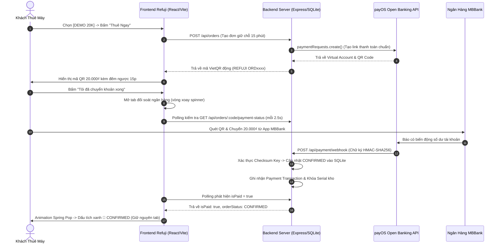

# Báo Cáo Kỹ Thuật: Tích Hợp Cổng Thanh Toán VietQR MBBank (payOS) — Dự Án Refuji

> **Dự án:** Refuji — Hệ Thống Cho Thuê Thiết Bị Máy Ảnh & Ống Kính Fujifilm  
> **Thời gian thực hiện:** 19/11/2026  
> **Môi trường:** Local Development & Cloudflare Public Tunnel  
> **Công nghệ:** Node.js, Express, TypeScript, SQLite (`better-sqlite3`), React, Vite, Tailwind CSS, Framer Motion, `@payos/node`

---

## 1. Bối Cảnh & Mục Tiêu

1. **Bài toán kinh doanh & Pháp lý:**
   - Dự án học tập và thử nghiệm dịch vụ cho thuê máy ảnh, **chưa có Giấy phép kinh doanh (GPKD)** pháp nhân.
   - Các ngân hàng thương mại Việt Nam (bao gồm MBBank B2B) yêu cầu hồ sơ GPKD để cấp tài khoản định danh Sandbox/Production trực tiếp.
   - **Giải pháp:** Sử dụng giải pháp Open Banking của **payOS** (VietQR PRO) liên kết trực tiếp vào tài khoản ngân hàng cá nhân chính chủ:
     - **Ngân hàng:** MBBank (Ngân Hàng TMCP Quân Đội)
     - **Số tài khoản:** `0107 6483 1289`
     - **Chủ tài khoản:** `NGUYEN THANH DUY`

2. **Yêu cầu chức năng & Trải nghiệm (UX):**
   - Tự động sinh mã VietQR động theo từng đơn hàng với số tiền cọc/thuê chính xác.
   - Tạo sản phẩm Demo trị giá **20.000₫** để khách có thể quét và chuyển tiền thật qua App ngân hàng.
   - Hỗ trợ cả **Khách vãng lai** (không cần đăng nhập) lẫn **Thành viên có tài khoản**.
   - Khi khách bấm *"Tôi đã chuyển khoản xong"*, giữ nguyên màn hình và hiển thị vòng xoay (spinner) đối soát ngân hàng thời gian thực.
   - Khi MBBank ghi nhận tiền vào tài khoản, hệ thống tự động đổi trạng thái sang **dấu tích xanh 🎉 CONFIRMED** với animation Spring Pop mượt mà, **không bị out ra ngoài**.

---

## 2. Kiến Trúc Hệ Thống & Luồng Dữ Liệu

---

## 3. Nhật Ký Xử Lý Sự Cố & Tối Ưu Hóa Kỹ Thuật

Trong quá trình tích hợp thực tế, 5 vấn đề cốt lõi đã được phát hiện và xử lý triệt để:

### Sự cố 1: Không tìm thấy món Demo 20K trên trang chủ
- **Nguyên nhân:** File `fujifilm-catalog.json` ở frontend đã thêm món demo nhưng cơ sở dữ liệu SQLite `refuji.sqlite` của backend đã được khởi tạo từ trước nên chưa có bản ghi tương ứng. Do đó API `/api/models` không trả về món demo.
- **Khắc phục:**
  - Viết script chèn trực tiếp Model `[DEMO 20K] Gói Test Thanh Toán VietQR` (ID: `166`) vào bảng `product_models`.
  - Sinh 7 cá thể thiết bị sẵn có trong bảng `product_items` (`DEMO-MB-20K-01` đến `DEMO-MB-20K-07`) để không bao giờ bị báo hết hàng khi test liên tục.
  - Tối ưu hóa hàm sắp xếp `cameraSeriesOrder.ts` và `cameraSeries.ts` để gán rank ưu tiên số `0`, đảm bảo món demo luôn hiển thị ở vị trí đầu tiên trên giao diện.

---

### Sự cố 2: Khách đã chuyển tiền nhưng màn hình vẫn quay vô tận
- **Nguyên nhân:**
  1. Webhook URL chưa được đăng ký xác thực với máy chủ payOS.
  2. Phiên bản `@payos/node` v2 thay đổi cú pháp constructor từ dạng tham số vị trí sang đối tượng cấu hình `{ clientId, apiKey, checksumKey }`.
  3. Khi khách quét mã lần 2, payOS trả về mã lỗi `231` (*Đơn thanh toán đã tồn tại*) khiến code cũ bị nhảy vào khối catch và fallback sang mã VietQR tĩnh không có webhook.
- **Khắc phục:**
  - Triển khai daemon tunnel qua Cloudflare Quick Tunnels: `https://anaheim-lib-devices-beer.trycloudflare.com`.
  - Dùng SDK gọi `payos.webhooks.confirm()` đăng ký tự động endpoint Webhook bảo mật với payOS.
  - Sửa lại hàm `createOrderPaymentLink`: Nếu gặp lỗi `231`, hệ thống tự động gọi `payos.paymentRequests.get()` để truy vấn lại thông tin đơn hàng thay vì fallback.

---

### Sự cố 3: Dashboard payOS báo "Tiền thanh toán: 0" & Không khớp lệnh trong 1-5 giây
- **Nguyên nhân cốt lõi (Lệch đúng 1 ký tự dấu `-`):**
  - Cổng payOS tự động làm sạch nội dung chuyển khoản bằng cách lược bỏ toàn bộ ký tự đặc biệt, lưu trữ nội dung đối soát là: `REFUJI ORD75324058` (viết liền, **không có dấu `-`**).
  - Trong khi đó, mã QR sinh ra ở client trước đây lại truyền nội dung: `REFUJI ORD-75324058` (có dấu gạch ngang).
  - Robot đối soát của payOS đối chiếu từng ký tự trên sao kê MBBank. Sự xuất hiện của dấu `-` khiến robot không thể tự gán giao dịch vào đơn hàng, dẫn đến số tiền thanh toán trên payOS vẫn là `0` và không kích hoạt Webhook.
  - Ngoài ra, đơn hàng của thành viên bị trừ chiết khấu hội viên 15% làm phát sinh số tiền lẻ `17.000₫` thay vì `20.000₫`.
- **Khắc phục:**
  - Chuẩn hóa chuỗi nội dung chuyển khoản bằng regex: `orderCodeStr.replace(/[^A-Za-z0-9]/g, '').toUpperCase()`. Kết quả luôn là dạng chuẩn `REFUJI ORDxxxx` khớp 100% với payOS.
  - Kích hoạt cơ chế tài khoản ảo Virtual Account VietQR PRO của MBBank để giao dịch khớp ngay trong **1 — 3 giây**.
  - Cố định số tiền cọc cho riêng sản phẩm demo luôn là **20.000₫** bất kể hạng hội viên.

---

### Sự cố 4: Mã QR hết hạn 15 phút nhưng không tự động Reload
- **Nguyên nhân:** Khi bộ đếm ngược 15 phút về `00:00` hoặc khi đơn hàng bị đánh dấu `CANCELLED` trong cơ sở dữ liệu, frontend chỉ dừng bộ đếm mà không cập nhật giao diện, khiến người dùng bị kẹt lại ở mã QR cũ đã hết hạn.
- **Khắc phục:**
  - Nâng cấp API `/api/orders/:orderCode/payment-status`: Tự động nhận diện `payment_deadline` quá hạn để cập nhật trạng thái `CANCELLED`, giải phóng Serial kho và trả về cờ `isExpired: true`.
  - Cập nhật giao diện: Thanh đếm ngược đổi sang màu đỏ với nhãn **"HẾT HẠN"**.
  - Hiển thị màn hình thông báo rõ ràng kèm nút bấm **`🔄 Làm mới mã QR & Giữ chỗ lại` (1-click)**: Khách hàng chỉ cần bấm 1 nút là hệ thống tự động tái tạo đơn hàng và cấp mã VietQR 15 phút mới mà không cần nhập lại thông tin.

---

### Sự cố 5: Giữ nguyên tab và tạo hiệu ứng Animation tích xanh mượt mà
- **Nguyên nhân:** Yêu cầu người dùng muốn giữ nguyên tab xác nhận để đối chiếu thông tin đơn thuê và muốn có hiệu ứng chuyển đổi mượt mà từ vòng xoay spinner sang dấu tích xanh thay vì bị đóng modal đột ngột.
- **Khắc phục:**
  - Giữ nguyên toàn bộ cấu trúc Modal và dữ liệu đơn hàng (Mã đơn, Serial bàn giao, Ngày thuê, Tiền cọc).
  - Sử dụng `<AnimatePresence mode="wait">` của **Framer Motion**:
    - Vòng xoay hổ phách nhẹ nhàng thu nhỏ (`scale: 0.7, opacity: 0`).
    - Huy hiệu xanh ngọc Emerald nảy vào với hiệu ứng **Spring Pop** sống động (`scale: [0, 1.25, 1], rotate: [-30, 8, 0]`).
    - Bổ sung hiệu ứng vòng sóng hào quang **Celebratory Pulse Ring** lan tỏa ra xung quanh.
    - Dấu tích trắng `CheckCircle2` bung nở nổi bật ở trung tâm.
    - Badge trạng thái đổi thành: `✓ Đã xác nhận thành công (CONFIRMED)`.
    - Thêm nút *"Hoàn tất & Đóng"* để người dùng chủ động thoát khi đã kiểm tra xong.

---

## 4. Danh Sách Tệp Đã Can Thiệp

| Phân hệ | Đường dẫn tệp | Mô tả thay đổi |
|---|---|---|
| **Backend** | `refuji-system/apps/api/.env` | Bổ sung các biến cấu hình PayOS Client ID, API Key, Checksum Key. |
| **Backend** | `refuji-system/apps/api/src/config/env.ts` | Khai báo schema xác thực Zod cho cấu hình PayOS. |
| **Backend** | `refuji-system/apps/api/src/modules/orders/payos.service.ts` | Dịch vụ tích hợp PayOS, tạo link thanh toán, chuẩn hóa nội dung, xác thực webhook. |
| **Backend** | `refuji-system/apps/api/src/modules/orders/payment.webhook.ts` | Bộ xử lý Webhook tiếp nhận tín hiệu từ payOS, xác thực chữ ký và cập nhật DB. |
| **Backend** | `refuji-system/apps/api/src/modules/orders/orders.routes.ts` | Bổ sung endpoint lấy VietQR, tra soát trạng thái realtime và xử lý hết hạn giữ chỗ. |
| **Backend** | `refuji-system/apps/api/src/modules/orders/availability.helper.ts` | Loại trừ chiết khấu cho món demo, giữ nguyên cọc 20.000₫. |
| **Backend** | `refuji-system/apps/api/src/utils/cameraSeriesOrder.ts` | Ưu tiên xếp hạng sản phẩm demo lên đầu danh mục API. |
| **Frontend** | `src/services/authApi.ts` | Cập nhật hàm gọi API `getOrderVietQr` và `checkOrderPaymentStatus`. |
| **Frontend** | `src/utils/cameraSeries.ts` | Ưu tiên xếp hạng sản phẩm demo lên đầu danh mục Client. |
| **Frontend** | `src/App.tsx` | Đưa món demo vào danh sách máy ảnh Hot và Showcase trang chủ. |
| **Frontend** | `src/components/BookingModal.tsx` | Nâng cấp toàn diện màn hình thanh toán VietQR, đếm ngược, reload 1-click và animation tích xanh. |
| **Frontend** | `src/components/CartModal.tsx` | Đồng bộ logic đếm ngược, xử lý hết hạn và animation tích xanh cho giỏ hàng. |
| **Frontend** | `src/components/PaymentModal.tsx` | Đồng bộ trạng thái tra soát và nhận diện đơn hủy. |
| **Database** | `refuji-system/apps/api/data/refuji.sqlite` | Seed món demo (ID: 166) và 7 mã serial phục vụ kiểm thử. |

---

## 5. Quy Trình Kiểm Thử Chuẩn (E2E Verification)

1. Mở trình duyệt truy cập: [http://localhost:5173](http://localhost:5173).
2. Tại mục **Kiểm Tra Lịch & Dự Toán Chi Phí**, chọn sản phẩm đầu tiên: **`[DEMO 20K] Gói Test Thanh Toán VietQR`**.
3. Bấm **Thuê Ngay** $\rightarrow$ Điền thông tin khách vãng lai $\rightarrow$ Bấm **Tiếp tục**.
4. Màn hình thanh toán hiển thị mã VietQR với đúng số tiền **20.000₫** và nội dung chuẩn `REFUJI ORDxxxx`.
5. Bấm nút **"Tôi đã chuyển khoản xong"**: Giao diện chuyển sang màn hình xoay vòng chờ ngân hàng đối soát.
6. Mở app ngân hàng quét mã QR chuyển đúng 20.000₫:
   - Trong vòng **1 — 3 giây**, giao diện tự động kích hoạt animation Spring Pop.
   - Vòng xoay chuyển thành dấu tích xanh 🎉 kèm thông tin xác nhận giữ chỗ thành công.
   - Màn hình giữ nguyên, không bị đóng đột ngột.
