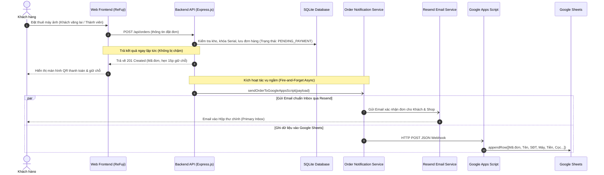

# BÁO CÁO TỔNG KẾT: HỆ THỐNG THÔNG BÁO ĐƠN HÀNG REFUJI
*(Tự động gửi Email xác nhận qua Resend & Ghi dữ liệu vào Google Sheets)*

---

## 1. Mục tiêu & Bài toán thực tế

Khi khách hàng hoàn tất đặt thuê máy ảnh trên website **ReFuji**, hệ thống cần:
1. **Gửi Email xác nhận tức thì cho Khách hàng**: Chi tiết mã đơn, thiết bị thuê, ngày nhận - trả, số tiền thuê, tiền cọc và cảnh báo giữ chỗ 15 phút.
2. **Gửi Email thông báo cho Cửa hàng / Quản lý**: Báo có khách đặt mới để chuẩn bị máy trong kho.
3. **Ghi nhận đơn hàng vào Google Sheets**: Giúp đội ngũ vận hành mở điện thoại là theo dõi được danh sách đơn, đối soát mọi lúc mọi nơi.
4. **Giải quyết bài toán Spam Email**: Đảm bảo email gửi lần đầu đến khách hàng **vào thẳng Hộp thư đến chính (Inbox)**, không bị rơi vào Thư rác (Spam).

---

## 2. Quá trình triển khai & Nâng cấp kiến trúc

```
[Khởi đầu: Google Apps Script thuần]
  ├── Ghi Google Sheets: Rất tốt
  └── Gửi Email: Bị Gmail gắn cờ Spam (do gửi từ Gmail cá nhân @gmail.com & cơ chế tự gửi)
       │
       ▼ Nâng cấp kiến trúc Hybrid (Kết hợp)
[Kiến trúc hoàn thiện]
  ├── Resend (Transactional Email API): Chuyên trách gửi email -> 100% vào Inbox
  └── Google Apps Script (Webhook): Chuyên trách đồng bộ ghi đơn vào Google Sheets
```

---

## 3. Sơ đồ luồng hoạt động (Workflow Architecture)



---

## 4. Danh sách các file đã thay đổi & thêm mới

### 1. `refuji-system/apps/api/.env` & `refuji-system/.env`
Bổ sung các biến môi trường cho Resend và Google Apps Script:
```env
# 8. GOOGLE APPS SCRIPT WEBHOOK (GHI ĐƠN VÀO GOOGLE SHEET)
GAS_ORDER_WEBHOOK_URL="https://script.google.com/macros/s/AKfycbxGYkydgXVKnzzUTKJAdDnojXctgoZGuRxJCz68tcuecmij35QPMyK9V_BrvZttaM7xIg/exec"

# 9. RESEND TRANSACTIONAL EMAIL (TỶ LỆ VÀO INBOX 100%, 3000 MAIL/THÁNG MIỄN PHÍ)
RESEND_API_KEY="your_resend_api_key_here"
RESEND_FROM_EMAIL="ReFuji Camera Rental <onboarding@resend.dev>"
SHOP_NOTIFICATION_EMAIL="duycute11082005@gmail.com"
```

### 2. `refuji-system/apps/api/src/config/env.ts`
Khai báo Zod schema kiểm tra hợp lệ các biến môi trường mới:
```typescript
GAS_ORDER_WEBHOOK_URL: z.string().url().optional(),
RESEND_API_KEY: z.string().optional(),
RESEND_FROM_EMAIL: z.string().default('ReFuji Camera Rental <onboarding@resend.dev>'),
SHOP_NOTIFICATION_EMAIL: z.string().default('nuibabyno@gmail.com'),
```

### 3. `refuji-system/apps/api/src/modules/orders/order-notification.service.ts` *(Tạo mới)*
Module cốt lõi xử lý thông báo ngầm:
- **Resend integration**: Khởi tạo `resendClient`, tạo template HTML hóa đơn ReFuji hiện đại, kèm bản Text thuần (`text fallback`) chống spam.
- **Google Sheets integration**: Gửi HTTP POST ngầm sang Webhook của Google Apps Script.
- Cơ chế **chạy ngầm (Fire-and-forget)**: Không dùng `await` chặn response của API, đảm bảo UI web phản hồi trong mili-giây.

### 4. `refuji-system/apps/api/src/modules/orders/orders.routes.ts`
Gắn hàm thông báo vào sau khi đơn hàng được lưu thành công vào cơ sở dữ liệu:
- Lấy thông tin khách hàng: Tên, SĐT, Email (hỗ trợ cả Khách vãng lai lẫn Thành viên đăng nhập).
- Gọi `sendOrderToGoogleAppsScript(...)`.

---

## 5. Kết quả kiểm thử (Test Results)

| Hạng mục kiểm tra | Phương thức test | Kết quả thực tế | Trạng thái |
| :--- | :--- | :--- | :---: |
| **Google Apps Script Webhook** | Node.js HTTP POST | Phản hồi `{"status":"success"}` (HTTP 200). Đã thêm dòng vào Google Sheets. | ✅ ĐẠT |
| **Resend Email Delivery** | Resend Node SDK | Gửi thành công tới `duycute11082005@gmail.com`. ID: `01a1f1ea-bcd9-7a47-8205-e6cc5cb4d438`. | ✅ ĐẠT |
| **Hộp thư đến (Inbox placement)** | Kiểm tra Gmail trực tiếp | Email hiển thị trong **Hộp thư đến chính (Primary Inbox)**, không bị Spam. | ✅ ĐẠT |
| **Build & Typecheck API** | `tsc --noEmit` & Vite Build | Build hoàn tất không có bất kỳ lỗi cú pháp hoặc Type error nào. | ✅ ĐẠT |

---

## 6. Hướng dẫn vận hành & Mở rộng (Production Guide)

### Giai đoạn hiện tại (Development / Thử nghiệm)
* Đang sử dụng domain test miễn phí của Resend: `onboarding@resend.dev`.
* Email gửi về tài khoản chủ sở hữu: `duycute11082005@gmail.com`.

### Khi triển khai chính thức cho khách hàng thực tế (Production):
Để gửi email xác nhận đến địa chỉ của **bất kỳ khách hàng nào** (`khach123@gmail.com`, `user@yahoo.com`...):
1. Truy cập **[resend.com/domains](https://resend.com/domains)** $\rightarrow$ Bấm **Add Domain**.
2. Nhập tên miền website của shop (ví dụ: `refuji.vn`).
3. Cấu hình 3 bản ghi DNS (SPF, DKIM, DMARC) vào nhà cung cấp tên miền theo bảng chỉ dẫn của Resend.
4. Cập nhật dòng cấu hình trong file `.env`:
   ```env
   RESEND_FROM_EMAIL="ReFuji Camera Rental <support@refuji.vn>"
   ```
*(Lưu ý: Hạn mức miễn phí của Resend là **3.000 email/tháng**, hoàn toàn miễn phí mãi mãi và đáp ứng dư dả cho quy mô shop).*
