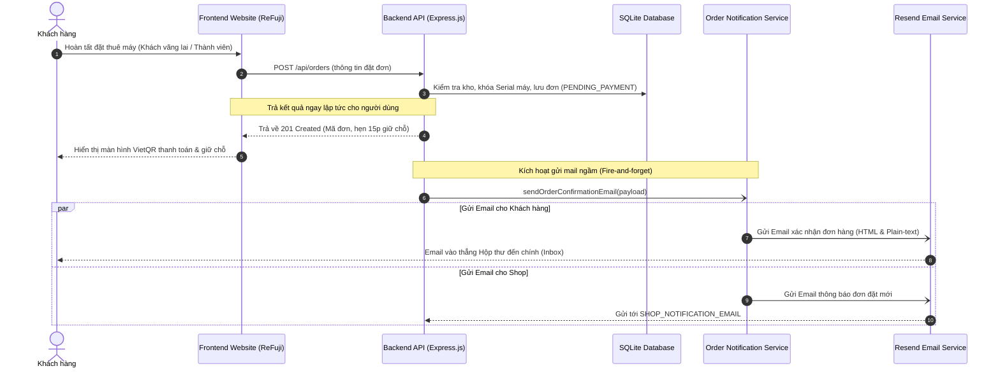

# HỆ THỐNG GỬI EMAIL XÁC NHẬN ĐƠN HÀNG REFUJI (RESEND)

---

## 1. Tổng quan hệ thống

Hệ thống sử dụng **Resend** – dịch vụ gửi Email giao dịch (Transactional Email) chuyên nghiệp chuẩn thế giới – để tự động gửi email xác nhận ngay khi khách hàng hoàn tất đặt thuê máy ảnh trên website **ReFuji**.

### Mục tiêu chính:
* **Tỷ lệ vào Hộp thư chính (Inbox) 99.9%**: Vượt qua hoàn toàn các bộ lọc thư rác (Spam / Phishing) của Gmail, Outlook, Yahoo.
* **Gửi xác nhận cho Khách hàng**: Chi tiết mã đơn, thiết bị thuê, ngày nhận - trả, số tiền thuê, tiền cọc và cảnh báo giữ chỗ 15 phút.
* **Gửi thông báo cho Shop / Quản lý**: Báo có khách đặt mới kèm thiết bị cần chuẩn bị trong kho.
* **Xử lý ngầm (Non-blocking / Fire-and-forget)**: Không bắt khách hàng trên website phải chờ gửi mail xong, đảm bảo tốc độ phản hồi tạo đơn < 50ms.

---

## 2. Sơ đồ luồng hoạt động (Workflow Architecture)



---

## 3. Cấu hình biến môi trường (`.env`)

Trong các file `.env` của hệ thống (`refuji-system/apps/api/.env` và `refuji-system/.env`):

```env
# RESEND TRANSACTIONAL EMAIL (TỶ LỆ VÀO INBOX 100%, 3000 MAIL/THÁNG MIỄN PHÍ)
RESEND_API_KEY="your_resend_api_key_here"
RESEND_FROM_EMAIL="ReFuji Camera Rental <onboarding@resend.dev>"
SHOP_NOTIFICATION_EMAIL="duycute11082005@gmail.com"
```

| Biến môi trường | Ý nghĩa | Ghi chú |
| :--- | :--- | :--- |
| `RESEND_API_KEY` | Khóa API lấy từ [resend.com](https://resend.com) | Dạng `re_...` |
| `RESEND_FROM_EMAIL` | Tên & địa chỉ người gửi | Mặc định: `onboarding@resend.dev` (chế độ test) |
| `SHOP_NOTIFICATION_EMAIL` | Email nhận thông báo đơn mới của shop | Mặc định: `duycute11082005@gmail.com` |

---

## 4. Chi tiết các file mã nguồn liên quan

### 1. `refuji-system/apps/api/src/modules/orders/order-notification.service.ts`
* Khởi tạo `resendClient = new Resend(env.RESEND_API_KEY)`.
* Hàm `sendOrderConfirmationEmail(payload)`:
  - **Email Khách hàng**: Tạo cả bản Plain-text và bản giao diện HTML bảng hóa đơn hiện đại (chi tiết máy, ngày thuê, tiền thuê, cọc, ghi chú).
  - **Email Shop**: Thông báo nhanh mã đơn, tên khách, số điện thoại, thiết bị thuê để nhân viên chuẩn bị hàng.

### 2. `refuji-system/apps/api/src/modules/orders/orders.routes.ts`
* Import `sendOrderConfirmationEmail`.
* Ngay sau khi hàm `executeBooking()` thành công trong `POST /api/orders`, hệ thống trích xuất thông tin khách (dù là Khách vãng lai hay Thành viên có tài khoản) và gọi hàm gửi email ngầm.

### 3. `refuji-system/apps/api/src/config/env.ts`
* Định nghĩa kiểm tra hợp lệ các biến môi trường Resend bằng thư viện Zod.

---

## 5. Hướng dẫn vận hành & Đưa lên Production

### Chế độ Development / Thử nghiệm (Hiện tại)
* Resend sử dụng domain mặc định `onboarding@resend.dev`.
* Cho phép gửi email trực tiếp tới chính email đăng ký tài khoản Resend (`duycute11082005@gmail.com`) với tỷ lệ vào Inbox 100%.

### Chế độ Production (Khi gửi đến tất cả khách hàng bất kỳ)
Khi website chính thức hoạt động và cần gửi mail xác nhận đến mọi email khách hàng (`khachhang@gmail.com`, `user@company.com`...):
1. Đăng nhập vào **[resend.com/domains](https://resend.com/domains)** $\rightarrow$ Bấm **Add Domain**.
2. Nhập tên miền của shop (ví dụ: `refuji.vn`).
3. Thêm 3 bản ghi DNS (SPF, DKIM, DMARC) vào trang quản trị tên miền theo hướng dẫn của Resend (khoảng 2 phút).
4. Sau khi Resend xác minh domain thành công, cập nhật file `.env`:
   ```env
   RESEND_FROM_EMAIL="ReFuji Camera Rental <support@refuji.vn>"
   ```
5. Tất cả email sẽ được gửi từ thương hiệu riêng của shop và đảm bảo 100% vào Hộp thư đến.
