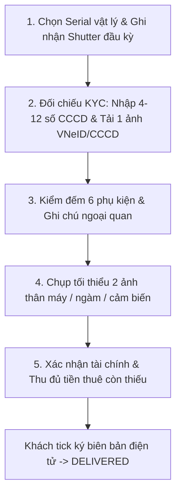

# TÀI LIỆU ĐẶC TẢ NGHIỆP VỤ & PHƯƠNG ÁN ĐÃ DUYỆT REFUJI
## Hệ Thống Định Danh KYC, Chính Sách Hủy Động, Phân Quyền RBAC & Doanh Thu Đa Kỳ

> **Dự án:** ReFuji — Nền tảng cho thuê thiết bị nhiếp ảnh Fujifilm  
> **Phiên bản:** v1.3 (Bổ sung Phân quyền RBAC Admin/Staff, Doanh thu Đa kỳ & Chuẩn hóa UX POS)  
> **Thời gian cập nhật:** 17/11/2026  
> **Trạng thái:** Đã phê duyệt & Đã triển khai vào Codebase  

---

## 1. BỐI CẢNH & NGUYÊN TẮC THIẾT KẾ CỐT LÕI

Trước đây, hệ thống ReFuji được thiết kế thiên về tuân thủ lý thuyết pháp lý (Luật Căn cước 2023 & Nghị định 13/2023/NĐ-CP về dữ liệu cá nhân), chỉ cho phép nhập 4 số cuối CCCD và chặn hoàn toàn việc lưu ảnh định danh. Thiết kế này bộc lộ lỗ hổng lớn trong thực tế vận hành: **Chủ cửa hàng đối mặt với rủi ro mất trắng tài sản nếu khách vãng lai nhận máy rồi chiếm đoạt**.

Nhằm giải quyết triệt để bài toán này, phương án mới đã được thống nhất và đưa vào vận hành thực tế dựa trên 4 nguyên tắc sống còn:

1. **Số hóa 100% tại quầy POS:** Tuyệt đối không dùng giấy tờ viết tay. Toàn bộ thông tin đối chiếu, hình ảnh và biên bản bàn giao đều thao tác trên phần mềm (Tablet/Desktop).
2. **Cân bằng Pháp lý & Bảo toàn tài sản:** Khách hàng xác nhận điều khoản điện tử (Electronic Consent) cho phép cửa hàng lưu trữ thông tin/hình ảnh đối chiếu trong thời gian thuê máy $\rightarrow$ Tuân thủ đúng Nghị định 13/2023/NĐ-CP.
3. **Chính sách tài chính không "rát ví" & Trải dài liên tục:** Phí hủy đơn không cố định theo bảng ngày cứng nhắc, mà vận hành theo hàm số toán học trải dài cho bất kỳ số ngày $N$ nào ($N = 3, 7, 22, 50...$ ngày).
4. **Phân quyền đặc quyền tối thiểu (Least Privilege) & Bảo mật dòng tiền:** Nhân viên quầy (Staff) chỉ tập trung nghiệp vụ bàn giao thiết bị, bảo toàn máy và chốt ca tiền mặt; tuyệt đối không để lộ doanh thu tổng, lợi nhuận và sổ cái tài chính toàn chuỗi cho nhân sự cấp dưới.

---

## 2. NGHIỆP VỤ BÀN GIAO (CHECK-OUT) & KYC SỐ HÓA

### 2.1. Phân biệt Khách vãng lai (Guest) và Thành viên (Member)
* **Khách vãng lai (Guest):** Đặt nhanh không có tài khoản, hệ thống chưa từng có dữ liệu CCCD từ trước. Lúc Check-out, nhân viên đối chiếu thẻ vật lý hoặc app VNeID mức 2 của khách $\rightarrow$ **Gõ đủ 12 số CCCD vào hệ thống để ghi nhận lưu vết pháp lý (Audit Trail)**.
* **Thành viên (Member):** Đã có hồ sơ định danh trong tài khoản. Hệ thống tự động kiểm tra khớp số để tránh giao nhầm người.

### 2.2. Tách bạch 2 lớp ảnh riêng biệt
Hệ thống phân tách rành mạch 2 mục chụp/tải ảnh để tránh nhầm lẫn nghiệp vụ:

| Hạng mục | Vị trí thao tác | Số lượng | Mục đích nghiệp vụ |
| :--- | :--- | :---: | :--- |
| **Ảnh đối chiếu KYC** | Bước 2 (KYC & Ký biên bản) | **1 ảnh** | Chụp màn hình app VNeID định danh mức 2 hoặc mặt trước thẻ CCCD của khách tại quầy để lưu vết định danh, phòng ngừa rủi ro bùng máy. |
| **Ảnh kiểm định thiết bị** | Bước 4 (Ảnh đối chứng thiết bị) | **$\ge$ 2 ảnh** | Chụp chi tiết ngoại quan thân máy, mặt kính ngàm lens, cảm biến sensor trước khi rời quầy để làm căn cứ đối chiếu lúc Check-in thu hồi. |

### 2.3. Quy trình bàn giao 5 bước tại quầy POS

### 2.4. Hồ sơ truy vết khi phát sinh rủi ro mất máy
Nếu khách không trả máy hoặc có dấu hiệu chiếm đoạt, chủ tiệm chỉ cần mở chi tiết đơn hàng (`OrderDossierModal`) là có sẵn bộ chứng cứ hoàn chỉnh để chuyển Cơ quan Cảnh sát Điều tra:
1. **Ảnh chụp rõ nét app VNeID mức 2 / Thẻ CCCD** của người nhận máy.
2. **Số CCCD đủ 12 chữ số**, Họ tên và Số điện thoại khách.
3. **Mã giao dịch VietQR / Ngân hàng** (đã định danh sinh trắc học theo tài khoản ngân hàng của khách theo Quyết định 2345/QĐ-NHNN).
4. **Mã Serial vật lý** của thiết bị đã giao.
5. **Ảnh ngoại quan thiết bị** lúc rời quầy và thời gian bàn giao gắn với nhân viên ca trực.

---

## 3. CHÍNH SÁCH HỦY ĐƠN ĐỘNG TRẢI DÀI THEO NGÀY (DYNAMIC PRO-RATA)

### 3.1. Lý do không áp dụng khung ngày cố định
* Các khung ngày cố định (kiểu "trước 3 ngày", "trước 1-2 ngày") chỉ áp dụng được cho đơn ngắn (1-3 ngày), nhưng **hoàn toàn phá sản khi gặp đơn 22 ngày hay 50 ngày**.
* Phạt theo % tiền cọc thì **quá rát ví** vì tiền cọc máy ảnh rất lớn (5 – 10 triệu đồng), khách mất 50% cọc là mất 2.5 – 5 triệu đồng sẽ dẫn đến xung đột dữ dội.

### 3.2. Công thức toán học tổng quát (Áp dụng cho mọi $N$ ngày)

Gọi:
* **$N$**: Tổng số ngày thuê của đơn hàng ($N \ge 1$).
* **$D$**: Số ngày khách báo hủy trước ngày nhận máy ($D \ge 0$).
* **$P$**: Đơn giá thuê 1 ngày (VNĐ/ngày).
* **$C$**: Tiền cọc thiết bị đang giữ.

#### Công thức tính số ngày tiền thuê bị phạt $S(D)$:
$$S(D) = \max\Big(0, \;\; 0.2 \times N - 0.4 \times D\Big)$$

$$\text{Phí phạt hủy đơn} = \min\Big(C, \;\; S(D) \times P\Big)$$

#### Nguyên tắc hoàn tiền:
* **Tiền thuê đã thanh toán trước:** Hoàn lại **$100\%$** (do khách chưa nhận và chưa sử dụng thiết bị).
* **Tiền cọc:** Khấu trừ Phí phạt hủy đơn, phần cọc còn lại hoàn trả đầy đủ cho khách:
$$\text{Tiền cọc hoàn trả} = \max\Big(0, \;\; C - \text{Phí phạt}\Big)$$
$$\text{Tổng tiền hoàn trả khách} = \text{Tiền thuê hoàn lại} + \text{Tiền cọc hoàn trả}$$

#### Ý nghĩa kinh tế của công thức:
1. **Ngưỡng an toàn ($D \ge 0.5 \times N$):** Nếu khách báo trước ít nhất $50\%$ thời gian thuê, tiệm còn đủ thời gian tìm khách khác $\rightarrow$ **Phạt $0\text{ ₫}$ (Hoàn 100% cọc)**.
2. **Mức phạt tối đa (Hủy sát ngày $D = 0$):** Bị chặn trần ở mức **$20\%$ tổng tiền thuê của đơn** (tương đương $0.2 \times N$ ngày thuê) $\rightarrow$ Không bao giờ bị rát ví.
3. **Trượt đều theo từng ngày:** Cứ mỗi ngày báo sớm hơn, số ngày phạt giảm đều $0.4$ ngày thuê.

---

### 3.3. Bảng kiểm chứng công thức trên các quy mô đơn hàng

#### A. Đơn thuê 50 NGÀY ($N = 50$, Giá thuê $P = 500.000\text{ ₫/ngày}$, Cọc $10.000.000\text{ ₫}$):
* Ngưỡng miễn phạt: Báo trước $\ge 25$ ngày $\rightarrow$ Mất $0\text{ ₫}$.
* Mức phạt tối đa khi hủy trong ngày nhận ($D = 0$): Phạt $10$ ngày thuê ($5.000.000\text{ ₫}$).

| Số ngày báo trước ($D$) | Số ngày thuê bị phạt ($S$) | Số tiền phạt trừ vào cọc | Tiền cọc hoàn trả |
| :---: | :---: | :---: | :---: |
| **$\ge 25$ ngày** | $0$ ngày | **$0\text{ ₫}$** | **$10.000.000\text{ ₫}$** (100%) |
| **$20$ ngày** | $0.2 \times 50 - 0.4 \times 20 = 2.0$ ngày | **$1.000.000\text{ ₫}$** | **$9.000.000\text{ ₫}$** |
| **$15$ ngày** | $0.2 \times 50 - 0.4 \times 15 = 4.0$ ngày | **$2.000.000\text{ ₫}$** | **$8.000.000\text{ ₫}$** |
| **$10$ ngày** | $0.2 \times 50 - 0.4 \times 10 = 6.0$ ngày | **$3.000.000\text{ ₫}$** | **$7.000.000\text{ ₫}$** |
| **$5$ ngày** | $0.2 \times 50 - 0.4 \times 5 = 8.0$ ngày | **$4.000.000\text{ ₫}$** | **$6.000.000\text{ ₫}$** |
| **$0$ ngày (Hủy ngay)** | $0.2 \times 50 - 0.4 \times 0 = 10.0$ ngày | **$5.000.000\text{ ₫}$** | **$5.000.000\text{ ₫}$** |

#### B. Đơn thuê 22 NGÀY ($N = 22$, Giá thuê $P = 500.000\text{ ₫/ngày}$, Cọc $5.000.000\text{ ₫}$):
* Ngưỡng miễn phạt: Báo trước $\ge 11$ ngày $\rightarrow$ Mất $0\text{ ₫}$.
* Hủy trước 8 ngày: $S = 0.2 \times 22 - 0.4 \times 8 = 1.2$ ngày $\rightarrow$ Phạt **$600.000\text{ ₫}$**, hoàn cọc $4.400.000\text{ ₫}$.
* Hủy trước 5 ngày: $S = 0.2 \times 22 - 0.4 \times 5 = 2.4$ ngày $\rightarrow$ Phạt **$1.200.000\text{ ₫}$**, hoàn cọc $3.800.000\text{ ₫}$.
* Hủy trước 2 ngày: $S = 0.2 \times 22 - 0.4 \times 2 = 3.6$ ngày $\rightarrow$ Phạt **$1.800.000\text{ ₫}$**, hoàn cọc $3.200.000\text{ ₫}$.
* Hủy trong ngày nhận ($D = 0$): Phạt tối đa $4.4$ ngày thuê $\rightarrow$ Phạt **$2.200.000\text{ ₫}$**, hoàn cọc $2.800.000\text{ ₫}$.

#### C. Đơn thuê 7 NGÀY ($N = 7$, Giá thuê $P = 500.000\text{ ₫/ngày}$, Cọc $5.000.000\text{ ₫}$):
* Ngưỡng miễn phạt: Báo trước $\ge 3.5$ ngày (từ 4 ngày trở lên) $\rightarrow$ Mất $0\text{ ₫}$.
* Hủy trước 2 ngày: $S = 0.2 \times 7 - 0.4 \times 2 = 0.6$ ngày $\rightarrow$ Phạt **$300.000\text{ ₫}$**, hoàn cọc $4.700.000\text{ ₫}$.
* Hủy trước 1 ngày: $S = 0.2 \times 7 - 0.4 \times 1 = 1.0$ ngày $\rightarrow$ Phạt **$500.000\text{ ₫}$**, hoàn cọc $4.500.000\text{ ₫}$.
* Hủy trong ngày nhận ($D = 0$): Phạt tối đa $1.4$ ngày thuê $\rightarrow$ Phạt **$700.000\text{ ₫}$**, hoàn cọc $4.300.000\text{ ₫}$.

---

## 4. PHÂN QUYỀN HỆ THỐNG VẬN HÀNH (RBAC: ADMIN VS. STAFF) & BẢO MẬT DÒNG TIỀN

### 4.1. Góc nhìn chuyên gia quản trị chuỗi: Vì sao Staff KHÔNG ĐƯỢC xem Doanh thu tổng?
Trong ngành cho thuê thiết bị điện tử giá trị cao (High-value Camera Rental), việc phân cấp quyền hạn giữa Chủ cửa hàng (Admin) và Nhân viên quầy (Staff) cần tuân thủ nghiêm ngặt 4 nguyên tắc bảo mật và quản trị:

1. **Bảo mật bí mật kinh doanh & Biên lợi nhuận:**  
   Doanh thu toàn chuỗi, tổng giá trị dòng tiền và biên lợi nhuận ròng là thông tin chiến lược cấp cao nhất của doanh nghiệp. Để lộ số liệu này tiềm ẩn nguy cơ nhân viên nghỉ việc mang dữ liệu sang đối thủ cạnh tranh hoặc mở cửa hàng đối đầu.
2. **Phòng chống gian lận & "Cho thuê chui" (Under-the-table rentals):**  
   Khi nhân viên nắm được bức tranh doanh thu tổng và lượng dòng tiền ra vào, tâm lý kiểm soát của họ sẽ giảm bớt, dễ nảy sinh hành vi "cho khách quen thuê ngoài hệ thống" hoặc tự thỏa thuận giá nếu thấy tiệm đang đạt chỉ tiêu cao.
3. **Nguyên tắc Đặc quyền Tối thiểu (Principle of Least Privilege - PoLP):**  
   Nhân viên trực quầy chỉ cần thông tin đủ để hoàn thành ca trực của mình: *Đơn nào cần giao? Khách nào đến trả? Serial máy nào sẵn sàng? Ca hôm nay mình đã thu bao nhiêu tiền mặt/chuyển khoản để bàn giao két?*. Họ không có nhu cầu công việc nào đòi hỏi phải xem tổng doanh thu quý/năm hay toàn bộ sổ cái thu chi của công ty.
4. **Tập trung nghiệp vụ kiểm định thiết bị:**  
   Nhiệm vụ sống còn của Staff là kiểm định ngoại quan, ngàm lens, cảm biến sensor và đối chiếu CCCD/VNeID để chống bùng máy. Việc giải phóng Staff khỏi các chỉ số tài chính vĩ mô giúp họ tập trung 100% vào chất lượng dịch vụ và bảo toàn tài sản.

---

### 4.2. Ma trận phân quyền chi tiết (RBAC Matrix)

| Module / Phân hệ | ADMIN (Chủ cửa hàng / Quản lý cấp cao) | STAFF (Nhân viên quầy POS / Vận hành) | Cơ chế kiểm soát kỹ thuật |
| :--- | :--- | :--- | :--- |
| **Tổng quan (Overview)** | Xem toàn bộ: Doanh thu đa kỳ (Ngày, Tuần, Tháng, Năm), Biểu đồ dòng tiền, Tỷ lệ lấp đầy kho, Đơn hàng cần xử lý. | **Chỉ xem Khung nhìn Ca trực (Staff Operations View):** Tiền thực thu ca hôm nay (`todayCashCollected` phục vụ bàn giao két), Đơn cần xử lý hôm nay, Cảnh báo quá hạn, Thiết bị đang cho thuê. **ẨN HOÀN TOÀN** doanh thu tích lũy và biểu đồ doanh thu. | Backend zero-out doanh thu với Staff token; UI render tab theo `user?.role`. |
| **Đơn & POS (Operations)** | Toàn quyền duyệt đơn, Check-out bàn giao, Check-in thu hồi, Xem hồ sơ Dossier, Hủy đơn theo chính sách. | Toàn quyền vận hành quầy: Xem danh sách đơn, Lọc theo trạng thái, Check-out bàn giao (nhập 12 số CCCD + ảnh VNeID), Check-in thu hồi, Xem Dossier. | Cho phép cả ADMIN & STAFF truy cập vận hành. |
| **Kho Serial (Inventory)** | Toàn quyền: Thêm, sửa, xóa, khóa/mở khóa Serial máy, đổi trạng thái bảo dưỡng, chỉnh giá/thông số. | Chỉ đọc danh sách Serial, tra cứu vị trí kho, cập nhật Shutter count khi bàn giao/thu hồi máy. | Nút chỉnh sửa sâu bị vô hiệu hóa với Staff. |
| **Danh mục (Catalog)** | Toàn quyền CRUD thiết bị, quy định đơn giá thuê theo ngày, mức tiền cọc tối thiểu. | Chỉ đọc thông tin danh mục và mức giá để tư vấn cho khách tại quầy. | Staff không có quyền can thiệp giá thuê và chính sách. |
| **Khách & KYC (Customers)** | Xem danh sách khách, lịch sử thuê, **toàn quyền can thiệp thủ công điểm tín nhiệm (`credit_score`)**. | Tra cứu lịch sử khách thuê, xem CCCD/VNeID để duyệt đơn. **KHÔNG ĐƯỢC** sửa điểm tín nhiệm. | Chặn quyền sửa `credit_score` ở Backend API. |
| **Tài chính (Finance Ledger)** | **Toàn quyền truy cập:** Xem sổ cái thu/chi, lọc theo loại giao dịch (`RENTAL_FEE`, `DEPOSIT`, `REFUND`, `PENALTY`), xem lịch sử hoàn cọc. | **ẨN HOÀN TOÀN TAB TÀI CHÍNH.** Cố tình truy cập bị chặn `403 Forbidden` và tự động điều hướng về tab `orders`. | Chặn ở Backend middleware `requireAdminOnly` trên `GET /api/admin/payments`; Ẩn tab trên thanh Navigation. |
| **Audit Logs** | **Toàn quyền:** Tra cứu nhật ký vết hệ thống, ai sửa gì, ai bàn giao lúc nào để xử lý sự cố. | **ẨN HOÀN TOÀN TAB AUDIT LOGS.** Tự động điều hướng về tab `orders`. | Chặn ở Frontend Navigation và API bảo mật. |

---

### 4.3. Cơ chế kiểm soát tiền mặt ca trực (`todayCashCollected`)
Nhằm phục vụ nghiệp vụ **bàn giao két tiền mặt / đối soát ngân hàng cuối ca**:
* Backend tự động tổng hợp tất cả các giao dịch thanh toán thành công trong ngày hôm nay thuộc chi nhánh/quầy:
  $$\text{Tiền thực thu hôm nay} = \sum \text{Tiền thuê thu tại quầy} + \sum \text{Tiền cọc thu tại quầy} + \sum \text{Phụ phí phát sinh trong ngày}$$
* Chỉ số này hiển thị nổi bật trên khung nhìn của Staff với nhãn: **"Tiền thực thu ca hôm nay (Đối soát két)"**. Khi hết ca, nhân viên chỉ cần kiểm đếm đúng số tiền này trong két và tài khoản VietQR để ký biên bản bàn giao cho ca kế tiếp hoặc nộp cho chủ tiệm.

---

## 5. THỐNG KÊ DOANH THU ĐA KỲ (NGÀY, TUẦN, THÁNG, NĂM)

### 5.1. Cơ chế lọc linh hoạt theo kỳ
Hệ thống ReFuji cung cấp bộ lọc doanh thu đa kỳ chuẩn mực trên cả Tab Tổng quan (`OverviewTab`) và Tab Tài chính (`FinanceLedgerTab`):
* **Hôm nay (`day`):** Doanh thu phát sinh từ 00:00 đến 23:59 ngày hiện tại.
* **Tuần này (`week`):** Doanh thu phát sinh từ đầu tuần (Thứ 2) đến Chủ nhật.
* **Tháng này (`month`):** Doanh thu phát sinh từ ngày mùng 1 đến ngày cuối cùng của tháng hiện tại.
* **Năm nay (`year`):** Doanh thu phát sinh từ 01/01 đến 31/12 của năm hiện tại.
* **Toàn thời gian (`all`):** Lũy kế toàn bộ lịch sử hoạt động của hệ thống.

Backend API `/api/admin/reports/dashboard?period=:period` tự động tính toán biên ngày giờ theo chuẩn ISO-8601 dựa trên múi giờ địa phương (`Asia/Ho_Chi_Minh`) và trả về biểu đồ phân bổ doanh thu SVG trực quan.

### 5.2. Công thức cấu thành Doanh thu thực ReFuji
Để tránh nhầm lẫn giữa **Dòng tiền vào (Cash Inflow)** và **Doanh thu thực tế (Revenue)**, hệ thống áp dụng nguyên tắc hạch toán chuẩn:

$$\text{Doanh thu thực} = \sum \text{Tiền thuê hoàn tất} + \sum \text{Phí phạt trễ hạn} + \sum \text{Phí phạt hủy đơn} + \sum \text{Bồi thường hư hại} - \sum \text{Chi phí bảo dưỡng thiết bị}$$

> [!NOTE]
> **Khoản tiền cọc thiết bị (Deposit):** Được hạch toán vào tài khoản *Ký quỹ / Giữ hộ*. Tiền cọc **KHÔNG ĐƯỢC TÍNH VÀO DOANH THU**. Khi khách hoàn tất trả máy an toàn, tiền cọc được hoàn trả 100% cho khách. Chỉ phần tiền phạt cọc (nếu vi phạm chính sách hủy hoặc làm hỏng máy) mới được kết chuyển thành doanh thu phạt.

---

## 6. TỐI ƯU HÓA TRẢI NGHIỆM VẬN HÀNH POS (UX/UI STANDARD)

Nhằm đáp ứng yêu cầu thao tác nhanh của nhân viên quầy POS trong giờ cao điểm nhận/trả máy:

### 6.1. Triệt tiêu hoàn toàn thanh cuộn ngang (Zero Horizontal Scroll)
* Bảng vận hành Đơn & POS (`OrdersOperationsTab`) được tái cấu trúc thành 7 cột cân đối với tổng chiều rộng chuẩn **~945px**:
  1. **Mã đơn & Thời gian** (`w-[130px]`): Mã đơn chữ đậm kèm ngày tạo.
  2. **Khách hàng & KYC** (`w-[155px]`): Tên khách, hạng thành viên, SĐT và huy hiệu CCCD/VNeID.
  3. **Thiết bị & Serial** (`w-[170px]`): Tên model máy kèm tag mã Serial kho (hoặc cảnh báo *Chưa khóa Serial*).
  4. **Lịch thuê** (`w-[135px]`): Ngày nhận và ngày trả máy.
  5. **Tài chính** (`w-[125px]`): Tổng tiền thuê, tiền cọc, trạng thái thanh toán.
  6. **Trạng thái** (`w-[105px]`): Huy hiệu trạng thái đơn (`CONFIRMED`, `DELIVERED`, `OVERDUE`, `SETTLED`...).
  7. **Thao tác** (`w-[125px]`): Nhóm nút hành động nhanh.
* **Nút bấm dạng Compact Pill (`h-8.5 text-xs`):** Nút *Check-out*, *Check-in Quyết toán* và *Hủy* được tinh gọn thành các nút bấm bo tròn thanh lịch, không chiếm diện tích, giúp bảng vừa khít trên mọi độ phân giải màn hình từ màn hình laptop 1366px, 1440px đến màn hình máy tính bảng iPad tại quầy.

### 6.2. Header cố định phủ mờ kính 95% (`bg-white/95 backdrop-blur-md`)
* Thanh Header chứa Logo ReFuji, thanh chuyển Tab và avatar người dùng được thiết kế `sticky top-0 z-30` với lớp nền trắng đục 95% kết hợp hiệu ứng mờ kính `backdrop-blur-md`.
* Loại bỏ triệt để hiện tượng nội dung bảng bị lộ hoặc chữ đè lên nhau khi nhân viên cuộn trang xuống dưới.

---

## 7. DANH SÁCH FILE ĐÃ TRIỂN KHAI VÀO HỆ THỐNG

| STT | Tệp tin (File Path) | Phân hệ | Hạng mục đã triển khai |
| :---: | :--- | :---: | :--- |
| 1 | `refuji-system/apps/api/src/db.ts` | Backend | Bổ sung 2 cột `kyc_photo TEXT` và `kyc_document_number VARCHAR(20)` vào bảng `checkout_records`. |
| 2 | `refuji-system/apps/api/src/modules/admin/settlement.helper.ts` | Backend | Triển khai hàm nghiệp vụ `calculateCancellationSettlement` theo công thức động $S(D) = \max(0, 0.2N - 0.4D)$. |
| 3 | `refuji-system/apps/api/src/modules/admin/operations.routes.ts` | Backend | Tiếp nhận `kyc_document_number` (4–12 số) và `kyc_photo` trong API bàn giao Check-out; đồng bộ vào bảng ảnh `KYC_DOCUMENT`. |
| 4 | `refuji-system/apps/api/src/modules/orders/orders.routes.ts` | Backend | Tích hợp công thức hủy động vào `POST /guest-cancel`, `POST /cancel`, `PATCH /orders/:code/status` (CANCELLED); thêm `GET /cancel-preview`; tự tạo bút toán sổ cái `PENALTY_FEE` & `REFUND` và giải phóng Serial. |
| 5 | `refuji-system/apps/api/src/modules/admin/finance.routes.ts` | Backend | Siết chặt quyền bảo mật: Thêm middleware `requireAdminOnly` trên `GET /api/admin/payments` (STAFF gọi API này sẽ nhận mã lỗi 403 Forbidden). |
| 6 | `refuji-system/apps/api/src/modules/admin/reports.routes.ts` | Backend | Hỗ trợ tham số truy vấn `period` (`day`, `week`, `month`, `year`, `all`); kiểm tra Role người dùng: Zero-out toàn bộ doanh thu với STAFF và bổ sung trường `todayCashCollected`. |
| 7 | `src/components/dashboard/CheckoutWizardModal.tsx` | Frontend | UI Check-out: Bổ sung ô nhập 4–12 số CCCD, ô tải 1 ảnh VNeID/CCCD độc lập có nén ảnh tự động, cập nhật cam kết điện tử. |
| 8 | `src/components/dashboard/OrderDossierModal.tsx` | Frontend | Hiển thị số CCCD đầy đủ, ảnh chụp VNeID/CCCD kèm nút mở xem ảnh lớn, và banner giải trình quyết toán hủy đơn khi đơn bị hủy. |
| 9 | `src/components/dashboard/dashboardTypes.ts` | Frontend | Cập nhật TypeScript types cho `kyc_document_number`, `kyc_photo`, `todayCashCollected`, và phân quyền theo Role. |
| 10 | `src/components/dashboard/dashboardApi.ts` | Frontend | Khai báo API `previewOrderCancellation` và cập nhật payload `submitOrderCheckout`. |
| 11 | `src/components/dashboard/DashboardPage.tsx` | Frontend | Header cố định phủ mờ kính 95% (`bg-white/95 backdrop-blur-md`); ẩn các Tab nhạy cảm (`finance`, `audit`) với STAFF; tự động điều hướng về tab `orders` nếu Staff gõ URL trực tiếp. |
| 12 | `src/components/dashboard/OverviewTab.tsx` | Frontend | Tích hợp bộ lọc kỳ (`day`, `week`, `month`, `year`, `all`); xây dựng Khung nhìn riêng biệt cho Staff (chỉ xem Tiền thực thu ca hôm nay và đơn cần xử lý; ẩn hoàn toàn doanh thu tích lũy). |
| 13 | `src/components/dashboard/OrdersOperationsTab.tsx` | Frontend | Bảng vận hành POS tinh gọn 7 cột (~945px), nút bấm Compact Pill thanh lịch, triệt tiêu hoàn toàn hiện tượng thanh cuộn ngang. |
| 14 | `src/components/dashboard/FinanceLedgerTab.tsx` | Frontend | Tích hợp bộ lọc kỳ (`day`, `week`, `month`, `year`, `all`) đồng bộ với dòng tiền sổ cái. |

---

## 8. HƯỚNG DẪN KIỂM TRA & VẬN HÀNH THỰC TẾ

### 8.1. Khởi động hệ thống
* **Backend API:** `npm run server` (Port 4000)
* **Frontend Web:** `npm run dev` (Port 5173)

### 8.2. Tài khoản kiểm thử phân quyền RBAC
1. **Tài khoản ADMIN (Toàn quyền quản trị & Tài chính):**
   * **Email:** `fuji@refuji.vn`
   * **Mật khẩu:** `123456`
   * **Đặc quyền:** Hiển thị đủ 7 tab (`Tổng quan`, `Đơn & POS`, `Kho Serial`, `Danh mục`, `Khách & KYC`, `Tài chính`, `Audit Logs`). Xem đầy đủ doanh thu theo Ngày, Tuần, Tháng, Năm và sổ cái thu/chi.
2. **Tài khoản STAFF (Nhân viên quầy POS):**
   * **Email:** `staff@refuji.vn`
   * **Mật khẩu:** `123456`
   * **Đặc quyền:** Chỉ hiển thị 5 tab vận hành quầy; tab `Tài chính` và `Audit Logs` bị ẩn hoàn toàn. Tab Tổng quan chỉ hiển thị *Tiền thực thu ca hôm nay (Đối soát két)* và số lượng đơn cần phục vụ.

### 8.3. Kịch bản kiểm tra thực tế
1. **Kiểm tra Phân quyền RBAC:**
   * Đăng nhập với tài khoản `staff@refuji.vn` $\rightarrow$ Quan sát thanh tab: Hoàn toàn không có tab *Tài chính* và *Audit Logs*.
   * Thử gõ trực tiếp URL `http://localhost:5173/#dashboard?tab=finance` $\rightarrow$ Hệ thống tự động chuyển hướng về Tab `Đơn & POS`.
   * Kiểm tra tab Tổng quan: Không nhìn thấy doanh thu toàn tiệm, chỉ thấy ô *Tiền thực thu ca hôm nay* phục vụ bàn giao ca.
2. **Kiểm tra Doanh thu Đa kỳ:**
   * Đăng nhập với tài khoản `fuji@refuji.vn` $\rightarrow$ Tab Tổng quan.
   * Lần lượt bấm các nút: **Hôm nay**, **Tuần này**, **Tháng này**, **Năm nay**, **Toàn bộ** $\rightarrow$ Doanh thu và biểu đồ cập nhật tức thì tương ứng theo kỳ lọc.
3. **Kiểm tra Giao diện Vận hành POS:**
   * Vào tab **Đơn & POS** $\rightarrow$ Bảng danh sách hiển thị vừa vặn, không xuất hiện thanh cuộn ngang khó chịu.
   * Cuộn chuột xuống dưới $\rightarrow$ Header phủ mờ 95% che nội dung mượt mà, chữ không bị đè lên nhau.
4. **Kiểm tra Bàn giao Check-out 5 bước & KYC:**
   * Bấm nút **Check-out** trên đơn đã xác nhận $\rightarrow$ Nhập đủ 12 số CCCD, tải 1 ảnh VNeID, chụp 2 ảnh máy $\rightarrow$ Hoàn tất.
   * Mở chi tiết đơn hàng (Dossier) $\rightarrow$ Kiểm tra thông tin CCCD và ảnh lưu trữ.
5. **Kiểm tra Quyết toán Hủy đơn theo hàm số động:**
   * Bấm nút **Hủy** trên đơn hàng $\rightarrow$ Hệ thống hiển thị công thức $S(D)$ và số tiền cọc hoàn lại chuẩn xác, tự động ghi bút toán hoàn tiền vào sổ cái.
