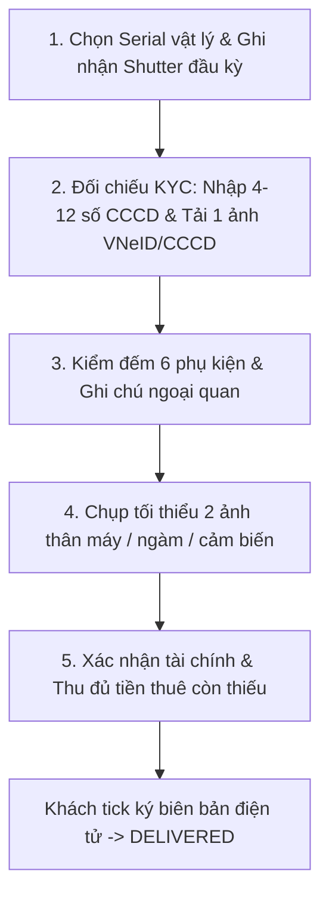

# TÀI LIỆU ĐẶC TẢ NGHIỆP VỤ & PHƯƠNG ÁN ĐÃ DUYỆT REFUJI
## Hệ Thống Định Danh KYC Số Hóa & Chính Sách Hủy Đơn Động Trải Dài

> **Dự án:** ReFuji — Nền tảng cho thuê thiết bị nhiếp ảnh Fujifilm  
> **Phiên bản:** v1.2 (Bổ sung Nghiệp vụ Thực chiến)  
> **Thời gian cập nhật:** 16/11/2026  
> **Trạng thái:** Đã phê duyệt & Đã triển khai vào Codebase  

---

## 1. BỐI CẢNH & NGUYÊN TẮC THIẾT KẾ CỐT LÕI

Trước đây, hệ thống ReFuji được thiết kế thiên về tuân thủ lý thuyết pháp lý (Luật Căn cước 2023 & Nghị định 13/2023/NĐ-CP về dữ liệu cá nhân), chỉ cho phép nhập 4 số cuối CCCD và chặn hoàn toàn việc lưu ảnh định danh. Thiết kế này bộc lộ lỗ hổng lớn trong thực tế vận hành: **Chủ cửa hàng đối mặt với rủi ro mất trắng tài sản nếu khách vãng lai nhận máy rồi chiếm đoạt**.

Nhằm giải quyết triệt để bài toán này, phương án mới đã được thống nhất và đưa vào vận hành thực tế dựa trên 3 nguyên tắc sống còn:

1. **Số hóa 100% tại quầy POS:** Tuyệt đối không dùng giấy tờ viết tay. Toàn bộ thông tin đối chiếu, hình ảnh và biên bản bàn giao đều thao tác trên phần mềm (Tablet/Desktop).
2. **Cân bằng Pháp lý & Bảo toàn tài sản:** Khách hàng xác nhận điều khoản điện tử (Electronic Consent) cho phép cửa hàng lưu trữ thông tin/hình ảnh đối chiếu trong thời gian thuê máy $\rightarrow$ Tuân thủ đúng Nghị định 13/2023/NĐ-CP.
3. **Chính sách tài chính không "rát ví" & Trải dài liên tục:** Phí hủy đơn không cố định theo bảng ngày cứng nhắc, mà vận hành theo hàm số toán học trải dài cho bất kỳ số ngày $N$ nào ($N = 3, 7, 22, 50...$ ngày).

---

## 2. NGHIỆP VỤ BÀN GIAO (CHECK-OUT) & KYC SỐ HÓA

### 2.1. Phân biệt Khách vãng lai (Guest) và Thành viên (Member)
* **Khách vãng lai (Guest):** Đặt nhanh không có tài khoản, hệ thống chưa từng có dữ liệu CCCD từ trước. Lúc Check-out, nhân viên đối chiếu thẻ vật lý hoặc app VNeID mức 2 của khách $\rightarrow$ **Gõ đủ 12 số CCCD vào hệ thống để ghi nhận lưu vết pháp lý (Audit Trail)**.
* **Thành viên (Member):** Đã có hồ sơ định danh trong tài khoản. Hệ thống tự động kiểm tra khớp số để tránh giao nhầm người.

### 2.2. Tách bạch 2 lớp ảnh riêng biệt
Hệ thống phân tách rành mạch 2 mục chụp/tải ảnh để tránh nhầm lẫn nghiệp vụ:

| Hạng mục | Vị trí thao tác | Số lượng | Mục đích nghiệp vụ |
| :--- | :--- | :---: | :--- |
| **Ảnh đối chiếu KYC** | Bước 2 (KYC & Ký biên bản) | **1 ảnh** | Chụp màn hình app VNeID định danh mức 2 hoặc mặt trước thẻ CCCD của khách tại quầy để lưu vết định danh, phòng ngừa rủi ro bùng máy. |
| **Ảnh kiểm định thiết bị** | Bước 4 (Ảnh đối chứng thiết bị) | **$\ge$ 2 ảnh** | Chụp chi tiết ngoại quan thân máy, mặt kính ngàm lens, cảm biến sensor trước khi rời quầy để làm căn cứ đối chiếu lúc Check-in thu hồi. |

### 2.3. Quy trình bàn giao 5 bước tại quầy POS

### 2.4. Hồ sơ truy vết khi phát sinh rủi ro mất máy
Nếu khách không trả máy hoặc có dấu hiệu chiếm đoạt, chủ tiệm chỉ cần mở chi tiết đơn hàng (`OrderDossierModal`) là có sẵn bộ chứng cứ hoàn chỉnh để chuyển Cơ quan Cảnh sát Điều tra:
1. **Ảnh chụp rõ nét app VNeID mức 2 / Thẻ CCCD** của người nhận máy.
2. **Số CCCD đủ 12 chữ số**, Họ tên và Số điện thoại khách.
3. **Mã giao dịch VietQR / Ngân hàng** (đã định danh sinh trắc học theo tài khoản ngân hàng của khách theo Quyết định 2345/QĐ-NHNN).
4. **Mã Serial vật lý** của thiết bị đã giao.
5. **Ảnh ngoại quan thiết bị** lúc rời quầy và thời gian bàn giao gắn với nhân viên ca trực.

---

## 3. CHÍNH SÁCH HỦY ĐƠN ĐỘNG TRẢI DÀI THEO NGÀY (DYNAMIC PRO-RATA)

### 3.1. Lý do không áp dụng khung ngày cố định
* Các khung ngày cố định (kiểu "trước 3 ngày", "trước 1-2 ngày") chỉ áp dụng được cho đơn ngắn (1-3 ngày), nhưng **hoàn toàn phá sản khi gặp đơn 22 ngày hay 50 ngày**.
* Phạt theo % tiền cọc thì **quá rát ví** vì tiền cọc máy ảnh rất lớn (5 – 10 triệu đồng), khách mất 50% cọc là mất 2.5 – 5 triệu đồng sẽ dẫn đến xung đột dữ dội.

### 3.2. Công thức toán học tổng quát (Áp dụng cho mọi $N$ ngày)

Gọi:
* **$N$**: Tổng số ngày thuê của đơn hàng ($N \ge 1$).
* **$D$**: Số ngày khách báo hủy trước ngày nhận máy ($D \ge 0$).
* **$P$**: Đơn giá thuê 1 ngày (VNĐ/ngày).
* **$C$**: Tiền cọc thiết bị đang giữ.

#### Công thức tính số ngày tiền thuê bị phạt $S(D)$:
$$S(D) = \max\Big(0, \;\; 0.2 \times N - 0.4 \times D\Big)$$

$$\text{Phí phạt hủy đơn} = \min\Big(C, \;\; S(D) \times P\Big)$$

#### Nguyên tắc hoàn tiền:
* **Tiền thuê đã thanh toán trước:** Hoàn lại **$100\%$** (do khách chưa nhận và chưa sử dụng thiết bị).
* **Tiền cọc:** Khấu trừ Phí phạt hủy đơn, phần cọc còn lại hoàn trả đầy đủ cho khách:
$$\text{Tiền cọc hoàn trả} = \max\Big(0, \;\; C - \text{Phí phạt}\Big)$$
$$\text{Tổng tiền hoàn trả khách} = \text{Tiền thuê hoàn lại} + \text{Tiền cọc hoàn trả}$$

#### Ý nghĩa kinh tế của công thức:
1. **Ngưỡng an toàn ($D \ge 0.5 \times N$):** Nếu khách báo trước ít nhất $50\%$ thời gian thuê, tiệm còn đủ thời gian tìm khách khác $\rightarrow$ **Phạt $0\text{ ₫}$ (Hoàn 100% cọc)**.
2. **Mức phạt tối đa (Hủy sát ngày $D = 0$):** Bị chặn trần ở mức **$20\%$ tổng tiền thuê của đơn** (tương đương $0.2 \times N$ ngày thuê) $\rightarrow$ Không bao giờ bị rát ví.
3. **Trượt đều theo từng ngày:** Cứ mỗi ngày báo sớm hơn, số ngày phạt giảm đều $0.4$ ngày thuê.

---

### 3.3. Bảng kiểm chứng công thức trên các quy mô đơn hàng

#### A. Đơn thuê 50 NGÀY ($N = 50$, Giá thuê $P = 500.000\text{ ₫/ngày}$, Cọc $10.000.000\text{ ₫}$):
* Ngưỡng miễn phạt: Báo trước $\ge 25$ ngày $\rightarrow$ Mất $0\text{ ₫}$.
* Mức phạt tối đa khi hủy trong ngày nhận ($D = 0$): Phạt $10$ ngày thuê ($5.000.000\text{ ₫}$).

| Số ngày báo trước ($D$) | Số ngày thuê bị phạt ($S$) | Số tiền phạt trừ vào cọc | Tiền cọc hoàn trả |
| :---: | :---: | :---: | :---: |
| **$\ge 25$ ngày** | $0$ ngày | **$0\text{ ₫}$** | **$10.000.000\text{ ₫}$** (100%) |
| **$20$ ngày** | $0.2 \times 50 - 0.4 \times 20 = 2.0$ ngày | **$1.000.000\text{ ₫}$** | **$9.000.000\text{ ₫}$** |
| **$15$ ngày** | $0.2 \times 50 - 0.4 \times 15 = 4.0$ ngày | **$2.000.000\text{ ₫}$** | **$8.000.000\text{ ₫}$** |
| **$10$ ngày** | $0.2 \times 50 - 0.4 \times 10 = 6.0$ ngày | **$3.000.000\text{ ₫}$** | **$7.000.000\text{ ₫}$** |
| **$5$ ngày** | $0.2 \times 50 - 0.4 \times 5 = 8.0$ ngày | **$4.000.000\text{ ₫}$** | **$6.000.000\text{ ₫}$** |
| **$0$ ngày (Hủy ngay)** | $0.2 \times 50 - 0.4 \times 0 = 10.0$ ngày | **$5.000.000\text{ ₫}$** | **$5.000.000\text{ ₫}$** |

#### B. Đơn thuê 22 NGÀY ($N = 22$, Giá thuê $P = 500.000\text{ ₫/ngày}$, Cọc $5.000.000\text{ ₫}$):
* Ngưỡng miễn phạt: Báo trước $\ge 11$ ngày $\rightarrow$ Mất $0\text{ ₫}$.
* Hủy trước 8 ngày: $S = 0.2 \times 22 - 0.4 \times 8 = 1.2$ ngày $\rightarrow$ Phạt **$600.000\text{ ₫}$**, hoàn cọc $4.400.000\text{ ₫}$.
* Hủy trước 5 ngày: $S = 0.2 \times 22 - 0.4 \times 5 = 2.4$ ngày $\rightarrow$ Phạt **$1.200.000\text{ ₫}$**, hoàn cọc $3.800.000\text{ ₫}$.
* Hủy trước 2 ngày: $S = 0.2 \times 22 - 0.4 \times 2 = 3.6$ ngày $\rightarrow$ Phạt **$1.800.000\text{ ₫}$**, hoàn cọc $3.200.000\text{ ₫}$.
* Hủy trong ngày nhận ($D = 0$): Phạt tối đa $4.4$ ngày thuê $\rightarrow$ Phạt **$2.200.000\text{ ₫}$**, hoàn cọc $2.800.000\text{ ₫}$.

#### C. Đơn thuê 7 NGÀY ($N = 7$, Giá thuê $P = 500.000\text{ ₫/ngày}$, Cọc $5.000.000\text{ ₫}$):
* Ngưỡng miễn phạt: Báo trước $\ge 3.5$ ngày (từ 4 ngày trở lên) $\rightarrow$ Mất $0\text{ ₫}$.
* Hủy trước 2 ngày: $S = 0.2 \times 7 - 0.4 \times 2 = 0.6$ ngày $\rightarrow$ Phạt **$300.000\text{ ₫}$**, hoàn cọc $4.700.000\text{ ₫}$.
* Hủy trước 1 ngày: $S = 0.2 \times 7 - 0.4 \times 1 = 1.0$ ngày $\rightarrow$ Phạt **$500.000\text{ ₫}$**, hoàn cọc $4.500.000\text{ ₫}$.
* Hủy trong ngày nhận ($D = 0$): Phạt tối đa $1.4$ ngày thuê $\rightarrow$ Phạt **$700.000\text{ ₫}$**, hoàn cọc $4.300.000\text{ ₫}$.

---

## 4. DANH SÁCH FILE ĐÃ TRIỂN KHAI VÀO HỆ THỐNG

| STT | Tệp tin (File Path) | Hạng mục đã triển khai |
| :---: | :--- | :--- |
| 1 | `refuji-system/apps/api/src/db.ts` | Bổ sung 2 cột `kyc_photo TEXT` và `kyc_document_number VARCHAR(20)` vào bảng `checkout_records`. |
| 2 | `refuji-system/apps/api/src/modules/admin/settlement.helper.ts` | Triển khai hàm nghiệp vụ `calculateCancellationSettlement` theo công thức động $S(D) = \max(0, 0.2N - 0.4D)$. |
| 3 | `refuji-system/apps/api/src/modules/admin/operations.routes.ts` | Tiếp nhận `kyc_document_number` (4–12 số) và `kyc_photo` trong API bàn giao Check-out; đồng bộ vào bảng ảnh `KYC_DOCUMENT`. |
| 4 | `refuji-system/apps/api/src/modules/orders/orders.routes.ts` | Tích hợp công thức hủy động vào `POST /guest-cancel`, `POST /cancel`, `PATCH /orders/:code/status` (CANCELLED); thêm `GET /cancel-preview`; tự tạo bút toán sổ cái `PENALTY_FEE` & `REFUND` và giải phóng Serial. |
| 5 | `src/components/dashboard/CheckoutWizardModal.tsx` | UI Check-out: Bổ sung ô nhập 4–12 số CCCD, ô tải 1 ảnh VNeID/CCCD độc lập có nén ảnh tự động, cập nhật cam kết điện tử. |
| 6 | `src/components/dashboard/OrderDossierModal.tsx` | Hiển thị số CCCD đầy đủ, ảnh chụp VNeID/CCCD kèm nút mở xem ảnh lớn, và banner giải trình quyết toán hủy đơn khi đơn bị hủy. |
| 7 | `src/components/dashboard/dashboardTypes.ts` | Cập nhật TypeScript types cho `kyc_document_number`, `kyc_photo`, `phase: 'KYC_DOCUMENT'`. |
| 8 | `src/services/dashboardApi.ts` | Khai báo API `previewOrderCancellation` và cập nhật payload `submitOrderCheckout`. |

---

## 5. HƯỚNG DẪN KIỂM TRA & VẬN HÀNH THỰC TẾ

1. **Khởi động hệ thống:**
   * Backend: `npm run server` (Port 4000)
   * Web: `npm run dev` (Port 5173)
2. **Kiểm tra luồng Check-out:**
   * Vào `#dashboard` $\rightarrow$ Tab **Đơn & POS** $\rightarrow$ Chọn đơn `CONFIRMED` $\rightarrow$ Bấm **Check-out**.
   * Tại **Bước 2**: Gõ đủ 12 số CCCD, bấm **Tải / Chụp ảnh VNeID** để đính kèm 1 ảnh.
   * Tại **Bước 4**: Tải tối thiểu 2 ảnh thiết bị.
   * Bấm **Hoàn tất bàn giao** $\rightarrow$ Mở Dossier để xem lại ảnh VNeID và số CCCD đã lưu.
3. **Kiểm tra luồng Hủy đơn:**
   * Bấm nút **Hủy** trên một đơn đã thanh toán hoặc đã duyệt.
   * Hệ thống tự động tính toán số ngày phạt, ghi nhận giao dịch hoàn tiền vào Sổ cái và hiển thị giải trình trong Dossier.
