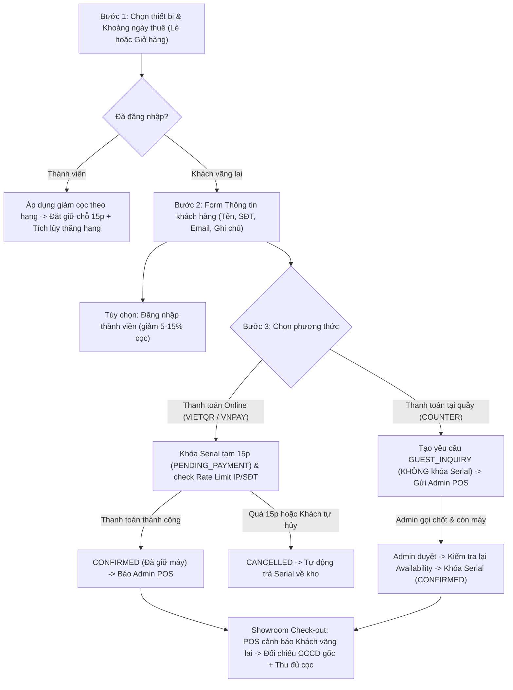

# Kế Hoạch Nâng Cấp ReFuji: Luồng Đặt Nhanh Khách Vãng Lai 3 Bước (Đồng Bộ `SYSTEM_SPECIFICATION_v1.1.md`)

> [!IMPORTANT]
> Bản kế hoạch kiến trúc triển khai luồng Khách vãng lai 3 bước không cần OTP SMS/Gmail, đồng bộ hóa tài liệu **[SYSTEM_SPECIFICATION_v1.1.md](../SYSTEM_SPECIFICATION_v1.1.md)** và **[README.md](../../README.md)**. *(Xem bản tổng hợp vận hành mới nhất sau khi hoàn thiện cả Dashboard & Kho Serial tại [tai_lieu_van_hanh_va_nghiep_vu_refuji.md](./tai_lieu_van_hanh_va_nghiep_vu_refuji.md)).*

---

## 1. Nguyên tắc Nghiệp vụ cốt lõi (Đặt nhanh 3 bước + Đặc thù ReFuji)

| Bước | Trải nghiệm Đặt nhanh 3 bước | Quy tắc Nghiệp vụ bảo vệ ReFuji |
| :--- | :--- | :--- |
| **Bước 1: Chọn thiết bị & lịch** | Tự do chọn thiết bị, số lượng, ngày nhận/trả và thêm vào Giỏ hàng không cần đăng nhập | Tồn kho khả dụng tính theo **giao thoa khoảng ngày (`Date Range Overlap`)** thay vì khóa cứng tức thời; giữ giỏ hàng khách vãng lai qua F5 |
| **Bước 2: Thông tin khách hàng** | Điền form `Họ tên`, `SĐT`, `Email`, `Ghi chú` (+ tùy chọn đăng nhập Thành viên) | Không tạo tài khoản `users`, không chạy `bcrypt`, chịu **100% cọc tiêu chuẩn ($0\%$ giảm cọc)**, không cộng điểm uy tín/nâng hạng (và không hồi tố nếu đăng ký sau) |
| **Bước 3: Thanh toán giữ chỗ** | Thanh toán ngay để chốt giữ chỗ trong thời gian đếm ngược | **Có cọc tiền online (`VIETQR`/`VNPAY`) mới khóa Serial 15 phút**; nếu chọn **Thanh toán tại quầy (`COUNTER`)** thì **KHÔNG khóa Serial** mà gửi yêu cầu (`GUEST_INQUIRY`) về Admin gọi chốt |
| **Bước 4: Tra cứu, Hủy & Check-out** | Nhận mã đơn + Tra cứu lại đơn không cần tài khoản | Tra cứu bằng **`Mã đơn + SĐT`**; được phép **Tự hủy** khi đang `PENDING_PAYMENT` / `GUEST_INQUIRY`. Khi nhận máy tại quầy (Check-out), POS cảnh báo **"Khách vãng lai — Bắt buộc đối chiếu CCCD/VNeID gốc"** |

---

## 2. Sơ đồ luồng Nghiệp vụ Khách vãng lai

---

## 3. Các lỗi ban đầu cản trở khách vãng lai đã xử lý

1. **Mất giỏ hàng khi F5 lúc chưa đăng nhập:**
   - [useCart.ts](../../src/hooks/useCart.ts) trước đây xóa sạch `refuji_cart_items` mỗi lần tải trang nếu `!savedUser && !currentUserId`.
   - **Giải pháp:** Giữ giỏ hàng khách vãng lai qua F5; chỉ xóa khi đăng xuất (`refuji_cart_clear`) hoặc đặt đơn thành công.
2. **Rò rỉ đơn giữ chỗ khi chưa xác thực:**
   - [orders.routes.ts](../../refuji-system/apps/api/src/modules/orders/orders.routes.ts) trước đây fallback `userId = 1` khi thiếu token, và [App.tsx](../../src/App.tsx) gọi `/api/orders/my-orders` ngay cả khi chưa đăng nhập.
   - **Giải pháp:** API `/my-orders` trả `401` khi chưa xác thực; `App.tsx` chỉ gọi `/my-orders` khi có tài khoản, còn khách vãng lai đồng bộ trạng thái đơn giữ chỗ theo `orderCode + guestPhone` lưu tạm trên trình duyệt.
3. **Kiểm tra trùng lịch theo Khoảng ngày (`Date Range Overlap`):**
   - [availability.helper.ts](../../refuji-system/apps/api/src/modules/orders/availability.helper.ts), [orders.routes.ts](../../refuji-system/apps/api/src/modules/orders/orders.routes.ts) và [catalog.routes.ts](../../refuji-system/apps/api/src/modules/catalog/catalog.routes.ts) áp dụng thuật toán `(existing_start < new_end AND existing_end > new_start)` + tính cả đơn `OVERDUE` chưa trả máy.

---

## 4. Thiết kế triển khai theo từng phân hệ

### A. Tài liệu Đặc tả (`docs/SYSTEM_SPECIFICATION_v1.1.md` & `README.md`)
- **[SYSTEM_SPECIFICATION_v1.1.md](../SYSTEM_SPECIFICATION_v1.1.md):**
  - Cập nhật luồng **Khách vãng lai (Guest Checkout 3 bước không cần OTP)**, loại trừ `GUEST_INQUIRY` khỏi tập giữ kho `BookedUnits`, quy định **100% cọc tiêu chuẩn ($0\%$ ưu đãi)**, API `/api/orders/guest-lookup`, `/guest-cancel`, cảnh báo KYC khi Check-out và các Test Case (`TC-GUEST-01..03`, `TC-AVAIL-04`).
- **[README.md](../../README.md):**
  - Đồng bộ kiến trúc thư mục, luồng Đặt nhanh Khách vãng lai 3 bước và hướng dẫn khởi chạy toàn bộ dịch vụ.

### B. Cơ sở dữ liệu ([db.ts](../../refuji-system/apps/api/src/db.ts) & [schema.prisma](../../refuji-system/apps/api/prisma/schema.prisma))
- Cho phép `rental_orders.user_id` nhận `NULL` (`user_id INTEGER NULL REFERENCES users(id)`).
- Bổ sung trên `rental_orders`: `is_guest`, `guest_name`, `guest_phone`, `guest_email`, `guest_note`, `payment_method` (`'VIETQR' | 'VNPAY' | 'COUNTER'`), `privacy_consent_at`, `ip_address`.
- Index tối ưu cho `(order_code, guest_phone)` và `(order_status, start_date, expected_return_date)`.

### C. Backend API (`refuji-system/apps/api/src/`)
- **[orders.routes.ts](../../refuji-system/apps/api/src/modules/orders/orders.routes.ts):** Dual mode `POST /api/orders` (Member JWT & Guest `guest_info` + `privacy_consent`), Rate Limit anti-spam 2 hold/IP-SĐT, `GET /api/orders/guest-lookup`, `POST /api/orders/:orderCode/guest-cancel`, `GET/PATCH /api/admin/orders`.
- **[catalog.routes.ts](../../refuji-system/apps/api/src/modules/catalog/catalog.routes.ts):** Lọc khả dụng theo `?start_date=...&end_date=...`, loại trừ `GUEST_INQUIRY`.
- **[auth.routes.ts](../../refuji-system/apps/api/src/modules/auth/auth.routes.ts):** Áp Rate Limiting bảo vệ endpoint xác thực.

### D. Frontend Khách hàng (`src/` — Port `5173`)
- [guest.schema.ts](../../src/schemas/guest.schema.ts): Validate form Thông tin khách hàng (`full_name`, `phone` VN 10 số, `email`, `note`, `privacy_consent`).
- [GuestCustomerStep.tsx](../../src/components/booking/GuestCustomerStep.tsx): Stepper 3 bước đặt nhanh (`1. Chọn máy & lịch` → `2. Thông tin khách` → `3. Thanh toán / Gửi yêu cầu giữ chỗ`) + tùy chọn *"Đăng nhập thành viên"*.
- [GuestOrderLookupPanel.tsx](../../src/components/booking/GuestOrderLookupPanel.tsx): Tra cứu đơn bằng `Mã đơn + SĐT`, thanh toán tiếp giữ chỗ 15p hoặc **Tự hủy đơn**.
- [BookingModal.tsx](../../src/components/BookingModal.tsx) & [CartModal.tsx](../../src/components/CartModal.tsx): Điều phối bước 2 cho khách vãng lai hoặc đặt trực tiếp với ưu đãi hạng cho thành viên.

### E. Frontend Admin POS & Script khởi chạy
- Hỗ trợ duyệt `GUEST_INQUIRY` kèm kiểm tra trùng lịch thực tế và banner cảnh báo KYC Khách vãng lai tại Check-out ([CheckoutWizardModal.tsx](../../src/components/dashboard/CheckoutWizardModal.tsx), [OrderApprovalPage.tsx](../../refuji-system/apps/web/src/pages/admin-staff/OrderApprovalPage.tsx)).
- [package.json](../../package.json): Thêm script `dev:all` chạy đồng thời `API (:4000) + Web Khách (:5173) + Web Monorepo (:5174)`.
