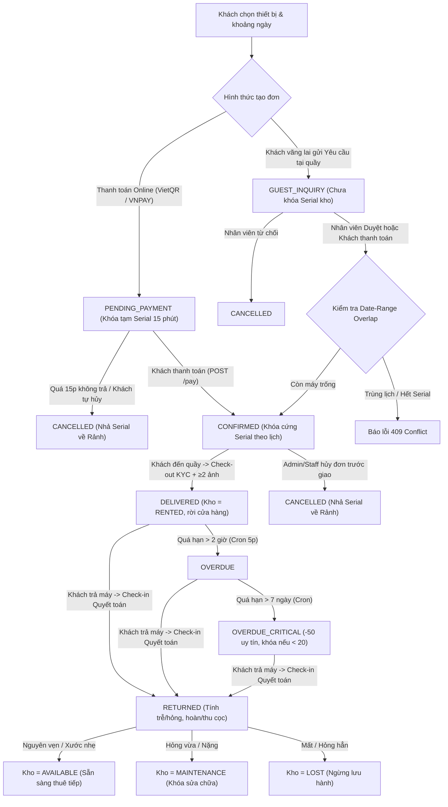

# Tài Liệu Tổng Hợp Hệ Thống & Sổ Tay Vận Hành REFUJI (10/11 – 12/11/2026)

> [!NOTE]
> Tài liệu này tổng hợp **toàn bộ các hạng mục đã phát triển, nâng cấp và sửa lỗi từ hôm qua (11/11, kèm nền tảng luồng vãng lai 10/11) đến hôm nay (12/11/2026)**, đồng thời chuẩn hóa **luồng nghiệp vụ đầu-cuối** và **hướng dẫn vận hành chi tiết từng tính năng** của hệ thống cho thuê máy ảnh **REFUJI**.

---

## Phần I. Kiến Trúc Tổng Thể & Dữ Liệu Sống Hiện Tại

Hệ thống REFUJI vận hành theo kiến trúc Full-Stack tách biệt giữa **Trang khách hàng (Storefront)**, **Phân hệ Quản trị Studio / POS (`Dashboard`)** và **Backend API + SQLite (WAL mode)**.

| Phân hệ | Địa chỉ / Entry Point | Module phụ trách chính | Ghi chú vận hành |
| :--- | :--- | :--- | :--- |
| **Storefront (Khách hàng)** | `http://localhost:5173` | [src/App.tsx](../../src/App.tsx) | Đặt lẻ, Giỏ hàng, Khách vãng lai, Tra cứu đơn, Tài khoản & KYC |
| **Dashboard Quản trị & POS** | `http://localhost:5173/#dashboard` (hoặc `/dashboard`, `/admin`) | [DashboardPage.tsx](../../src/pages/dashboard/DashboardPage.tsx) | 7 phân hệ quản trị bảo vệ bởi [`DashboardGate`](../../src/components/dashboard/DashboardGate.tsx) (RBAC `STAFF`/`ADMIN`) |
| **API Backend & Cron** | `http://localhost:4000/api` | [index.ts](../../refuji-system/apps/api/src/index.ts), [db.ts](../../refuji-system/apps/api/src/db.ts) | SQLite lưu tại `refuji-system/apps/api/data/refuji.sqlite`, kèm Cron nền 5 phút/lần |
| **Monorepo Web (Đồng bộ)** | `http://localhost:5174` | [refuji-system/apps/web](../../refuji-system/apps/web) | Bản đồng bộ UI Storefront trong workspace `@refuji/web` |

### Lệnh khởi chạy & kiểm tra build ([package.json](../../package.json#L6-L13))

- Chạy API (`:4000`) + Storefront/Dashboard (`:5173`): `npm run dev`
- Chạy đồng thời cả API + Storefront + Monorepo Web (`:5174`): `npm run dev:all`
- Kiểm tra TypeScript & đóng gói production: `npm run build` (tại root) và `npm run build` (tại `refuji-system`)

### Thống kê CSDL thực tế tại thời điểm bàn giao

- **Danh mục (`product_models`):** **61** mẫu thiết bị, gồm **17 Thân máy (`BODY`)**, **23 Ống kính (`LENS`)** và **21 Phụ kiện (`ACCESSORY`)** chia đúng 6 nhóm chuẩn.
- **Kho vật lý (`product_items`):** **90 cá thể Serial** (`20` Body + `23` Lens + `47` Accessory), hiện đang ở trạng thái sẵn sàng `AVAILABLE`.
- **Tài khoản (`users`):** **7** tài khoản (`1` `ADMIN` là `fuji@refuji.vn`, `6` `CUSTOMER`).
- **Tài khoản Quản trị mặc định:** `fuji@refuji.vn` · Mật khẩu: `Test@1188` (API auth trong [auth.routes.ts](../../refuji-system/apps/api/src/modules/auth/auth.routes.ts#L306) hỗ trợ cả `test@123`).

---

## Phần II. Nhật Ký Đầy Đủ Các Hạng Mục Đã Làm (10/11 → 12/11/2026)

### Chặng 1 (10/11 – Chiều 11/11): Luồng Đặt Nhanh Khách Vãng Lai 3 Bước & Giữ Chỗ Theo Ngày
1. **Chốt nghiệp vụ không bắt SMS OTP / Gmail ở bước đặt thuê** để tránh nghẽn server và rào cản trải nghiệm; thay bằng **Rate Limit** theo SĐT hoặc IP (tối đa `2` đơn giữ chỗ 15 phút `PENDING_PAYMENT` và tối đa `3` yêu cầu tại quầy `GUEST_INQUIRY` đang mở). Đồng bộ đặc tả trong [SYSTEM_SPECIFICATION_v1.1.md](../../docs/SYSTEM_SPECIFICATION_v1.1.md) và [README.md](../../README.md).
2. **Thuật toán Date-Range Overlap ([availability.helper.ts](../../refuji-system/apps/api/src/modules/orders/availability.helper.ts#L174-L400)):** Kiểm tra trùng lịch theo từng Serial trên khoảng `[start_date, expected_return_date)`, tự động nhả đơn giữ chỗ `PENDING_PAYMENT` quá hạn 15 phút và **không khóa kho** đối với `GUEST_INQUIRY` cho tới khi Nhân viên duyệt hoặc khách thanh toán.
3. **Giao diện đặt vãng lai 3 bước ([`GuestCustomerStep`](../../src/components/booking/GuestCustomerStep.tsx#L46)) & Tra cứu công khai ([`GuestOrderLookupPanel`](../../src/components/booking/GuestOrderLookupPanel.tsx#L63)):** Validate form với `guest.schema.ts` (SĐT VN 10 số, email RFC, tick Luật BVDLCN 2025), hỗ trợ tự hủy đơn bằng **Mã đơn + SĐT** để giải phóng Serial ngay lập tức.

### Chặng 2 (Tối 11/11): Tìm Kiếm Nâng Cao, Chuẩn Hóa Typography & Tối Giản Trang Chủ
1. Bổ sung bộ lọc **Mức giá/ngày** (`Dưới 200k`, `200k–400k`, `400k–700k`, `Trên 700k`) trên [`GlassSearchBar`](../../src/components/GlassSearchBar.tsx) và [`AllEquipmentModal`](../../src/components/AllEquipmentModal.tsx).
2. Xóa `font-mono` phát sinh, khôi phục bộ chữ chuẩn toàn web (`Cormorant Garamond` serif cho tiêu đề, `Poppins` / `Plus Jakarta Sans` cho UI & con số), chuẩn hóa nút/thẻ sang `rounded-full` / `rounded-3xl` / `rounded-2xl`.
3. Căn giữa [`LiquidNavbar`](../../src/components/LiquidNavbar.tsx) và nút chọn ngày tại `#explore`, gom tính năng Tra cứu đơn gọn vào `AuthModal`, `AccountModal` và `Footer`; chuyển toast thông báo thành dạng pill bo tròn tự ẩn sau **5 giây**.

### Chặng 3 (Đêm 11/11): Quy Chuẩn Toàn Bộ Popup & Chi Tiết Máy Ảnh
1. Thống nhất 100% khung popup trên toàn hệ thống bằng [popupTheme.ts](../../src/components/ui/popupTheme.ts): viền ngoài thụt đều (`POPUP_BACKDROP_CLASS` / `POPUP_FRAME_CLASS`), **click backdrop bên ngoài để đóng**, giữ nút `X`.
2. Tinh chỉnh [`BookingModal`](../../src/components/BookingModal.tsx): khung ảnh máy vuông lớn hòa nền trắng không viền, sửa nhãn thành *"Đặt hàng / Đã hết hàng"*, đưa nút Thêm giỏ hàng ngang hàng Yêu thích/Chia sẻ, sửa lỗi xuống dòng đơn vị `₫` và bỏ các khối mô tả lặp.

### Chặng 4 (Rạng Sáng 12/11): Dashboard Quản Trị & POS Full-Stack + Phân Quyền RBAC
1. **Backend Quản trị tách module ([admin/index.ts](../../refuji-system/apps/api/src/modules/admin/index.ts)):** Xây dựng 10 file chuyên trách gồm `reports.routes.ts`, `operations.routes.ts`, `inventory.routes.ts`, `finance.routes.ts`, `customers.routes.ts`, `settlement.helper.ts`, `cron.service.ts`, `seed-operations.helper.ts`, `admin.middleware.ts`, `audit.service.ts`.
2. **Frontend Studio & POS tách biệt ([DashboardPage.tsx](../../src/pages/dashboard/DashboardPage.tsx)):** Xây dựng 7 tab vận hành + 3 modal nghiệp vụ chuyên sâu (`CheckoutWizardModal`, `CheckinSettlementModal`, `OrderDossierModal` + in biên bản).
3. **Vá bảo mật & lỗi hạ tầng:** Sửa lỗi Rate Limiter khóa oan IP 15 phút khi login hợp lệ; sửa lỗi 9 modal bị `<AnimatePresence>` chặn `createPortal`; áp **RBAC 3 tầng** (`CUSTOMER` · `STAFF` · `ADMIN`) đọc trực tiếp quyền live từ SQLite qua [`requireStaffOrAdmin`](../../refuji-system/apps/api/src/modules/admin/admin.middleware.ts#L53-L67) và [`requireAdminOnly`](../../refuji-system/apps/api/src/modules/admin/admin.middleware.ts#L69-L77).

### Chặng 5 (00:30 – 01:12 Ngày 12/11): Đồng Bộ Giao Diện Chuẩn Home & Bền Vững Khi F5
1. Căn Dashboard chuẩn chiều rộng `max-w-6xl`, header liquid glass, giữ URL `#dashboard`, khôi phục tiêu đề serif `TỔNG QUAN VẬN HÀNH REFUJI`, thay icon sticker bằng Lucide, thay `<select>` mặc định tối bằng [`GlassSelect`](../../src/components/dashboard/GlassSelect.tsx).
2. Sửa nút **In Biên bản** bị che trong [`OrderDossierModal`](../../src/components/dashboard/OrderDossierModal.tsx), căn đều cột bảng `Khách & KYC`, gắn `cache: 'no-store'` + `refreshSignal` cho toàn bộ nút Làm mới, lưu tab đang mở vào `sessionStorage` kết hợp silent refresh token giúp **F5 reload không bị mất tab hay văng phiên**.

### Chặng 6 (Sáng 12/11 – Hiện Tại): Phụ Kiện 6 Nhóm Ảnh Thật, Vá Split-Brain Kho & Sắp Xếp Series 1→7
1. **Tái cơ cấu 21 mẫu Phụ kiện (`47` Serial) về đúng 6 nhóm chuẩn** với **100% ảnh thật chính hãng** trong [public/assets/acc](../../public/assets/acc) (loại bỏ toàn bộ ảnh SVG tự vẽ), bổ sung lọc con 6 nhóm trong [`AllEquipmentModal`](../../src/components/AllEquipmentModal.tsx#L40-L47) và chuẩn hóa tỷ lệ khung ảnh [`isSmallThumbnailImage`](../../src/utils/cn.ts):
   - **Pin & Sạc (5 mẫu):** Pin Fujifilm NP-W126S, NP-W235, pin dự phòng, bộ sạc pin đơn, bộ sạc pin đôi.
   - **Thẻ nhớ (4 mẫu):** SD 32GB, SD 64GB, SD 128GB, đầu đọc thẻ nhớ.
   - **Flash (3 mẫu):** Godox TT350F, Godox V350F, flash rời tương thích Fujifilm.
   - **Tripod (3 mẫu):** Chân máy mini, tripod du lịch, tripod chuyên nghiệp.
   - **Microphone (4 mẫu):** Hollyland Lark M2, Rode VideoMicro, micro không dây, micro shotgun.
   - **Gimbal (2 mẫu):** DJI RS series, gimbal dành cho máy ảnh mirrorless.
2. **Vá triệt để lỗi Split-brain giữa Storefront và Dashboard (tình trạng hết hàng ngoài web nhưng vào tab *"Đang cho thuê"* lại trống):**
   - Bổ sung [`reconcileActiveOrderItemStatuses`](../../refuji-system/apps/api/src/db.ts#L669-L725) tự đồng bộ mọi Serial thuộc đơn `DELIVERED`/`OVERDUE` phải giữ trạng thái `RENTED`.
   - Tách rạch ròi **`Đang thuê (RENTED)`** (đã giao máy khỏi cửa hàng) vs **`Đang giữ lịch (RESERVED)`** (đơn `CONFIRMED`/`PENDING_PAYMENT` đã khóa lịch ngày nhưng máy vật lý vẫn nằm tại tủ chờ khách tới lấy) qua [`getActiveSerialBookingsMap`](../../refuji-system/apps/api/src/modules/orders/availability.helper.ts#L88-L172).
   - Cập nhật đồng bộ KPI `Rảnh / Thuê / Giữ / Bảo trì` trên `OverviewTab`, `CatalogTab`, `InventoryMaintenanceTab` và cập nhật nút Hủy đơn để tự giải phóng `product_items.status` nếu hủy đơn đang giao.
3. **Sắp xếp toàn bộ 17 thân máy theo đúng thứ tự Series 1 → 7:**
   - Đồng bộ backend ([cameraSeriesOrder.ts](../../refuji-system/apps/api/src/utils/cameraSeriesOrder.ts)), JSON catalog ([fujifilm-catalog.json](../../public/fujifilm-catalog.json)) và frontend ([cameraSeries.ts](../../src/utils/cameraSeries.ts)):
     `1. X100 → 2. X-S → 3. X-T → 4. X-M → 5. X-E → 6. X-Pro → 7. GFX` (kèm `8. X-H`, `9. X half`).
   - Sửa lỗi nhận diện chuỗi (`GFX100` chứa `"X100"` → ưu tiên bắt `GFX` trước; `X half (X-HF1)` chứa `"X-H"` → ưu tiên bắt `HALF`/`X-HF` trước) và đặt mặc định hệ ngàm mở **Tất cả hệ ngàm** để không bị ẩn dòng Medium Format `GFX`.

---

## Phần III. Luồng Nghiệp Vụ Cốt Lõi & Quy Tắc Tính Toán

### 1. Sơ đồ vòng đời Đơn hàng & Đồng bộ Kho Serial

### 2. Bảng đối chiếu Trạng thái Đơn ↔ Kho Serial ↔ Storefront

| Trạng thái Đơn hàng | Trạng thái bảng `product_items` | Hiển thị trong tab `Kho Serial` | Storefront (Khung ngày trùng lịch) | Ý nghĩa vận hành |
| :--- | :--- | :--- | :--- | :--- |
| *(Không có đơn giao thoa)* | `AVAILABLE` | **Sẵn sàng (AVAILABLE)** | **Còn hàng / Đặt hàng** | Máy đang nằm trong tủ và rảnh lịch |
| `PENDING_PAYMENT` (còn hạn 15p) | `AVAILABLE` | **Giữ lịch (RESERVED)** | **Trừ slot giữ chỗ** | Giữ tạm 15 phút đợi khách chuyển khoản |
| `GUEST_INQUIRY` | `AVAILABLE` | **Sẵn sàng (AVAILABLE)** | **Không trừ kho** | Yêu cầu tư vấn tại quầy, chưa chốt máy |
| `CONFIRMED` | `AVAILABLE` | **Giữ lịch (RESERVED)** | **Trừ slot / Đã có khách giữ chỗ** | Khách đã chốt/cọc online, máy chờ khách tới nhận |
| `DELIVERED` / `OVERDUE` / `OVERDUE_CRITICAL` | `RENTED` | **Đang cho thuê (RENTED)** | **Đã hết hàng (nếu hết slot)** | Máy thực tế đã giao ra khỏi cửa hàng |
| *(Đang lập phiếu bảo trì)* | `MAINTENANCE` | **Bảo dưỡng (MAINTENANCE)** | **Trừ khỏi quỹ khả dụng** | Máy đang vệ sinh cảm biến / sửa chữa |
| *(Báo mất)* | `LOST` | **Thất lạc (LOST)** | **Trừ khỏi quỹ khả dụng** | Máy bị mất hoặc hỏng không thể phục hồi |

> [!IMPORTANT]
> **Giải đáp thắc mắc *"Web báo đã hết hàng nhưng vào tab Đang cho thuê lại trống"*:**
> Khi khách đặt đơn online thành công (`CONFIRMED`) hoặc đang giữ chỗ 15 phút (`PENDING_PAYMENT`) nhưng **chưa đến quầy làm Check-out nhận máy**, máy vật lý vẫn còn ở cửa hàng nên nằm ở bộ lọc **`Giữ lịch` (`RESERVED`)**, **không** nằm ở **`Đang cho thuê` (`RENTED`)** (vốn chỉ dành cho đơn `DELIVERED` đã mang máy đi). Storefront tính khả dụng theo cả `RENTED` + `RESERVED` trong khoảng ngày đang chọn.

### 3. Quy tắc Date-Range Overlap & Chống Spam Giữ Chỗ

- **Kiểm tra giao thoa khoảng ngày ([`getLockedSerialsForRange`](../../refuji-system/apps/api/src/modules/orders/availability.helper.ts#L174-L235)):**
  - Một đơn khóa Serial trong khung `[ordStart, ordEnd)` nếu `ordStart < reqEnd && ordEnd > reqStart`.
  - Riêng đơn đang `OVERDUE` hoặc `OVERDUE_CRITICAL` bị xem là giữ máy kéo dài cho tới khi trả, nên mọi khoảng tìm kiếm có `ordStart < reqEnd` đều khóa Serial đó.
  - Khách đặt ngày tương lai (ví dụ 20/11–23/11) sẽ **không bị chặn** bởi đơn đã trả trước 20/11.
- **Giới hạn thời gian & số lượng ([orders.routes.ts](../../refuji-system/apps/api/src/modules/orders/orders.routes.ts#L108-L179)):**
  - Thời lượng thuê hợp lệ: **1 đến 30 ngày** mỗi đơn.
  - Khách vãng lai theo cùng SĐT hoặc cùng IP: tối đa **2** đơn `PENDING_PAYMENT` đang giữ chỗ và tối đa **3** đơn `GUEST_INQUIRY` đang chờ duyệt.

### 4. Hạng Thành Viên & Điểm Uy Tín

- **Đánh giá tự động ([`syncAndEvaluateUserTier`](../../refuji-system/apps/api/src/modules/auth/auth.routes.ts#L82-L130)) & Hiển thị ([`AccountModal`](../../src/components/AccountModal.tsx#L24-L53)):**

| Mã hạng | Tên hạng | Ngưỡng đơn (Runtime) | Ưu đãi tiền cọc | Quyền lợi bổ sung |
| :--- | :--- | :--- | :--- | :--- |
| `BRONZE` | **Hạng Đồng** | `0 – 2` đơn | **0%** (Mức chuẩn) | Mặc định khi đăng ký mới |
| `SILVER` | **Hạng Bạc** | `3 – 7` đơn | **Giảm 5% tiền cọc** | Tự động kích hoạt & áp vào `POST /api/orders` |
| `GOLD` | **Hạng Vàng** | `8 – 14` đơn | **Giảm 10% tiền cọc** | Ưu tiên giữ chỗ |
| `PLATINUM` | **Bạch Kim** | `>= 15` đơn | **Giảm 15% tiền cọc** | Thủ tục **Fast-track** tại quầy khi Check-out |

- **Quy tắc Điểm Uy Tín (thang 0 – 100):**
  - Tài khoản mới khởi tạo: **100 điểm**.
  - Check-in đúng hạn, máy nguyên vẹn, đủ phụ kiện: **+2 điểm**.
  - Trả trễ `1 – 3` ngày: **-5 điểm**; trễ `> 3` ngày: **-15 điểm**; hư hỏng từ mức `MINOR` trở lên: **-10 điểm**; mất/hỏng hẳn (`LOST`): **-50 điểm**.
  - Cron tự động escalade quá hạn `> 7 ngày` (`OVERDUE_CRITICAL`): **-50 điểm**.
  - **Cơ chế tự khóa:** Nếu điểm uy tín tụt xuống **`< 20` điểm** (từ Check-in, Cron hoặc Admin chỉnh tay), hệ thống **tự động đặt `is_active = 0`** khóa tài khoản ngay lập tức.

### 5. Công Thức Check-in Quyết Toán & 6 Mức Hư Hỏng ([settlement.helper.ts](../../refuji-system/apps/api/src/modules/admin/settlement.helper.ts))

1. **Giờ hẹn trả tiêu chuẩn & Ân hạn:** Giờ chốt ngày trả là **`20:00` (UTC+7)**. Khách được **ân hạn miễn phí `2 giờ`** (trả trước `22:00` cùng ngày không tính phạt trễ).
2. **Phí trễ hạn (khi vượt quá 2 giờ ân hạn):**
   $$\text{LateDays} = \max\left(1, \left\lceil \frac{\Delta t_{\text{giờ}} - 2}{24} \right\rceil\right)$$
   $$\text{Phí trễ} = \min\Big(\text{LateDays} \times 1.5 \times \text{Giá thuê 1 ngày},\; 2 \times \text{Tiền cọc đang giữ}\Big)$$
3. **Bảng 6 Mức Hư Hỏng (`DAMAGE_LEVEL_RULES`):**

| Mã mức | Nhãn hiển thị | Tỷ lệ phạt (% cọc đơn vị) | Trạng thái Serial mặc định sau Check-in |
| :--- | :--- | :---: | :--- |
| `NONE` | Nguyên vẹn | **0%** | `AVAILABLE` |
| `LIGHT_SCRATCH` | Xước nhẹ ngoài vỏ (`< 2cm`) | **5%** | `AVAILABLE` |
| `MINOR` | Trầy xước / Cấn viền, mất nắp cap | **15%** | `AVAILABLE` |
| `MODERATE` | Hỏng nhẹ / Bụi nặng cảm biến | **35%** | `MAINTENANCE` |
| `SEVERE` | Xước cảm biến / Gãy ngàm / Vào nước | **70%** | `MAINTENANCE` |
| `LOST` | Mất thiết bị / Hỏng hoàn toàn | **100%** | `LOST` |

4. **Tổng kết hoàn/thu cọc:**
   $$\text{TotalPenalty} = \text{Phí trễ} + \text{Phí hư hỏng} + \text{Phí thiếu phụ kiện} + \text{Phụ phí khác}$$
   $$\text{Net} = \text{Tiền cọc giữ} - \text{TotalPenalty}$$
   - `Net >= 0`: **Hoàn lại cho khách `Net`** (`payment_status` = `REFUNDED` nếu phạt = 0, hoặc `PARTIALLY_REFUNDED` nếu có khấu trừ).
   - `Net < 0`: **Hoàn `0₫`, thu thêm khách `|Net|`** và ghi sổ cái giao dịch phạt.

---

## Phần IV. Hướng Dẫn Vận Hành Cho Khách Hàng (Storefront)

### 1. Tìm kiếm, chọn lịch & lọc thiết bị (`#explore` & `AllEquipmentModal`)
- **Bước 1:** Ở mục **Tra cứu lịch**, bấm chọn ngày nhận & trả máy trên thanh [`GlassSearchBar`](../../src/components/GlassSearchBar.tsx) hoặc mở lịch (`CalendarModal`). Hệ thống gọi `GET /api/models?start_date=...&end_date=...` để tính lại số lượng khả dụng theo đúng khung ngày đó.
- **Bước 2:** Lọc theo **Loại thiết bị** (`Thân máy`, `Ống kính`, `Phụ kiện`), **Hệ ngàm** (mặc định `'Tất cả hệ ngàm'` để thấy đủ cả X-Mount và GFX Medium Format), **Dòng máy Series (`1. X100 → 7. GFX`)** và **Mức giá/ngày**.
- **Bước 3:** Khi chọn **Phụ kiện** trong popup [`AllEquipmentModal`](../../src/components/AllEquipmentModal.tsx), dùng thanh lọc con 6 nhóm (*Pin & Sạc*, *Thẻ nhớ*, *Flash*, *Tripod*, *Microphone*, *Gimbal*) hoặc gõ từ khóa tìm nhanh.

### 2. Đặt 1 thiết bị (`BookingModal`) hoặc Nhiều thiết bị (`CartModal`)
- **Đặt lẻ ([`BookingModal`](../../src/components/BookingModal.tsx)):** Bấm vào thẻ máy bất kỳ → xem thông số, ngày nhận/trả, tổng tiền thuê & tiền cọc (đã trừ % theo hạng nếu là thành viên) → chọn **Đặt hàng** hoặc bấm icon túi **Thêm vào giỏ**. Nếu hết slot trong khung ngày đó, nút tự đổi sang **Đã hết hàng**.
- **Giỏ hàng ([`CartModal`](../../src/components/CartModal.tsx)):** Bấm icon giỏ hàng trên góc phải thanh điều hướng để tăng/giảm số lượng, đổi ngày chung, rồi tiến hành thanh toán gộp 1 mã đơn. Thành viên đăng nhập được đồng bộ giỏ hàng bền vững trong SQLite (`/api/cart`).

### 3. Luồng Khách Vãng Lai 3 Bước (Không cần đăng nhập)
1. Nhấn **Đặt hàng** / **Thanh toán** → Mở màn [`GuestCustomerStep`](../../src/components/booking/GuestCustomerStep.tsx).
2. Điền **Họ tên**, **Số điện thoại VN 10 số**, **Email**, ghi chú (tùy chọn) và **tick đồng ý Chính sách bảo vệ dữ liệu cá nhân (Luật BVDLCN 2025)**.
3. Chọn **1 trong 2 phương thức**:
   - **Thanh toán Online giữ chỗ (`VietQR` / `VNPAY`):** Tạo đơn `PENDING_PAYMENT` **khóa Serial tạm 15 phút** + đồng hồ đếm ngược. Khách quét mã / bấm xác nhận chuyển sang `CONFIRMED`, hoặc bấm **Tự hủy giữ chỗ** để trả máy về kho ngay.
   - **Đặt giữ lịch tại quầy (`COUNTER`):** Tạo đơn `GUEST_INQUIRY` **chưa khóa kho**, gửi về hàng đợi POS để nhân viên gọi xác nhận trước khi khóa Serial.

### 4. Tra cứu & Tự hủy đơn Vãng lai ([`GuestOrderLookupPanel`](../../src/components/booking/GuestOrderLookupPanel.tsx))
- **Vị trí mở:** Bấm **Tài khoản → tab "Tra cứu đơn"** trên `AuthModal`, hoặc link **Tra cứu đơn** dưới Footer, hoặc link trong `AccountModal`.
- **Cách dùng:** Nhập chính xác **Mã đơn (`#ORD-...`) + Số điện thoại đặt đơn** (hoặc chọn nhanh từ danh sách đơn gần đây lưu trên trình duyệt) → Xem trạng thái, mã Serial được gán → Có thể bấm **Thanh toán giữ chỗ** (nếu còn hạn 15p) hoặc **Hủy đơn** (nếu chưa bàn giao `DELIVERED`) để nhả Serial.

### 5. Quản lý Tài khoản Thành viên ([`AccountModal`](../../src/components/AccountModal.tsx))
- **Tab 1 — Hạng & Ưu đãi cọc:** Xem tiến độ số đơn lên hạng `BRONZE / SILVER / GOLD / PLATINUM` và mức giảm tiền cọc tự động.
- **Tab 2 — Đơn thuê của tôi:** Xem toàn bộ đơn đặt khi đăng nhập, thanh toán tiếp đơn `PENDING_PAYMENT` hoặc tự hủy đơn trước khi bàn giao.
- **Tab 3 — Hồ sơ & Bảo mật:**
  - **Đổi mật khẩu:** Yêu cầu mật khẩu hiện tại + mật khẩu mới ≥ 8 ký tự (có hoa, thường, số, ký tự đặc biệt).
  - **Cập nhật CCCD (12 số):** Yêu cầu nhập lại mật khẩu xác nhận. **Ràng buộc an toàn:** Hệ thống chặn đổi số CCCD nếu khách đang có đơn ở trạng thái `PENDING_PAYMENT`, `CONFIRMED`, `DELIVERED` hoặc `OVERDUE`.

---

## Phần V. Hướng Dẫn Vận Hành Dashboard Quản Trị & POS (`#dashboard`)

### 1. Truy cập & Phân quyền RBAC 3 tầng ([`CustomersKycTab`](../../src/components/dashboard/CustomersKycTab.tsx#L239-L250))

Truy cập `http://localhost:5173/#dashboard` (hoặc mục **Dashboard Quản trị** trong menu tài khoản của Staff/Admin). Mọi API `/api/admin/*` đều đi qua middleware xác thực live role trong DB:

| Vai trò | Storefront | Dashboard Overview & POS (Duyệt, Check-out, Check-in, Bảo dưỡng, Ghi nhận thu quầy) | Quyền đặc biệt của `ADMIN` (Giá, Thêm/Ẩn mẫu, Phân hạng, Khóa user, Phân quyền RBAC) |
| :--- | :---: | :---: | :---: |
| **`CUSTOMER`** | Được | Bị chặn (403) | Bị chặn |
| **`STAFF`** | Được | **Toàn quyền vận hành POS & Kho Serial** | Chỉ được **Xem** (bị chặn chỉnh giá/phân quyền) |
| **`ADMIN`** | Được | **Toàn quyền** | **Toàn quyền** |

> [!TIP]
> **Cơ chế cập nhật dữ liệu trên Dashboard:**
> - Giao diện Dashboard **tải mới tự động** khi bạn: (1) mở `#dashboard`, (2) chuyển tab, (3) hoàn tất thao tác (Duyệt, Hủy, Check-out, Check-in, Thêm Serial, Ghi nhận tiền), hoặc (4) bấm nút **Làm mới** (trên tab hoặc icon xoay tròn góc trên phải, dùng `cache: 'no-store'`).
> - Nếu có khách đặt đơn mới từ trình duyệt khác, hãy bấm nút **Làm mới** để kéo danh sách mới nhất từ SQLite.
> - **F5 Reload:** Dashboard tự nhớ tab đang mở trong `sessionStorage` và tự gia hạn Access Token qua HttpOnly Refresh Cookie nên không bị văng ra ngoài.

---

### 2. Vận hành từng Tab trên Dashboard

#### Tab 1: Tổng quan (`OverviewTab`) — [OverviewTab.tsx](../../src/components/dashboard/OverviewTab.tsx)
- **4 Thẻ KPI:** Doanh thu thực nhận (và ròng sau chi phí bảo dưỡng), Tiền cọc đang nắm giữ, Hiệu suất kho (`Rảnh / Thuê / Giữ / Bảo trì` trên tổng 90 Serial), Số lượng đơn & Tỷ lệ Thành viên vs Vãng lai.
- **Biểu đồ & Hàng đợi trong ngày:** Xu hướng doanh thu 10 mốc gần nhất, Top thiết bị thuê nhiều nhất, Danh sách khách hẹn **Nhận máy hôm nay** (bấm để mở Check-out ngay) & **Trả máy hôm nay** (bấm để mở Check-in ngay), Cảnh báo thiết bị cần bảo dưỡng.
- **Nút "Quét quá hạn & Giữ chỗ (Cron)":** Bấm để kích hoạt ngay hàm [`runOperationalSweep`](../../refuji-system/apps/api/src/modules/admin/cron.service.ts#L14-L142) (ngoài lịch nền tự chạy mỗi **5 phút**):
  1. Tự hủy các đơn `PENDING_PAYMENT` quá 15 phút và nhả Serial.
  2. Chuyển đơn `DELIVERED` quá 2 giờ ân hạn thành `OVERDUE`.
  3. Escalade đơn quá 7 ngày thành `OVERDUE_CRITICAL` (trừ 50 điểm uy tín & tự khóa tài khoản nếu `< 20`).

#### Tab 2: Đơn & POS (`OrdersOperationsTab`) — [OrdersOperationsTab.tsx](../../src/components/dashboard/OrdersOperationsTab.tsx)
- **Lọc hàng đợi:** Tìm theo Mã đơn (`#ORD...`), Tên khách, SĐT; lọc theo loại khách (`Tất cả / Thành viên / Vãng lai`) và 8 nhóm trạng thái (`Tất cả`, `Chờ duyệt Quầy`, `Giữ chỗ 15p`, `Sẵn sàng Check-out`, `Đang giao khách`, `Quá hạn`, `Đã quyết toán`, `Đã hủy`).
- **Xử lý theo trạng thái đơn:**
  1. **Đơn `GUEST_INQUIRY` (Chờ duyệt Quầy):** Gọi điện xác nhận với khách rồi bấm **Duyệt** → Hệ thống kiểm tra Date-Range Overlap và gán Serial khóa kho (`CONFIRMED`). Nếu hết máy đúng ngày đó sẽ bật banner cảnh báo `409 Conflict`. Hoặc bấm **Từ chối/Hủy** (2 lần xác nhận chống bấm nhầm).
  2. **Đơn `CONFIRMED` / `PENDING` → Bấm "Check-out (Bàn giao)" ([`CheckoutWizardModal`](../../src/components/dashboard/CheckoutWizardModal.tsx)):**
     - Chọn chính xác **mã Serial vật lý** giao cho khách và cập nhật **Shutter count** tại thời điểm giao.
     - Chọn phương thức KYC (`CCCD`, `VNeID`, `Passport`, `Fast-track Platinum`), nhập **đúng 4 chữ số cuối CCCD/VNeID** đối chiếu trực tiếp, và tick **Khách đã ký biên bản**.
     - Tick kiểm đếm **6 phụ kiện đi kèm** (Pin, Sạc/Cáp, Dây đeo, Nắp body/lens, Thẻ SD, Túi đựng) + ghi chú ngoại quan.
     - **Bắt buộc chụp / tải lên tối thiểu 2 ảnh đối chứng** (ảnh tự nén trước khi gửi API) làm căn cứ lúc thu hồi.
     - Nếu đơn chưa thanh toán đủ tiền thuê, tick **Thu nốt tiền thuê còn lại tại quầy** (Tiền mặt / Chuyển khoản / VietQR).
     - Xác nhận → Đơn chuyển `DELIVERED`, Serial chuyển `RENTED`, tự tạo dòng `checkout_records` & giao dịch sổ cái.
  3. **Đơn `DELIVERED` / `OVERDUE` → Bấm "Check-in (Thu hồi)" ([`CheckinSettlementModal`](../../src/components/dashboard/CheckinSettlementModal.tsx)):**
     - Hệ thống tự điền ngày trả hiện tại và gọi `POST /checkin-preview` theo thời gian thực mỗi khi chỉnh số liệu.
     - Kiểm tra từng Serial: nhập **Độ mới sau thuê (%)**, **Shutter count sau thuê**, chọn **6 mức hư hỏng** (`NONE → LOST`), nhập phí thiếu phụ kiện (nếu thiếu dây/nắp/pin) và chọn trạng thái kho kế tiếp (`AVAILABLE`, `MAINTENANCE` hoặc `LOST`).
     - Xem bảng tổng hợp **Phí trễ hạn** (tự miễn 2h ân hạn, tự áp trần `2x cọc`), **Tổng phạt**, **Tiền hoàn cọc cho khách** hoặc **Thu thêm** + Delta Điểm uy tín.
     - Bấm Hoàn tất → Đơn chuyển `RETURNED`, mở lại Serial (hoặc khóa bảo dưỡng), cộng/trừ điểm uy tín, tự nâng hạng nếu đạt mốc, ghi sổ cái `REFUND` / `LATE_FEE` / `DAMAGE_FEE`.
  4. **Xem & In Hồ sơ (`OrderDossierModal`):** Bấm **Hồ sơ** trên bất kỳ đơn nào để xem toàn bộ Serial, KYC 4 số cuối, Checklist, Ảnh Check-out/Check-in, Sổ giao dịch và bấm **In Biên bản** (`window.print()`).

#### Tab 3: Kho Serial (`InventoryMaintenanceTab`) — [InventoryMaintenanceTab.tsx](../../src/components/dashboard/InventoryMaintenanceTab.tsx)
Chia 2 sub-tab: **`Kho cá thể Serial`** và **`Phiếu Bảo dưỡng & Cảnh báo`**:
- **Bộ lọc 6 trạng thái kho:** `Tất cả`, `Sẵn sàng (AVAILABLE)`, `Giữ lịch (RESERVED)`, `Đang thuê (RENTED)`, `Bảo dưỡng (MAINTENANCE)`, `Thất lạc (LOST)`.
- **Nút "+ Nhập kho Serial mới":** Chọn mẫu thiết bị → Nhập mã Serial vật lý duy nhất (VD: `SN-FUJI-X100VI-03`), Shutter count, Độ mới `%`, Ghi chú → Tăng ngay số lượng tồn kho trên Storefront mà **không cần đụng vào code hay file JSON**.
- **Sửa thông số Serial (nút Sửa):** Chỉnh Shutter count, Độ mới `%`, Ngày bảo trì kế tiếp, Trạng thái kho. *(Lưu ý bảo vệ: Nếu Serial đang thuộc đơn `DELIVERED`, hệ thống chặn đổi trạng thái thủ công và yêu cầu vào **Đơn & POS** để Check-in hoặc Hủy đơn nhằm tránh sai lệch dữ liệu).*
- **Tạo Phiếu Bảo Dưỡng & Hoàn tất Bảo Dưỡng:**
  - Trên bất kỳ Serial không đang cho thuê, bấm **Bảo dưỡng** → Chọn loại (`Vệ sinh cảm biến`, `Sửa chữa`, `Cân chỉnh`, `Firmware`, `Kiểm định`), chi phí, đơn vị thực hiện (`ReFuji Care Center`), lịch hẹn → Serial tự khóa sang `MAINTENANCE` (Storefront tự trừ slot).
  - Khi sửa xong, sang sub-tab **Phiếu Bảo dưỡng** → bấm **Hoàn tất & Mở kho** → Nhập chi phí thực tế, `%` độ mới sau sửa, chu kỳ bảo dưỡng kế tiếp (+90 ngày) → Serial tự mở lại `AVAILABLE`.
- **Cảnh báo bảo dưỡng tự động:** Tự liệt kê các máy có `shutter_count >= 10.000`, `condition_percent < 92%`, hoặc `next_maintenance_date` đến hạn trong 7 ngày tới.

#### Tab 4: Danh mục (`CatalogTab`) — [CatalogTab.tsx](../../src/components/dashboard/CatalogTab.tsx)
- Liệt kê toàn bộ 61 mẫu thiết bị được sắp theo chuẩn **Series 1 → 7** (`X100 → X-S → X-T → X-M → X-E → X-Pro → GFX`).
- Hiển thị rõ từng cột tồn kho thực tế: `Tổng / Rảnh / Giữ / Thuê / Bảo trì`.
- **Quyền `ADMIN`:** Thêm mẫu thiết bị mới (có thể nhập kèm Serial đầu tiên), Sửa tên/giá thuê ngày/tiền cọc/ảnh/mô tả, hoặc Bật/Tắt **Ẩn-Hiện trên Storefront** (khi ẩn, khách ngoài trang chủ không nhìn thấy và không đặt được).

#### Tab 5: Khách & KYC (`CustomersKycTab`) — [CustomersKycTab.tsx](../../src/components/dashboard/CustomersKycTab.tsx)
- **Sub-tab Thành viên & Nhân sự:** Lọc theo Vai trò (`Tất cả / Nhân sự STAFF-ADMIN / Khách hàng`), theo Hạng (`BRONZE → PLATINUM`) hoặc tìm Tên/Email/SĐT.
  - Xem mã định danh KYC che 8 số đầu (`****6789`), số đơn, tổng chi tiêu thực tế.
  - **Cấp/Thu hồi quyền RBAC (chỉ `ADMIN`):** Đổi Dropdown vai trò giữa `CUSTOMER ↔ STAFF ↔ ADMIN`. Có popup xác nhận khi nâng lên `ADMIN` và **khóa an toàn luôn giữ tối thiểu 1 `ADMIN` đang hoạt động** (không tự hạ quyền chính mình).
  - **Điều chỉnh Hạng / Điểm uy tín / Khóa tài khoản (`ADMIN`):** Bấm sửa điểm uy tín (`0–100`, tự khóa nếu `< 20`), nâng hạng đặc cách hoặc khóa/mở khóa tài khoản vi phạm; bấm **Chi tiết** để xem toàn bộ lịch sử đơn của khách.
- **Sub-tab Khách Vãng Lai:** Tự động gom nhóm các đơn `is_guest = 1` theo SĐT để theo dõi số lần thuê, tổng doanh thu và số yêu cầu `GUEST_INQUIRY` đang chờ.

#### Tab 6: Tài chính (`FinanceLedgerTab`) — [FinanceLedgerTab.tsx](../../src/components/dashboard/FinanceLedgerTab.tsx)
- **4 thẻ tổng hợp dòng tiền:** Tổng thu ghi nhận, Tổng tiền cọc đã nhận, Tổng đã hoàn cọc, **Dòng tiền ròng tại quỹ** (`Tổng thu - Tổng hoàn`).
- **Bộ lọc `GlassSelect`:** Lọc theo 7 loại giao dịch (`DEPOSIT`, `RENTAL_FEE`, `FULL_BOOKING`, `LATE_FEE`, `DAMAGE_FEE`, `OTHER_FEE`, `REFUND`) và 4 kênh (`CASH`, `BANK_TRANSFER`, `VIETQR`, `VNPAY`).
- **Nút "+ Ghi nhận thu / hoàn tiền tại quầy":** Nhập mã đơn (`#ORD-...`), số tiền, kênh thanh toán, loại giao dịch → Tự ghi sổ `payment_transactions`, tự đồng bộ `payment_status` trên `rental_orders` (`DEPOSITED` / `PAID_FULL` / `REFUNDED`) và ghi Audit Log.

#### Tab 7: Audit Logs (`AuditLogsTab`) — [AuditLogsTab.tsx](../../src/components/dashboard/AuditLogsTab.tsx)
- Nhật ký bất biến ghi lại toàn bộ hành động thay đổi dữ liệu trong hệ thống: Ai làm (`USER` / `SYSTEM_CRON` / `PAYMENT_WEBHOOK`), làm gì (`ORDER_CREATED`, `ORDER_CHECKOUT`, `ORDER_CHECKIN`, `ITEM_CREATED`, `CUSTOMER_ROLE_UPDATED`, `MODEL_UPDATED`, `CRON_EXPIRED_CANCEL`...), và so sánh JSON `old_value` ↔ `new_value` khi bấm **Chi tiết**.

---

## Phần VI. Cẩm Nang Xử Lý Nhanh Tình Huống Vận Hành (Không Đụng Code)

| Tình huống thực tế | Nguyên nhân hệ thống | Thao tác xử lý chuẩn trên giao diện |
| :--- | :--- | :--- |
| **1. Test demo lỡ đặt hàng làm máy bị trừ kho** | Đơn giữ chỗ `PENDING_PAYMENT` hoặc `CONFIRMED` hoặc đã giao `DELIVERED` đang giữ Serial | Vào **Khách tự hủy** (trong Tab *Đơn thuê* hoặc *Tra cứu đơn*) hoặc vào `#dashboard` → **Đơn & POS** → bấm **Hủy/Từ chối** (nếu chưa Check-in) hoặc **Check-in Thu hồi** (nếu đã `DELIVERED`), hệ thống lập tức trả Serial về `AVAILABLE`. |
| **2. Cửa hàng nhập thêm máy thực tế** | Cần tăng số lượng hiển thị của 1 mẫu đang bán | Vào `#dashboard` → **Kho Serial** → **+ Nhập kho Serial mới** → Chọn đúng mẫu máy, nhập Serial vật lý mới → Storefront tự cộng thêm slot ngay. |
| **3. Storefront báo Hết hàng nhưng tab "Đang cho thuê" lại trống** | Máy đang ở trạng thái **Giữ lịch (`RESERVED`)** (đơn `CONFIRMED` / `PENDING_PAYMENT` chờ lấy máy) hoặc **Bảo dưỡng (`MAINTENANCE`)** | Trong **Kho Serial**, chọn pill lọc **Giữ lịch** hoặc **Bảo dưỡng** để xem chính xác mã đơn `#ORD...` và ngày nhận/trả đang giữ Serial đó. |
| **4. Khách quen nâng hạng / nhân viên mới vào làm** | Cần gán quyền POS cho nhân viên mới | Đăng nhập `ADMIN` → `#dashboard` → **Khách & KYC** → đổi cột Vai trò của nhân viên từ `CUSTOMER` sang **`STAFF`**. |
| **5. Đơn giữ chỗ 15p đã hết giờ mà vẫn thấy khóa** | Đợi chu kỳ Cron nền tiếp theo (tối đa 5 phút) hoặc chưa bấm làm mới | Bấm nút **Quét quá hạn & Giữ chỗ (Cron)** ở tab **Tổng quan** (hoặc tải lại Storefront) để kích hoạt `releaseExpiredPendingHolds()` ngay lập tức. |
